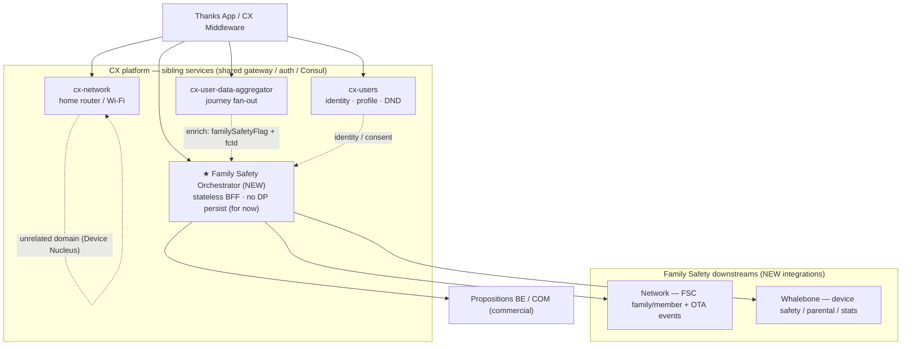

# ADR‑001 — Family Safety as a separate orchestration microservice

**Status:** Proposed · **Date:** 2026-11-16 · **Decision owner:** Architecture
**Decision:** Build Family Safety as a **new, independent CX platform service** (an orchestration layer / BFF) — **not** embedded in, and **not** split across, `cx-users` and `cx-network`.

---

## 1. Context

Family Safety is **new functionality** (Safety Circle, invites, check-in, SOS, device-status, fraud alerts, device & network protection, parental controls). It must:
- talk to **two downstream systems** that are new integrations for CX — **Network** (FSC family/member + OTA events) and **Whalebone** (device safety / parental / stats);
- serve **multiple upstreams** — Thanks App, the user-data-aggregator (profile enrich), and other CX services.

A suggestion on the table is to **reuse the existing CX services** — put some Family Safety APIs in `cx-users` and some in `cx-network`. This ADR evaluates that against standing up a **dedicated Family Safety orchestrator**.

### The three existing CX services (for reference)

| Service | Job | Talks to | Does **not** do |
|---|---|---|---|
| **cx-users** | Customer identity / profile / consent (DND) | UCM (profile), UCC Consent, Ads | Router control, carts, Family Safety, Whalebone |
| **cx-network** | Home **router / Wi-Fi** (AirFiber/DSL) experience | Device Nucleus, Digital Profile (via CXUMConnector) | UCM profile product, Family Circle, SOS, Whalebone |
| **cx-user-data-aggregator (UDA)** | Journey aggregator (fan-out → one screen) | Digital Profile, UCM, CXUsers, Orders, Plans, Billing, POQ, … | Owns router APIs; does **not** call cx-network |

> **Naming trap:** `cx-network` (home router) ≠ Family Safety **"Network FSC"** (telecom family/safety-circle). Same word, different system.

---

## 2. Options considered

| # | Option | Verdict |
|---|---|---|
| A | **Embed Family Safety into `cx-network`** | ❌ Rejected — wrong domain (home router), naming trap, blast radius |
| B | **Split Family Safety across `cx-users` + `cx-network`** | ❌ Rejected — fragments one bounded context across two services |
| C | **New dedicated Family Safety orchestrator (BFF)** | ✅ **Chosen** |

---

## 3. Decision

Stand up **Family Safety as a fourth, sibling CX platform service** — a **stateless orchestration layer (BFF)** that fans out to **Network (FSC + OTA)** and **Whalebone**, and aggregates for the App. It runs on the **same CX platform** (gateway, auth, Consul config) as `cx-users` / `cx-network` / UDA, but owns its **own bounded context, deploy, scale and on-call**.

---

## 4. Rationale — why a separate service (and not reuse/split)

| # | Reason | Detail |
|---|---|---|
| 1 | **Different bounded context** | `cx-users` = identity/consent; `cx-network` = home router (Device Nucleus). Family Safety = circle / safety-events / device-protection. A new domain doesn't belong inside either; it would break single-responsibility and pollute their contracts. |
| 2 | **Naming trap is a real hazard** | Putting FS circle/SOS into `cx-network` conflates two unrelated "network" domains (home router vs telecom FSC) — an operational and cognitive trap for every future engineer. |
| 3 | **Brand-new downstream integrations** | FS needs **Network FSC/OTA** and **Whalebone** — neither `cx-users` nor `cx-network` talks to these today (`cx-network` → Device Nucleus, not FSC). Adding them means new blast radius on mature, high-traffic services. |
| 4 | **Independent blast radius / scale / SLA** | SOS is latency- and criticality-sensitive and partly realtime. Coupling FS to `cx-users` (hit on every app session) or `cx-network` (home) risks their stability and ties release cadence. A separate service fails, deploys and scales on its own. |
| 5 | **Splitting across two is the worst option** | "Some APIs here, some there" fragments **one** bounded context across two services → distributed logic, no single owner, cross-service calls for one journey, duplicated auth/aggregation. Lowest cohesion, highest cost. |
| 6 | **Clear ownership & roadmap** | FS is a distinct product with its own team, consent model, data-retention policy and **partner (Whalebone) contract**. A dedicated service gives one owner end-to-end. |
| 7 | **Security / partner isolation** | Whalebone tenant keys and consent-gated protection are isolated in one service — smaller credential-exposure and audit surface than spreading them into identity/home services. |

---

## 5. What we **do** reuse (not everything is new)

A separate service does **not** mean reinventing identity or profile.

| Capability | Reuse | How |
|---|---|---|
| Identity / profile / DND | **cx-users** | FS calls it (directly or via UDA) for "who is this user?" — never reimplemented |
| `familySafetyFlag` + `fcId` on the profile screen | **UDA (enrich only)** | additive fields on the existing profile response; FS or App reads them. UDA does **not** own Family Safety |
| Home router / Wi-Fi / pause | **cx-network (untouched)** | different domain; stays separate to avoid the naming trap |
| Gateway / auth / Consul config | **CX platform** | FS is a sibling on the same platform — consistent patterns, minimal new plumbing |
| Commercial (pack / subscription) | **Propositions BE / COM** | FS orchestrator calls them; billing is not re-implemented |

---

## 6. Concern map — where each thing lives

| Concern | Owning service |
|---|---|
| Identity / profile / consent (DND) | `cx-users` |
| `familySafetyFlag` + `fcId` on home/profile | UDA (enrich) or App after the FS call |
| Home router / guest Wi-Fi / device pause | `cx-network` (unrelated) |
| Circle / invite / member / roles | **FS Orchestrator → Network FSC** |
| Check-in / SOS / alarm / device-status / fraud | **FS Orchestrator → Network OTA** |
| Device safety / parental / stats | **FS Orchestrator → Whalebone** |
| Pack purchase / subscription / provisioning | **FS Orchestrator → Propositions BE / COM** |

---

## 7. Shape of the new service (FS Orchestrator / BFF)

- **Pure orchestration layer** — fan-out to Network (FSC + OTA) + Whalebone, aggregate for the App (the ~24–29 upstream endpoints already specified).
- **Stateless — no Digital-Profile persistence for now.** It computes/aggregates per request; it does not own a durable FS datastore today.
- **Owns:** the upstream API contract, enum-driven routing, ID mapping (`fcId↔familyId`, `MSISDN=deviceID=subscriptionID`), **GET-merge-PUT** for Whalebone, per-step retries/backoff, consent gating, `transactionId` propagation.
- **Does not own:** identity (`cx-users`), home router (`cx-network`), billing (Propositions BE/COM), or any persistence (none now).

> **The one state watch-item:** Network FSC has only `Active/Inactive` (no invite lifecycle). While we stay "no persist for now", invite states (`INVITED/EXPIRED/DECLINED`) are held ephemerally / deferred to Network. If the product needs durable invite state or FS audit history, that's the trigger to revisit persistence — **a conscious later decision, not an accident.**

---

## 8. Trade-offs (honest view)

| Cost of a separate service | Mitigation |
|---|---|
| New infra, CI/CD, on-call, auth wiring | Standard on the CX platform — gateway/auth/Consul already exist; marginal effort |
| One extra network hop vs embedding | BFF aggregation **reduces** app round-trips overall; hop is intra-platform |
| Risk of duplicating identity logic | Explicitly **reuse** `cx-users` / UDA; do not reimplement profile/consent |
| Another service to monitor | Clear ownership + its own SLA is a feature for a safety product, not a bug |

---

## 9. Consequences

- ✅ Family Safety evolves, deploys, scales and fails **independently** of identity and home-router services.
- ✅ The Whalebone partner contract and consent model are **isolated** in one service.
- ✅ `cx-network` stays unambiguously "home router"; the FSC "Network" confusion is avoided.
- ✅ `cx-users` and UDA are **reused** for identity and profile-enrich — no duplication.
- ⚠️ We accept one more platform service and one more hop; revisit **persistence** only when invite-state/audit forces it.

**Recommendation: proceed with Option C — Family Safety as a separate, stateless orchestration microservice (a fourth sibling CX service).**

---

*Companion specs: `Family-Safety-API-Binding-Leadership` (upstream↔downstream), `Network-API-Documentation`, `Whalebone-API-Documentation`, `Orchestration-API-Design-Spec`.*
