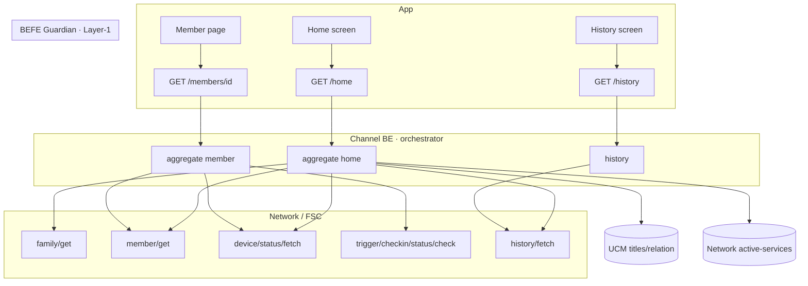
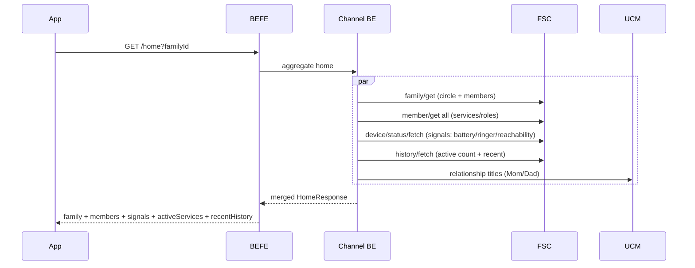

# BEFE Layer-1 — Aggregate APIs & Flow (App → Channel BE)

**Date:** 26 Nov 2026 · **Swagger:** `befe-layer1-swagger.html` / `.json`
**Idea:** the app makes **one call per screen**; BEFE aggregates from Channel BE's downstream reads — **FSC `family/get`, `member/get`, `device/status/fetch`, `history/fetch`** (+ UCM relation, Network active-services).

## 1. Which screen needs what (from Figma + BEFE requirements)

| Screen (Figma / BEFE) | Family info | Member info | Device status (battery/signal/ringer/location) | History | → BEFE API |
|---|:--:|:--:|:--:|:--:|---|
| 04 Home (B19) | ✅ all members + relation + role + responders + active services | — | ✅ per-member **signals** | ✅ count + recent | **API 1 `/home`** |
| 11 Settings / roles (B60) | ✅ members, roles, responders, subscription | — | — | — | **API 1 `/home`** (role-aware) |
| 05 Member page (B21) | — | ✅ one member services | ✅ **full device detail** + check-in | ✅ member's | **API 2 `/members/{id}`** |
| 13 Phone/network (B71) | — | ✅ | ✅ signals detail | — | **API 2 `/members/{id}`** |
| 12 Alerts & history (B68) | — | filter | — | ✅ list | **API 3 `/history`** |
| 02 Add family (B08) | candidates (Family Mode) | — | — | — | *(separate: members/candidates)* |

**Rule:** family-level + per-member **signals + active services** = one aggregate (**`/home`**); a tapped member's **services + device status + check-ins** = one aggregate (**`/members/{id}`**); the history screen = **`/history`**.

## 2. The three Layer-1 APIs

| # | BEFE API | Returns | Fans out to (Channel BE → FSC/UCM/Network) |
|---|---|---|---|
| 1 | **GET `/home`** | family + `me` + `members[]` (relation, role, responder, membershipStatus) + **signals** + **activeServices** + subscription + responders + activeAlertsCount + recentHistory | `family/get` + `member/get`(all) + `device/status/fetch`(familyId) + **UCM** titles + Network active-services + `history/fetch`(count) |
| 2 | **GET `/members/{membershipId}`** | member card + **services[]** + **deviceDetail** (battery%, ringer, phoneOff, reachable, signal, SIM, checkinWorking, sosWorking, location) + latestCheckIn + checkInHistory + activeAlert + safetyReportUrl (+ deviceSafety/parental if advanced) | `member/get`(one) + `device/status/fetch`(msisdn) + `trigger/checkin/status/check` + (Whalebone status if advanced) |
| 3 | **GET `/history`** | historyInfos[] (eventType, member, status, message, timestamp), role-scoped, filters | `history/fetch` (+ UCM titles) |

## 3. Flow diagram

## 4. Home aggregate — fan-out sequence

## 5. Response ↔ UI / BEFE-requirement check

- **`memberCard`** (BEFE Home card fields) → `MemberCard { membershipId, displayName, relationship, role, isResponder, membershipStatus, signals{battery,ringer,networkStrength,reachabilityReason,lastOnNetworkAt}, latestCheckInSummary, activeAlert, featuresBrokenHint }` ✅
- **`circleStatus`** Active/Expiring/Paused/Closing ✅
- **Active services** (What's working per member: SPAM available only to Airtel; SOS NOT_WORKING if Location off) → `ServiceStatus{service,available,working,status,missingPermission}` ✅
- **Device page signals** (§13: phone-off/no-network/battery-low/number-inactive) → `DeviceDetail.reachabilityReason` + `simStatus` + battery ✅
- **History types** (B68) → `HistoryItem.eventType` CHECK_IN/SOS/FRAUD/ALARM/DEVICE_STATUS ✅
- Each signal carries `lastUpdatedOn` + `available` (iPhone/non-Airtel) ✅

## 6. Notes
- `/home` is the heavy fan-out — cache per family for ~1–2 min (matches "updates every hour" for signals; SOS/live read fresh).
- Role scoping: pass caller `msisdn`/`role`; fraud & low-battery are responder-only in `/history`.
- Non-Airtel members: network signals absent → `Signals.available=false`; app shows the fixed message.
- Downstream data fully represented so a single BEFE response = one screen (no chatty per-widget calls).

---

*BEFE Layer-1: 3 aggregate reads (`/home`, `/members/{id}`, `/history`) that land on Channel BE and fan out to FSC `family/get` + `member/get` + `device/status/fetch` + `history/fetch` (+ UCM + Network). Swagger: `befe-layer1-swagger`.*
