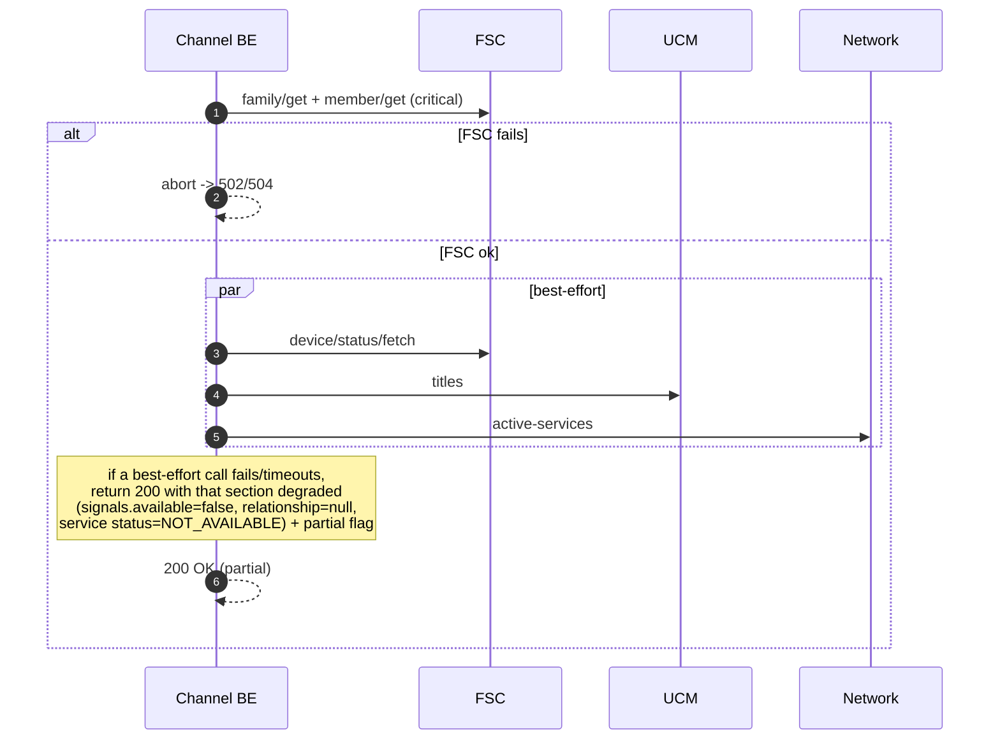

# BEFE Layer-1 — Sequence Diagram (success + all error cases)

**Applies to:** `GET /home`, `GET /members/{membershipId}`, `GET /history` (same request lifecycle).
**Codes:** 200 · 400 · 401 · 403 · 404 · 429 · 500 · 502 · 504.

## 1. Error-code matrix

| HTTP | code | type | When |
|---|---|---|---|
| 200 | `0` | — | Success |
| 400 | `SH-40001` | VALIDATION | Missing/invalid `familyId`, bad `membershipId`, bad date range |
| 401 | `SH-40101` | AUTH | Missing/invalid token (at gateway/BEFE) |
| 403 | `SH-40301` | FORBIDDEN | **BOLA** — caller MSISDN not in the circle / not allowed for scope |
| 404 | `SH-40401` | RESOURCE_NOT_FOUND | Family / member not found |
| 429 | `SH-42901` | RATE_LIMIT | Per-MSISDN rate limit exceeded (Kong) → retry after backoff |
| 500 | `SH-50000` | UNKNOWN | Unexpected orchestrator error |
| 502 | `SH-50302` | DOWNSTREAM | FSC / UCM / Network / Whalebone returned error |
| 504 | `SH-50401` | DOWNSTREAM | Downstream timed out |

Envelope: `{ status:"FAILURE", message, httpStatusCode, traceId, errors:[{code,message,type}] }`.

## 2. Full request lifecycle (all branches)

```mermaid
sequenceDiagram
    autonumber
    participant App
    participant KONG as Kong Gateway
    participant BEFE as BEFE / Guardian
    participant CBE as Channel BE
    participant DS as Downstream (FSC / UCM / Network)

    App->>KONG: GET /home?familyId (JWT)
    alt 429 rate limit (per-MSISDN)
        KONG-->>App: 429 SH-42901 RATE_LIMIT
    else 401 no / bad token
        KONG-->>App: 401 SH-40101 AUTH
    else authenticated
        KONG->>BEFE: forward
        alt 400 validation (familyId missing / bad param)
            BEFE-->>App: 400 SH-40001 VALIDATION
        else valid request
            BEFE->>CBE: aggregate(familyId, caller)
            CBE->>DS: family/get (+ BOLA: caller in circle?)
            alt 403 caller not in circle
                DS-->>CBE: membership not found for caller
                CBE-->>BEFE-->>App: 403 SH-40301 FORBIDDEN
            else 404 family/member not found
                DS-->>CBE: 404
                CBE-->>BEFE-->>App: 404 SH-40401 NOT_FOUND
            else 504 downstream timeout
                DS--xCBE: timeout (read 2000ms)
                CBE-->>BEFE-->>App: 504 SH-50401 DOWNSTREAM
            else 502 downstream 5xx
                DS-->>CBE: 5xx / connection error
                CBE-->>BEFE-->>App: 502 SH-50302 DOWNSTREAM
            else 500 unexpected
                CBE-->>BEFE-->>App: 500 SH-50000 UNKNOWN
            else 200 success
                par fan-out (home)
                    CBE->>DS: member/get(all)
                    CBE->>DS: device/status/fetch
                    CBE->>DS: history/fetch (count)
                    CBE->>DS: UCM titles
                end
                DS-->>CBE: merged data
                CBE-->>BEFE: HomeResponse
                BEFE-->>App: 200 OK
            end
        end
    end
```

## 3. Partial-downstream behaviour (resilience)

For the **aggregate** APIs, a non-critical downstream failure should **degrade, not fail**:



**Rule:** `family/get` + `member/get` are **critical** (their failure → 502/504). `device/status/fetch`, UCM titles and Network active-services are **best-effort** → on failure the response still returns 200 with that section marked unavailable (circuit-breaker + fallback), never a hard error.

## 4. Retry guidance for the app

| Code | App action |
|---|---|
| 429 | Honour `Retry-After`; exponential backoff + jitter |
| 502 / 504 | Retry once after short delay; then show "couldn't refresh, showing last known" |
| 500 | Do not auto-retry aggressively; show generic error + report `traceId` |
| 400 / 403 / 404 | Do not retry — fix request / show the specific message |

---

*Error matrix + sequence diagrams for the BEFE Layer-1 aggregate reads. Swagger (`befe-layer1-swagger`) now documents 200/400/401/403/404/429/500/502/504 with example bodies per code.*
