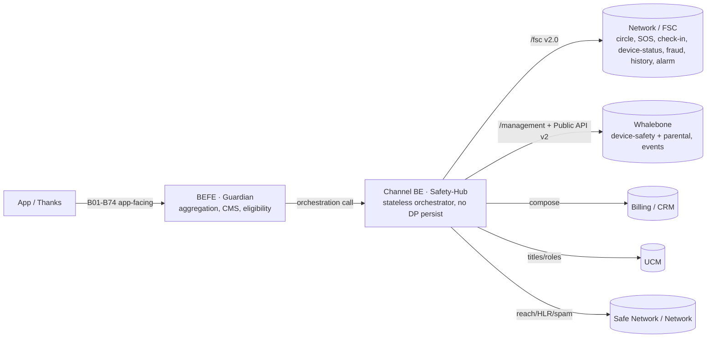
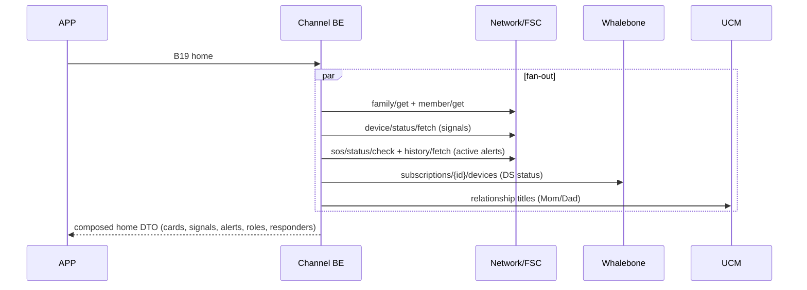

# Family Safety — End-to-End API-Flow HLD

**App → BEFE (Guardian) → Channel BE (Safety-Hub orchestrator) → Whalebone / Network (FSC)**
**Date:** 26 Nov 2026 · **Inputs:** FSC BEFE API Requirements (B01–B74) · FSC swagger v2.0 (`/fsc`, incl. Fraud Alert Controller) · Airtel Secure HLD + Whalebone API-flow HLD (`/management`, Public API v2)

---

## 0. Tiers



- **BEFE (Guardian)** = app-facing: auth context, aggregation, CMS/FAQ, eligibility, DTO shaping.
- **Channel BE (Safety-Hub)** = stateless orchestrator: fans out to FSC, Whalebone, Network, Billing, UCM; holds the **membership ↔ subscriptionId(=MSISDN)** linkage and the **service→feature** map; no DP persist.
- Identity: `circleId = familyId`, `msisdn = deviceId = subscriptionId`.

---

## STEP 1 — App → BEFE (B01–B74, confirmed)

| Domain | BEFE B-ids | App-facing purpose |
|---|---|---|
| Eligibility / Subscription | B01–B05, B66, B67 | eligibility, offers, purchase, status, resume, how-it-works |
| Circle & Home | B06, B07, B19, B20 | create, bootstrap, **home aggregate**, refresh-signals |
| Members & Invites | B08–B16 | candidates, validate, invite send/list/resend/detail/respond/web, features catalog |
| Permissions | B17, B18 | permission matrix, ack |
| Member page | B21–B25 | detail, features, safety-report, notify-back-online, advanced-request |
| Check-ins | B26–B32 | list, create, respond, dismiss, status, schedules, connected |
| SOS | B33–B38 | create, state, respond, dissolve, active, location |
| Fraud / Spam | B39–B42 | active alerts, warn, end-call, events (read) |
| Device Safety | B43–B48 | status, activate, deactivate, SDK bootstrap, scan, events |
| Parental | B49–B59 | hub, activate, schedules, screen-time, apps, pause, requests, content-filter, places, usage, location |
| Settings / Roles | B60–B65 | settings, roles, responders, remove, leave, close-preview |
| Alerts & History | B68–B70 | alerts list, detail, weekly report |
| Signals & Lifecycle | B71–B74 | signals, subscribe-back-online, lifecycle events, re-consent |

**Verdict:** the B01–B74 list is complete for the app surface. BEFE adds **no new downstream logic** — it aggregates and delegates orchestration to Channel BE.

---

## STEP 2 — BEFE → Channel BE (orchestrator responsibilities)

BEFE calls one Channel BE orchestration endpoint per B-id; Channel BE then fans out. Channel BE owns:
- **Compose** (home, member page, settings, alerts) across FSC + Whalebone + Network + UCM + Billing.
- **Linkage**: membership ↔ Whalebone subscriptionId (= MSISDN); service→feature map.
- **Idempotency/retry**, BOLA (verify msisdn ∈ circleId via `family/get`), X-Request-ID propagation.

---

## STEP 3 — Channel BE → Whalebone (Device Safety + Parental)

(from the Whalebone API-flow HLD; `/management` + Public API v2)

| Trigger (from BEFE) | Channel BE → Whalebone |
|---|---|
| Device Safety activate (B44/B46) | `POST /management/subscriptions` (sub=familyId) → `POST /management/devices` (device=MSISDN, `tags:[device-safety]`) **or** GET-merge-`PUT /management/devices/{MSISDN}` tags+=device-safety → `POST /management/devices/{MSISDN}/pair-app` → token to app |
| Device Safety status (B43) | `GET /management/subscriptions/{familyId}/devices` + **VPN-status** + **URL-inspection-status** (new endpoints) |
| Device Safety events (B48) | `GET /events/search` / `GET /events/stats` / `GET /events/timeline` (Public API v2) |
| Parental activate (B50) | tags += parental-control (GET-merge-PUT); no block until filters set |
| Parental schedules/content/apps/lists (B51,B53,B56) | `PUT …/filter` (7 threats true), `PUT …/applications`, `PUT …/scheduled-filter`, `POST /subscriptions/{familyId}/{whitelist\|blacklist}` (+`/delete`) |
| Parental usage/reports (B58) | `GET /events/stats` (aggregate=domain), `GET /dns/timeline` |
| Deactivate (B45) | GET-merge-`PUT /devices/{MSISDN}` tags−service; if no tag left app stops SDK (pairing kept) |
| Lifecycle (B73) | `POST /subscriptions/{familyId}/suspend`\|`activate`; `POST /devices/{MSISDN}/suspend`\|`migrate`\|`unpair-app` |

**Rules:** keys in Channel BE only; **GET-merge-PUT full list**, serialize per MSISDN; ≤500/page; 409→GET+resume, 429→backoff; Airtel never calls DELETE.

---

## STEP 3′ — Channel BE → Network / FSC (`/fsc` v2.0)

| Trigger (from BEFE) | Channel BE → FSC v2.0 |
|---|---|
| Circle create / read (B06/B07/B19) | `POST /api/v1/family/save` · `GET /api/v1/family/get` · `GET /api/v1/member/get` |
| Member provision / remove / role (B10/B63/B61) | `POST /api/v1/member/save` · `DELETE /api/v1/member/delete` · `POST /api/v1/member/role/update` |
| Device status / signals (B19/B21/B71) | `GET /api/v1/device/status/fetch` (battery/ringer/reachability/...) · `POST /api/v1/device/status/store` (permissions/telemetry) |
| Check-ins (B26–B32) | `POST /api/v1/trigger/checkin/` (CREATE/RESPONSE/DISMISS/PAUSE/RESUME) · `GET /api/v1/trigger/checkin/status/check` |
| SOS (B33–B38) | `POST /api/v1/trigger/sos/` (CREATE/ACK/RESOLVE) · `DELETE /api/v1/trigger/sos/cancel` · `GET /api/v1/trigger/sos/status/check` |
| Alarm (SOS no-internet / presidential) | `POST /api/v1/alarm/incoming` · `POST /api/v1/alarm/sos/kill` |
| Fraud / Spam (B39–B41) | `GET /api/v1/fraud/alert/fetch` · `POST /api/v1/fraud/alert/action` (WARN/END_CALL/MARK_SAFE/NOTIFY_MEMBER/BLOCK_NUMBER) |
| Alerts & History (B68–B69) | `GET /api/v1/history/fetch` (CHECK_IN/SOS/FRAUD/ALARM/DEVICE_STATUS) |

**Network-produced signals** (not device SDK): reachability/phone-off, signal strength, SIM/number status, last-on-network, spam/OTP — served via `device/status/fetch` + fraud APIs + HLR.

---

## 4. End-to-end master mapping (one row per feature)

| Feature | APP | BEFE (B) | Channel BE → Network/FSC | Channel BE → Whalebone |
|---|---|---|---|---|
| Eligibility / buy | 01 | B01–B05 | `family/get` (getCircleByMsisdn gap) + Billing | — |
| Create circle | 01 | B06 | `family/save` | `POST /subscriptions` (if DS at claim) |
| Home aggregate | 04 | B07,B19,B20 | `family/get`+`member/get`+`device/status/fetch`+`sos/status/check`+`history/fetch` | `subscriptions/{id}/devices` (DS status) |
| Add members / invite | 02,03 | B08–B16 | `member/save` + invite (gap) | — |
| Permissions | 03 | B17,B18 | `device/status/store` (typed perms) | — |
| Member page | 05 | B21–B25 | `member/get`+`device/status/fetch`+checkin status | DS status (if advanced) |
| Check-ins | 06 | B26–B32 | `trigger/checkin/`+`status/check` (+SMS/IVR msg) | — |
| SOS | 07 | B33–B38 | `trigger/sos/`+`cancel`+`status/check`+`alarm/incoming` (+LBS) | — |
| Fraud / Spam | 08 | B39–B42 | `fraud/alert/fetch`+`fraud/alert/action`+`alarm/incoming` | — |
| Device Safety | 09 | B43–B48 | membership↔subscription linkage | `subscriptions`+`devices`+`filter`+`pair-app`+`events` |
| Parental | 10 | B49–B59 | device-code pairing (gap) | `filter`+`applications`+`scheduled-filter`+`{listType}`+`events/stats` |
| Settings / roles | 11 | B60–B65 | `member/role/update`+`member/delete`+`family/save` | — |
| Alerts & history | 12 | B68–B70 | `history/fetch` | `events/search` (DS history) |
| Signals / lifecycle | 13 | B71–B74 | `device/status/fetch` + Network HLR/MNP | — |

---

## 5. End-to-end sequences

### 5.1 Onboarding → Device Safety ON (full chain)

```mermaid
sequenceDiagram
    participant APP as App+SDK
    participant BEFE
    participant CBE as Channel BE
    participant FSC as Network/FSC
    participant WB as Whalebone
    APP->>BEFE: B01 eligibility / B06 create / B44 device-safety activate
    BEFE->>CBE: orchestrate
    CBE->>FSC: family/save (circle) ; member/save (member)
    CBE->>WB: POST /subscriptions (sub=familyId)
    CBE->>WB: POST /devices (device=MSISDN, tags:[device-safety])
    WB-->>CBE: all threats blocked
    CBE->>WB: POST /devices/{MSISDN}/pair-app
    WB-->>CBE: pairing token
    CBE-->>BEFE-->>APP: token
    APP->>WB: authenticate/importCA, VPN consent, startProtection
    APP->>CBE: report protection state
    CBE-->>BEFE-->>APP: Device Safety active
```

### 5.2 SOS (full chain)

```mermaid
sequenceDiagram
    participant APP
    participant BEFE
    participant CBE as Channel BE
    participant FSC as Network/FSC
    APP->>BEFE: B33 create SOS (location,battery)
    BEFE->>CBE: sos create
    CBE->>FSC: POST /trigger/sos/ (CREATE) [+LBS if no location]
    CBE->>FSC: POST /alarm/incoming (fan to responders)
    FSC-->>CBE: sosId, responders
    CBE-->>BEFE-->>APP: live SOS (map, responders, battery)
    APP->>BEFE: B36 dissolve
    BEFE->>CBE->>FSC: DELETE /trigger/sos/cancel (initiator-only)
```

### 5.3 Home aggregate (fan-out)



---

## 6. Gaps & ownership (carry into the plan)

- **FSC gaps:** invite lifecycle, responder flags, `getCircleByMsisdn`, feature flags on membership, typed device-status enum (AI-2), history role-scoping, subscription provisioning (if not reusing recharge BEFE).
- **Whalebone new dev:** tag-switching (2 wk), VPN-status + URL-inspection-status (1 wk each); service→feature map sign-off.
- **Network:** reachability/HLR, back-online, low-battery fanout, MNP/lifecycle events, Safe-Network fraud ingest + warn/end-call.
- **Linkage** (Channel BE): membership ↔ subscriptionId(=MSISDN); SDK protection/pairing state is **app-reported** (not a Whalebone field).
- **Messaging:** check-in SMS/IVR, presidential/sticky push, flash/USSD warn → CLM/Bumblebee + Network.

---

*End-to-end API-flow HLD. App calls BEFE (B01–B74); BEFE delegates to Channel BE; Channel BE orchestrates Network/FSC (`/fsc` v2.0) and Whalebone (`/management` + Public API v2), composing with Billing/UCM. Downstream contracts are the FSC v2.0 swagger and the Whalebone API-flow HLD; open items are tracked above and in the project plan's blocker matrix.*
