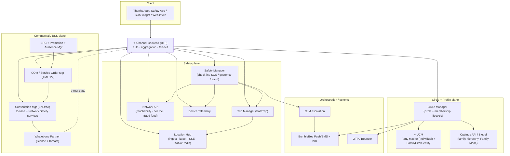
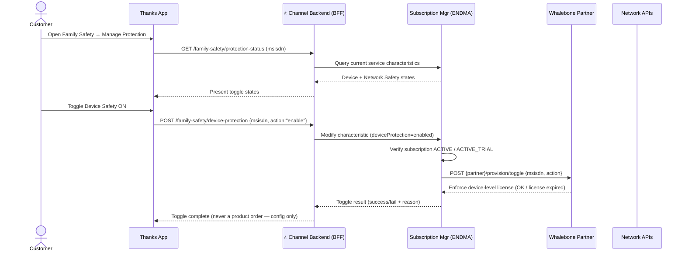
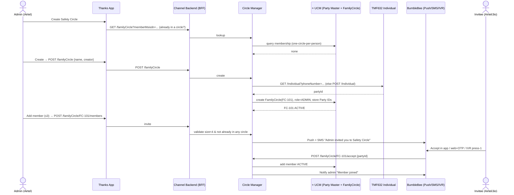
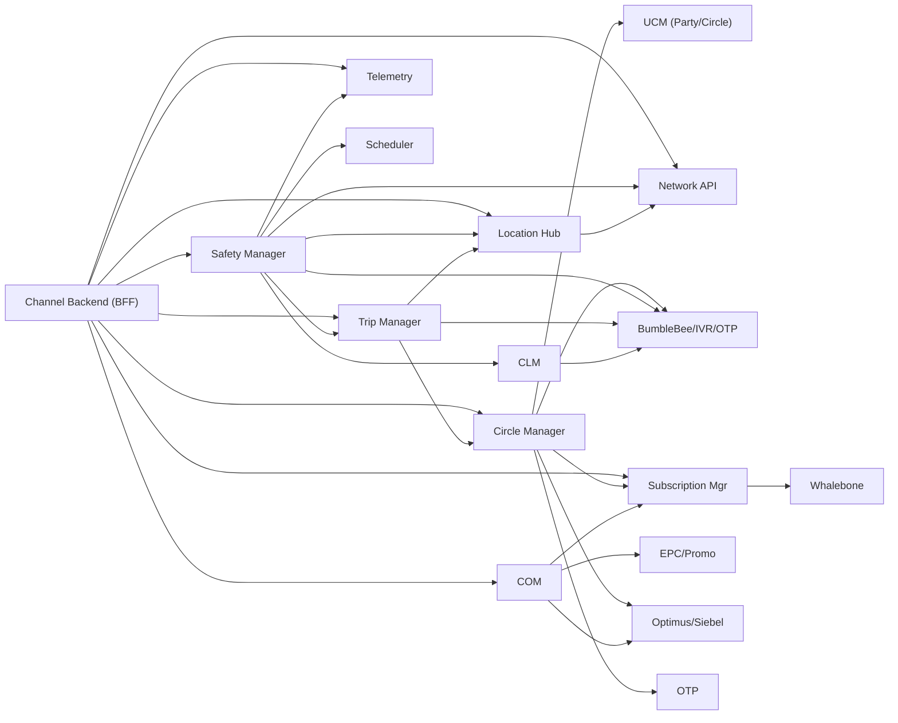
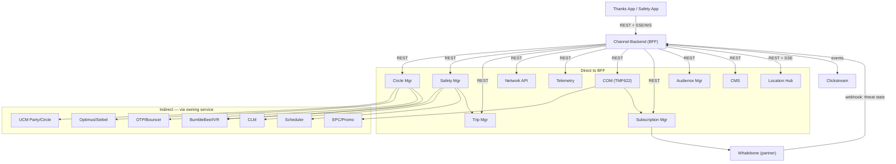
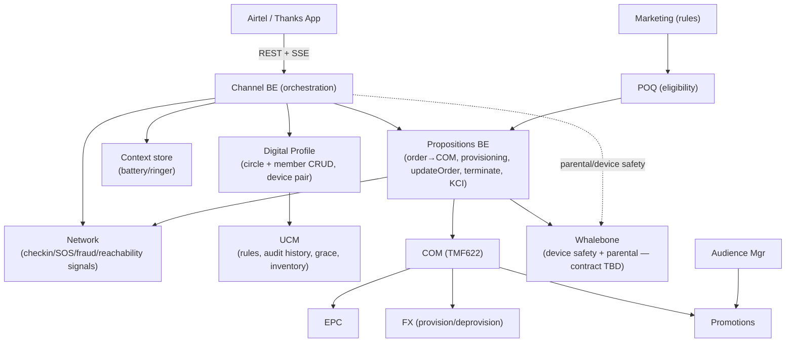

# Airtel Family Safety — System, API & Integration Plan

**Purpose:** From the BRDs, EA HLD docs and the Figma Exhaustive-Cases flows, identify **every system** that participates in Family Safety / Safety Circle, **which APIs each system exposes/consumes**, **how the systems interact**, the **flow with the Channel Backend (BFF) and the user/party-profile backend (UCM) in focus**, the **engineering effort** (by API + complexity), the **challenges**, and the **partners**.

**Status:** Draft for Architecture + Product review
**Date:** 2026-10-30
**Based on:**
- `Airtel_Family_Safety_BRD_(002)(1).pdf` — product BRD (circle, check-in, SOS, unreachability, routine, fraud, parental, SafeTrip)
- `EA-Create_Family_Safety_Circle.pdf` — HLD: circle setup, consent, membership lifecycle, UCM data model
- `EA-Family_Safety_Architecture.pdf` — HLD: commercial plane + Device/Network Safety (Whalebone, COM, Subscription), **Channel Backend (BFF)**
- `BRD-_SDK_solution_2nd_app_.pdf` — partner SDK / license management BRD
- `EA-Safety_Trip_-_Real-time_GPS_Location.pdf` — Location Hub + Trip Manager
- Figma `39:4390` Exhaustive Cases (≈487 LP screens) + `Family-Safety-Circle-Functionality-Checklist.md`

> **Legend for API maturity**
> `(EA)` = named in an EA HLD doc · `(BRD)` = stated in a BRD · `[INFERRED]` = required by Figma/BRD behaviour but not yet in a shared LLD. Finalise all paths in OpenAPI during LLD.

---

## 0. Answer up front — the two backends you asked to focus on

| You asked about | What the source docs actually name | Where |
|---|---|---|
| **Channel Backend** | **Channel Backend (BFF)** — `<<channel>>` tier that sits between the Thanks App and the Service Order Manager (COM) / Subscription Manager / Whalebone / Network APIs. It is the single aggregation + auth tier for all Family Safety journeys. | EA-Family_Safety_Architecture — "Enable/Disable Device & Network Safety" sequence diagrams |
| **User-Profile Backend** | **Not named verbatim.** The equivalent role is split across **UCM** (new *Family Circle* entity + *Party Master / Individual* records = the member/party profile store) and **Circle Manager** (owns circle + membership lifecycle on top of UCM). Commercial identity still lives in **Siebel/Customer (TMF629)**; family hierarchy comes from **Optimus API**. | EA-Create_Family_Safety_Circle — UCM Family Circle Domain + Party Master diagram |

So in this plan, **"user-profile backend" = UCM Party Master + UCM Family Circle entity, fronted by Circle Manager**, and every member-identity read/write is routed there (never into the Customer/TMF629 billing entity — see §9 "Why Customer entity fails").

---

## 1. System inventory (who is in play)

### 1.1 Family Safety Circle plane (consent, circle, safety events, location)

| ID | System | Owner (from EA stakeholder matrix) | Responsibility |
|---|---|---|---|
| S01 | **Thanks App** (+ Safety App for device protection) | App FE / Marketing (Lakshay) | Discovery, purchase, circle UI, SOS widget, dashboard, SDK host |
| S02 | **Channel Backend (BFF)** ⭐ | Channel (Surili Jain) | Single aggregation/auth tier: fans out to Circle Manager, Safety Manager, Trip Manager, COM, Subscription, Network; builds home/member-card payloads |
| S03 | **Circle Manager / Family Circle Service** | UCM (Vibhu Gupta) | Circle entity, invites, membership lifecycle, roles, consent, member validation for Trip |
| S04 | **UCM — Party Master + Family Circle entity** ⭐ | UCM (Vibhu Gupta) | Party/Individual records (MSISDN, name), new *FamilyCircle* entity holding circle metadata + member Party IDs + roles + per-member feature characteristics |
| S05 | **Safety Manager** | EA (Safety Event model) | Unified Safety Event: `CHECK_IN`, `SOS`, `GEOFENCE`, `INACTIVITY`, `FRAUD`, `FALL`; state machine, responses, history |
| S06 | **Trip Manager** | EA (Safety Trip) | SafeTrip / Emergency Trip create/start/stop, viewer selection, tracking-session link |
| S07 | **Location Hub** | EA (Safety Trip) | Location ingest API, latest-location API, SSE stream; Kafka `location.events`, Redis/Aerospike latest, History DB |
| S08 | **Network API** | Network (Gopal Dave / Bhabani) | Reachability/network state, cell-tower location assist, **Airtel Safe fraud signal feed** |
| S09 | **Device Telemetry** | Device platform | Battery, signal/mode, ringer, unlock/activity, permission state |
| S10 | **CLM** | Lifecycle | Staged escalation journeys (30→45→60 min) from clickstream miss events |
| S11 | **IVR / BumbleBee voice** | Voice | Automated check-in call (60 min); invite "press 1" join |
| S12 | **BumbleBee Communication Platform (Push + SMS)** | Comms | Invites, reminders, SOS, threat alerts, activation msgs |
| S13 | **OTP / Bouncer** | Auth | Web-invite consent OTP; OTP/biometric for role/permission changes (SC7) |
| S14 | **Admin Console** | Ops | Escalation thresholds (CI4), nudge config (EX2) |
| S15 | **Advisor / CRM view** | Service | Read-only case/consent/alert visibility (BRD §11) |
| S16 | **Clickstream / Analytics** | Analytics | Instrumentation (BRD §14); feeds CLM windows |
| S17 | **Audience Manager** | Audience (Parshant Verma) | Free-trial / "Claim Now" eligibility rules |

### 1.2 Commercial / BSS plane (pack purchase, subscription, license)

| ID | System | Owner | Responsibility |
|---|---|---|---|
| S18 | **COM / Service Order Manager** | COM (Sidhant / Vikalp) | **All LOB orders via TMF622**; orchestrates provisioning |
| S19 | **Subscription Manager (ENDMA)** | Digital (Salil / Kaushal) | Family Safety subscription carrying **two services: Device Safety + Network Safety** |
| S20 | **EPC (Product/Service catalog) + Promotion** | Product (Shubham/Shadab) | Product & Service Specs (`partner_sku_id`, planTier, screens), hidden free-sample PO |
| S21 | **Siebel Postpaid / ATOM / FX / Inform / LAPU / Event Bus / M2M Product Inventory** | BSS (Sai/Nitish/Gaurav/Ankit) | Postpaid+prepaid provisioning rails, customer entity, order ingestion |
| S22 | **Optimus API + Family Mode** | BSS/CX | Parent–child / managed-account hierarchy; add MSISDN to admin Family Mode |
| S23 | **Whalebone Partner backend** | Partner (external) | License allocate/verify/suspend/delete; threat event sync |
| S24 | **Whalebone SDK (on-device)** | Partner (external) | Malware, fraud-APK block, safe browsing, content filter, parental enforcement, Device ID |

---

## 2. Partners (as requested)

| # | Partner | Type | What they provide | APIs / interface | MVP? |
|---|---|---|---|---|---|
| 1 | **Whalebone** | External security vendor (SDK + backend) | Malware detection, fraud-APK block, safe browsing, content filtering, parental enforcement, Device ID; **annual license pool** rotated into Airtel packs | License allocate / map / verify / suspend / delete; threat-event sync to Airtel dashboard; on-device SDK as a **dynamically loaded module inside Thanks App** | ✅ Yes (Device/Network Safety) |
| 2 | **24×7 Fraud Expert Helpline** | BPO / service desk | Human experts to verify suspicious activity / report fraud | Call-centre integration (telephony + case view) | ✅ (SDK BRD Feature 5) |
| 3 | **Uber / Ola / Rapido** | Mobility | Trip origin/destination/ETA/route for destination-aware SafeTrip | Partner trip APIs | ❌ Phase 2+ (explicitly NON-MVP) |
| 4 | **Google Maps** | Maps/geocoding | Route-specific monitoring, detours | Maps/Directions API | ❌ Phase 2+ (NON-MVP) |
| 5 | **Wearable partner(s)** | Device | Fall / movement / inactivity signals | Partner wearable API | ❌ Future (if integrated) |

> **BumbleBee** and **IVR** are Airtel-internal platforms (Push/SMS/voice), not external partners. **Whalebone is the only external partner in MVP.**

---

## 3. System interaction — connection matrix

| From | To | Protocol | Why |
|---|---|---|---|
| Thanks App | **Channel Backend (BFF)** | REST / SSE | All journeys go through BFF (auth + aggregation) |
| Channel Backend (BFF) | Circle Manager | REST | Create circle, invite, accept, leave, roles, members |
| Channel Backend (BFF) | Safety Manager | REST | Check-in, SOS, responses, history, schedules |
| Channel Backend (BFF) | Trip Manager | REST | Start/stop SafeTrip, select viewers |
| Channel Backend (BFF) | Location Hub | REST + **SSE** | Latest location + live stream to viewers |
| Channel Backend (BFF) | COM (Service Order Mgr) | REST (TMF622) | Buy/claim pack |
| Channel Backend (BFF) | Subscription Mgr (ENDMA) | REST | Device/Network Safety toggle (config, not order) |
| Channel Backend (BFF) | Network API / Telemetry | REST | Reachability + device status for member cards |
| Circle Manager | **UCM Party Master / Family Circle entity** | REST | Persist circle + member Party IDs + roles + feature chars |
| Circle Manager | TMF632 Individual | REST | Resolve/create Individual (party) by phone number |
| Circle Manager | Optimus API / Siebel | REST | Fetch family hierarchy; add MSISDN to admin Family Mode |
| Circle Manager | BumbleBee (Push/SMS) / IVR | Async | Invite dispatch (app / SMS / press-1), member-left notice |
| Circle Manager | OTP / Bouncer | REST | Web-invite consent OTP; SC7 auth |
| Circle Manager | Subscription Mgr | Event | Revoke shared pack on member/admin exit |
| Safety Manager | BumbleBee Push | Async | Check-in / SOS notify |
| Safety Manager | CLM | Event | Start escalation journey on miss |
| Safety Manager | Trip Manager → Location Hub | REST | Emergency Trip on SOS |
| Safety Manager | Network + Telemetry | REST | Context on SOS / unreachability |
| CLM | Push → sticky → IVR → Safety Manager | Orchestration | 30→45→60 min escalation then alert circle |
| Trip Manager | Circle Manager | REST | Validate viewers are active members |
| Trip Manager | Location Hub | REST | Create/close tracking session |
| Location Hub | Kafka → Redis/Aerospike + History DB | Internal | Latest-location fan-out for SSE |
| COM | Subscription Mgr → Whalebone | Order events / Partner API | Activate subscription, assign license |
| Whalebone SDK | Whalebone Partner backend | Partner channel | License verify, threat telemetry |
| Whalebone Partner | Channel Backend / Dashboard API | Partner → Airtel | Threats-blocked stats sync |
| IVR / BumbleBee | Safety Manager | Callback | Record IVR response on check-in/invite |

---

## 4. Flow diagrams

### 4.1 Context — everything around the Channel Backend (BFF)

### 4.2 Channel Backend (BFF) in focus — Device Safety toggle (EA sequence)

### 4.3 User/Party-profile backend in focus — Create circle + invite (UCM)

---

## 5. APIs by system (the core table)

### 5.1 Channel Backend (BFF) ⭐

| Method | API | Purpose | Downstream | Source |
|---|---|---|---|---|
| GET | `/family-safety/home` | Aggregate landing: circle + members + card status | Circle, Telemetry, Network, Safety | `[INFERRED]` (Figma LP-35) |
| GET | `/family-safety/members/{id}` | Member detail aggregate | Circle, Telemetry, Safety | `[INFERRED]` (LP-38/39) |
| GET | `/family-safety/protection-status` | Device/Network Safety toggle states | Subscription Mgr | (EA) |
| POST | `/family-safety/device-protection` | Enable/disable Device Safety (config) | Subscription → Whalebone | (EA) |
| POST | `/family-safety/network-protection` | Enable/disable Network Safety (config) | Subscription → Network | (EA) |
| POST | `/family-safety/purchase` / `/claim` | Buy / claim pack | COM (TMF622) | (EA/BRD) |
| * | *pass-through* for circle/safety/trip | Thin proxy w/ auth + payload shaping | respective services | `[INFERRED]` |

### 5.2 Circle Manager (on top of UCM) ⭐

| Method | API | Purpose | Source |
|---|---|---|---|
| GET | `/familyCircle?memberMsisdn=` | Eligibility / already-in-circle | (EA) |
| POST | `/familyCircle` | Create circle | (EA) LP-04 |
| GET | `/familyCircle/{id}` | Circle summary | (EA) LP-35 |
| PATCH | `/familyCircle/{id}` | Name/avatar/settings | `[INFERRED]` LP-18 |
| POST | `/familyCircle/{id}/members` | Invite (≤3; validate size<4) | (EA) SC1–4 |
| GET | `/familyCircle/{id}/invites` | Pending invites | `[INFERRED]` US7 |
| POST | `/invites/{id}/remind` | Remind (does **not** restart 2-day window) | `[INFERRED]` LP-09 |
| POST | `/invites/{id}/resend` | Resend expired | `[INFERRED]` LP-17 |
| GET | `/invites/{token}` | Invite preview (app/web) | (EA) LP-11..14 |
| POST | `/familyCircle/{id}/accept` | Accept in app | (EA) LP-12 |
| POST | `/invites/{token}/accept-web` | Accept after OTP | (EA) LP-13 |
| POST | `/invites/{token}/accept-ivr` | Press-1 join | (EA) LP-14 |
| POST | `/familyCircle/{id}/switch` | Leave other circle → join | `[INFERRED]` LP-16 |
| GET | `/familyCircle/{id}/members` | Members + roles + relationship | (EA) SC2/SC5 |
| PATCH | `/members/{memberId}` | Relationship/role/permissions | (EA) SC5/SC7 |
| POST | `/familyCircle/{id}/members/{partyId}/leave` | Leave / leave-request | (EA) SC8 |
| POST | `/leaveRequests/{id}/approve` | Admin approve/reject leave | (EA) |
| POST | `/familyCircle/{id}/adminExit` | Admin exit → grace period | (EA) |
| DELETE | `/members/{memberId}` | Admin remove | (EA) REMOVED |
| POST | `/members/{memberId}/reverify` | MSISDN/SIM change / 3-month non-Airtel re-verify | (EA) SC9 |
| GET | `/contacts/airtel-family` | Airtel family first, then contacts | `[INFERRED]` LP-05·3 |

**Events:** `InviteCreated`, `InviteAccepted`, `MemberLeft`, `CirclePendingClosure`, `CircleTerminated`.
**UCM data:** `FamilyCircle{circle_id, name, creator_id, status}` + member Party IDs + roles + per-member feature characteristics (new entity — **not** Customer/TMF629, not `Individual.relatedParty`).

### 5.3 Safety Manager

| Method | API | Purpose | Source |
|---|---|---|---|
| POST | `/safety-events` | Create (`CHECK_IN`/`SOS`/`GEOFENCE`/`INACTIVITY`/`FRAUD`/`FALL`) | (EA) CI1/SO1 |
| GET | `/safety-events/{id}` | Detail + state machine | (EA) CI5 |
| GET | `/circles/{id}/safety-events` | History (30-day) | (EA) LP-40 |
| PATCH | `/safety-events/{id}` | State transitions | (EA) CI3 |
| POST | `/safety-events/{id}/responses` | Receiver / IVR response | (EA) CI2 |
| GET | `/safety-events/{id}/responses` | Response list | (EA) CI5 |
| POST | `/check-ins/schedules` + `GET`/`PATCH` | Scheduled check-in (repeat/pause/resume) | `[INFERRED]` LP-67/69 |
| POST | `/sos/{id}/cancel` | Cancel + reason | (EA) SO5 |
| PUT | `/circles/{id}/sos-priority` | SOS priority recipients | `[INFERRED]` |
| POST | `/sos/{id}/emergency-trip` | Start Emergency Trip | (EA) |

**Check-in state:** `SENT→DELIVERED→RESPONDED | NO_RESPONSE→ESCALATING→ESCALATED`
**SOS state:** `SENT→FAMILY_NOTIFIED→ACTIVE→RESOLVED | CANCELLED`
**Escalation (CI4):** t+30 push → t+45 sticky → t+60 IVR → alert circle (thresholds via Admin Console).

### 5.4 Trip Manager + Location Hub (SafeTrip)

| Method | API | System | Source |
|---|---|---|---|
| POST | `/trips` · `/trips/{id}/start` · `/stop` · `GET /trips/{id}` · `GET /trips/active` · `PATCH /trips/{id}` | Trip Manager | (EA) |
| POST | `/location/v1/tracking-sessions` | Location Hub — start session | (EA) |
| POST | `/location/v1/tracking-sessions/{TS}/locations` | Location Hub — ingest pings | (EA) |
| GET | `/location/stream?trackingSessionId={TS}` | Location Hub — **SSE** to viewers | (EA) |
| GET | `/location/v1/tracking-sessions/{TS}/latest` | Latest before SSE subscribe | `[INFERRED]` |

**Rules:** dynamic ping interval (active vs idle), GPS else cell-tower via Network API, do **not** persist cell-only tracks, close stream on trip end.

### 5.5 Network API + Device Telemetry

| Capability | Proposed API | Source |
|---|---|---|
| Reachability / network state | `GET /network/v1/msisdn/{msisdn}/reachability` | `[INFERRED]` UR1 |
| Network event stream | `GET /network/v1/stream` (SSE) | `[INFERRED]` |
| Fraud signal feed | consume "Airtel Safe signal feed" | (BRD) FR1 |
| Device heartbeat / status | `POST /telemetry/v1/devices/{id}/heartbeat`, `GET /telemetry/v1/members/{id}/status` | `[INFERRED]` LP-36 |

### 5.6 Commercial plane (COM / Subscription / Whalebone)

| System | API / interface | Purpose |
|---|---|---|
| COM | TMF622 Product Order | All LOB orders for Family Safety PO |
| EPC + Promotion | Product/Service Spec (`partner_sku_id`), hidden free-sample PO | Catalog + 3-month postpaid trial |
| Subscription Mgr (ENDMA) | Create/update subscription with **Device Safety + Network Safety** services | Pack lifecycle, toggles |
| Whalebone Partner | allocate / map / verify / suspend / delete license; threat sync | `LicenseID → CustomerID → MSISDN → DeviceID → Subscription → Validity` |
| Whalebone SDK | on-device module inside Thanks App | malware/APK/URL/content/parental |

### 5.7 Places / Geofence (Reachability + Parental) — ownership decision needed

Recommended: **Places owned by Circle Manager**, breach → Safety Manager `GEOFENCE`. `GET/POST /members/{id}/places`, `PUT /places/{id}/alerts` `[INFERRED]`.

---

## 6. Effort estimate (by API count + complexity)

Assumptions: one backend engineer ≈ 5 productive days/week; estimates are **backend build + integration + unit/integration test**, excluding app FE, partner-side work, SIT/UAT, and infra hardening. Complexity: **L** = CRUD/thin, **M** = state machine / multi-system, **H** = realtime / partner / data-model change.

| # | System | APIs (new/changed) | Cx | Eng effort (person-weeks) | Key cost driver |
|---|---|---|---|---|---|
| 1 | **Channel Backend (BFF)** ⭐ | ~10 (aggregation + toggles + proxy) | M | **6–8** | AuthZ, home/member aggregation fan-out, error/degradation handling |
| 2 | **UCM — FamilyCircle entity + Party Master** ⭐ | new entity + reads/writes | H | **8–12** | **New data model** (avoid Customer/Party collisions), migrations, 30-mesh problem |
| 3 | **Circle Manager** | ~22 | M–H | **10–14** | Invite lifecycle, consent, 3-channel accept, grace period, roles |
| 4 | **Safety Manager** | ~13 | M–H | **8–12** | Two state machines, responses, schedules, history/retention |
| 5 | **CLM escalation + IVR callback** | journey + callback | M | **3–5** | Staged timers, clickstream dependency, IVR integration |
| 6 | **Trip Manager** | ~6 | M | **4–6** | Trip lifecycle, viewer validation |
| 7 | **Location Hub** | ~5 + pipeline | H | **8–12** | Ingest + Kafka + Redis + **SSE** fan-out + battery-aware intervals |
| 8 | **Network API** | ~2 (+feed) | M | **3–5** | Reachability semantics, SSE vs poll, fraud feed |
| 9 | **Device Telemetry** | ~2 | M | **3–4** | Permission-gated capture, OS differences |
| 10 | **Push/SMS/BumbleBee + OTP** | integration | L–M | **3–5** | High-priority/sticky push, web-invite OTP |
| 11 | **COM + Subscription Mgr + EPC/Promotion** | TMF622 + service model | H | **10–14** | Order orchestration, trial PO, two-service subscription |
| 12 | **Whalebone integration + License Mgmt** | partner APIs + LMS | H | **8–12** | License inventory/rotation/mapping, suspend/delete, device re-pair |
| 13 | **Places / Geofence** | ~3 | M | **3–5** | Geofence eval + event routing |
| 14 | **Advisor view + Analytics/instrumentation** | read APIs + events | L–M | **3–5** | Privacy-scoped read, ~30 instrumentation events |
| — | **Cross-cutting** (consent model, privacy guardrails, security review, env, NFR) | — | H | **6–10** | Consent/permission split, "degrade gracefully", audit |

**Indicative backend total: ~95–130 person-weeks** (≈ **2–3 pods over ~5–6 months** for MVP → full suite). **MVP (P0–P1: circle + check-in + SOS + push):** ~30–40 person-weeks. Add App FE (parallel, similar order), partner lead time, SIT/UAT separately.

### Phased delivery (aligned to BRD roadmap)

| Phase | Scope | Systems online |
|---|---|---|
| **P0** | Circle create/invite/accept (app+SMS+IVR), members, roles | BFF, Circle Mgr, UCM, BumbleBee, OTP |
| **P1** | Check-in + SOS + history + push escalation | + Safety Mgr, CLM, IVR |
| **P2** | Telemetry + reachability on member cards | + Network, Telemetry |
| **P3** | SafeTrip + Location Hub SSE | + Trip Mgr, Location Hub, Redis/Kafka |
| **P4** | Commercial pack + Whalebone Device/Network Safety | + COM, Subscription, EPC, Whalebone |
| **P5** | Parental Controls + Places/geofence + scheduled check-ins | + Places, Whalebone parental |
| **P6** | Fraud / routine / unreachability intelligence polish | Network fraud, CLM tuning |

---

## 7. Challenges / risks

| # | Challenge | Impact | Mitigation |
|---|---|---|---|
| 1 | **New UCM FamilyCircle entity** — Customer (TMF629) and `Individual.relatedParty` both break (non-Airtel members, circle-level attrs, N×(N-1) mesh writes on join/leave) | Data-model rework if wrong | Build the dedicated FamilyCircle entity now (per EA); never model members as Customers |
| 2 | **Non-Airtel members (Jio/Vi)** | Reachability/network/fraud signals unavailable → degraded features | App-based check-in/SOS only; disclose limits before invite; 3-month re-verify |
| 3 | **Invite cap conflict** — Figma says 3, EA says max 4 (1 admin + 3) / older text 6 | Data model + UX | **Resolve with Product** (plan uses 1 admin + 3 = 4) |
| 4 | **Realtime battery drain** (Location SSE) | UX/battery complaints | Dynamic active/idle ping; cell-tower fallback; don't persist cell-only tracks |
| 5 | **"Unreachable" ≠ "unsafe"** copy risk | Trust / false alarm | Strict copy review (UR2); explainable alerts; graceful degradation ("Unable to check status") |
| 6 | **Consent vs OS permission split** | Legal / privacy | Consent once at accept; permissions per-feature, independently revocable; immediate revocation |
| 7 | **Whalebone license lifecycle** — annual pool rotated into monthly/6-month packs, X-day retention, device re-pair, suspend/delete real-time? | Partner dependency, billing disputes | Confirm verify/disable SLA with partner; license inventory + mapping + reconciliation; define X days |
| 8 | **Toggle vs order** — Device/Network Safety enable/disable is **config on existing service, not a product order** | Billing correctness | Route toggles through Subscription Mgr characteristic change, not COM |
| 9 | **Admin exit / circle grace period** | Continuity | 7-day grace, any eligible member can take over; revoke shared pack on exit |
| 10 | **Escalation timing not frozen** (5/10/15 min? CI4 says 30/45/60) | Behaviour inconsistency | Freeze thresholds with CFT; keep configurable via Admin Console |
| 11 | **iOS capability gaps** (Safari extension; limited background) | Feature parity | Disclose iOS limits in product (NFR-09) |
| 12 | **Parental Controls offline enforcement + uninstall/accessibility block** | Enforcement reliability | Local rules + sync on reconnect; block uninstall / alert parent (Android); declare device/OS-dependent |
| 13 | **Advisor privacy** | Compliance | Read-only, consent-scoped, no raw location/routine; OTP for assisted changes |
| 14 | **Many systems (~24) + external partner** | Integration/SIT complexity | Phase delivery P0–P6; contract-first OpenAPI; BFF isolates app from churn |

---

## 8. Open architecture decisions (owners to confirm)

| # | Decision | Owner |
|---|---|---|
| 1 | Single Family Safety **BFF** vs app→each service | Architect (confirmed: BFF) |
| 2 | **Places** ownership (Circle vs Safety vs Location) | Architect |
| 3 | Invite max (3 vs 4 vs 6) | Product |
| 4 | Whalebone inside Thanks App module vs separate Safety App (EA: module; SDK BRD: separate app) | Product + Architect |
| 5 | Network SSE vs poll | Network + App |
| 6 | License X-day retention after expiry | Product + Partner |
| 7 | Safety Event delete policy / 30-day retention | Product |
| 8 | Escalation thresholds (30/45/60 vs 5/10/15) | CFT |
| 9 | Home Wi-Fi / IPTV / STB signal owners (routine break) | Homes + Network |

---

## 9. Why the Customer / Party entity fails (data-model note)

- **Customer (TMF629)** = commercial billing relationship → modelling non-Airtel members as customers creates fake/shadow BSS accounts, pollutes metrics and CRM. ❌
- **`Individual.relatedParty`** = person-to-person pointer → can't hold circle-level attributes (name, avatar, rules) and forces N×(N-1) mutual-link writes (6 members = 30 links) on every join/leave. ❌
- ✅ **Solution:** a dedicated **UCM FamilyCircle entity** holding circle metadata, member Party IDs, roles and per-member feature characteristics — this is the "user/party-profile backend" for Family Safety. Commercial identity stays in Siebel/Customer; family hierarchy comes from Optimus; only the **admin line** carries the paid subscription.

---

## 10. Figma `39:4390` API surface — traceability, complexity & story points

This section takes the **exact API surface needed to build the Exhaustive-Cases canvas** and cross-checks every endpoint against the BRD and the EA HLD/LLD docs.

**Columns**
- **Backed by** — `EA` (named in an EA HLD), `BRD` (stated in a BRD), `Figma-gap` (needed by the design but **not** in any BRD/EA doc → raise as a BRD change request).
- **Owning system** — service that implements the business logic.
- **BFF integrates with** — if the Channel Backend (BFF) must build new orchestration for this API, the downstream systems it has to call.
- **Cx** — complexity: **L** (thin CRUD), **M** (state / multi-system), **H** (realtime / partner / new data-model).
- **SP (≈d)** — story points (Fibonacci) and the approximate **dev-days for 1 backend engineer** (1→½d, 2→1d, 3→2d, 5→3.5d, 8→6d).
- **Challenge** — the main risk for that endpoint.

> **SP→day guide:** 1=½d · 2=1d · 3=2d · 5=3.5d · 8=6d · 13=12d. SP here cover **backend build + integration + tests** only (not app FE, not partner-side work). Platform builds (realtime/SSE, scheduler, COM/subscription, Whalebone license) are tracked in §6.

### Auth / session
| API | Backed by | Owning system | BFF integrates with | Cx | SP (≈d) | Challenge |
|---|---|---|---|---|---|---|
| `GET /me` | BRD (shell) | BFF + UCM/Customer | UCM, Customer/Siebel | L | 2 (1d) | Identity resolution across app-shell + circle |
| `GET /eligibility/safety-circle` | EA (design assumptions) | Circle Mgr + Subscription | CM, Subscription, Siebel, Audience Mgr | M | 3 (2d) | Eligibility rules not finalised; needs active-pack check |

### 1. Getting started (11 SP ≈ 7d)
| API | Backed by | Owning system | BFF integrates with | Cx | SP (≈d) | Challenge |
|---|---|---|---|---|---|---|
| `POST /circles` | EA (`POST /familyCircle`) | Circle Mgr → UCM | CM | M | 5 (3.5d) | New FamilyCircle entity; one-circle-per-person rule |
| `GET /circles/{id}` | EA | Circle Mgr | CM | L | 2 (1d) | — |
| `GET /onboarding/permissions` | **Figma-gap** | BFF / CMS | CMS | L | 1 (½d) | Content mgmt; copy localisation |
| `POST /device/permissions` | BRD (permissions) | Device Telemetry | TEL | M | 3 (2d) | OS permission capture Android vs iOS |

### 2. Adding and joining (33 SP ≈ 21.5d)
| API | Backed by | Owning system | BFF integrates with | Cx | SP (≈d) | Challenge |
|---|---|---|---|---|---|---|
| `GET /contacts/airtel-family` | EA (design) | Circle Mgr → Optimus | CM, Optimus/Siebel | M | 5 (3.5d) | Optimus family-mode fetch; PII/consent |
| `POST /circles/{id}/invites` | EA | Circle Mgr + BumbleBee | CM, BB(Push/SMS) | M | 5 (3.5d) | Cap enforcement; dual-channel dispatch |
| `POST /invites/{id}/remind` | EA | Circle Mgr + BB | CM, BB | L | 2 (1d) | Must **not** restart 2-day window |
| `POST /invites/{id}/resend` | EA (resend) | Circle Mgr + BB | CM, BB | L | 2 (1d) | New token, invalidate old |
| `GET /circles/{id}/invites` | Figma-gap | Circle Mgr | CM | L | 2 (1d) | — |
| `GET /invites/{token}` | EA | Circle Mgr | CM | L | 2 (1d) | App + web + SMS preview parity |
| `POST /invites/{token}/accept` | EA | Circle Mgr → UCM | CM | M | 3 (2d) | Consent capture; membership write |
| `POST /invites/{token}/accept-ivr` | EA (LP-14) | IVR/BumbleBee → Circle Mgr | CM, IVR | H | 5 (3.5d) | IVR integration; token↔MSISDN binding |
| `POST /invites/{token}/decline` | EA (lifecycle) | Circle Mgr | CM | L | 1 (½d) | — |
| `POST /circles/switch` | Figma-gap (LP-16) | Circle Mgr → UCM | CM | M | 3 (2d) | Atomic leave-old + join-new |
| `GET /members/{msisdn}/availability` | EA (inferred) | Circle Mgr / UCM | CM | M | 3 (2d) | Already-in / already-invited lookup |

> Note: EA also defines `POST /invites/{token}/accept-web` (OTP) — add to the Figma set for the no-app web-join (LP-13).

### 3. Managing the circle (21 SP ≈ 14d)
| API | Backed by | Owning system | BFF integrates with | Cx | SP (≈d) | Challenge |
|---|---|---|---|---|---|---|
| `GET /circles/{id}/members` | EA | Circle Mgr | CM | L | 2 (1d) | — |
| `PATCH …/members/{id}/role` | EA (SC5/SC7) | Circle Mgr + OTP | CM, OTP/Bouncer | M | 3 (2d) | OTP/biometric auth for role change |
| `DELETE …/members/{id}` | EA (REMOVED) | Circle Mgr → UCM + BB | CM, BB, Subscription | M | 3 (2d) | De-provision sharing immediately |
| `POST /circles/{id}/leave` | EA (SC8) | Circle Mgr + Subscription + BB | CM, Subscription, BB | M | 5 (3.5d) | Parental-lock, admin approval, grace period |
| `GET/PATCH /circles/{id}/settings` | Figma-gap (LP-18) | Circle Mgr | CM | L | 3 (2d) | — |
| `POST /circles/{id}/protection/stop` | EA (SC9/MC-04) | Circle Mgr + Subscription + Network | CM, Subscription, Network | H | 5 (3.5d) | Port-out / SIM-swap detection; re-verify |

### 4. Home and member pages (23 SP ≈ 15.5d)
| API | Backed by | Owning system | BFF integrates with | Cx | SP (≈d) | Challenge |
|---|---|---|---|---|---|---|
| `GET /circles/{id}/home` | EA (DB1) | **BFF aggregate** | CM, Telemetry, Network, Safety Mgr | H | 8 (6d) | Multi-system fan-out, partial-failure, latency |
| `GET /circles/{id}/members/{id}` | EA (DB3) | **BFF aggregate** | CM, Telemetry, Safety Mgr | M | 5 (3.5d) | Compose profile + status + history |
| `GET /members/{id}/device-status` | BRD (§8 signals) | Telemetry + Network | TEL, Network | M | 3 (2d) | Permission-gated; non-Airtel gaps |
| `GET /circles/{id}/history` | EA (CI5) | Safety Mgr | SM | M | 3 (2d) | 30-day retention policy |
| `GET /alerts/{alertId}` | EA | Safety Mgr | SM | L | 2 (1d) | — |
| `GET /me/sharing` | BRD (DB4 privacy) | Circle Mgr / Telemetry | CM, TEL | L | 2 (1d) | "What the circle sees" transparency |

### 5. Reachability — places & alerts (24 SP ≈ 16.5d)
| API | Backed by | Owning system | BFF integrates with | Cx | SP (≈d) | Challenge |
|---|---|---|---|---|---|---|
| `GET/POST /members/{id}/places` | Figma-gap (BRD has reachability, not places CRUD) | Places (Circle Mgr) + Maps | CM/Places, Maps | M | 5 (3.5d) | Geocoding; **Places ownership undecided (§8)** |
| `PATCH/DELETE /places/{placeId}` | Figma-gap | Places | CM/Places | L | 2 (1d) | — |
| `PUT /places/{placeId}/alerts` | Figma-gap | Places → Safety Mgr (GEOFENCE) | CM/Places, SM | M | 3 (2d) | Geofence event routing |
| `POST /location/ping` | EA (Safety Trip) | Location Hub | LH | M | 3 (2d) | Battery; dynamic interval |
| `GET /members/{id}/location` | EA + BRD (UR) | Location Hub + Network (cell) | LH, Network | M | 3 (2d) | Consent; location-off state |
| `WS /realtime/location` | EA (SSE) | Location Hub | LH (Kafka/Redis/SSE) | H | 8 (6d) | Realtime infra + scale + battery |

### 6. SOS (20 SP ≈ 13d)
| API | Backed by | Owning system | BFF integrates with | Cx | SP (≈d) | Challenge |
|---|---|---|---|---|---|---|
| `POST /sos` | EA (SO1) | Safety Mgr | SM | M | 5 (3.5d) | Countdown, active-state machine |
| `POST /sos/{id}/end` | EA (SO3/SO5) | Safety Mgr | SM | L | 2 (1d) | "I'm safe" + reason |
| `GET /sos/active` | EA | Safety Mgr | SM | L | 2 (1d) | — |
| `PUT /circles/{id}/sos-priority` | Figma-gap | Safety Mgr | SM | L | 3 (2d) | Priority-recipient model |
| `POST /sos/{id}/location` | EA (SO2) | Safety Mgr + Location + Network | SM, LH, Network | M | 3 (2d) | Location-off disclosure |
| `POST /sos/{id}/notify` | EA (SO2) | Safety Mgr + BumbleBee | SM, BB(Push/SMS/IVR) | H | 5 (3.5d) | Critical push + SMS + call reliability |

### 7. Fraud alerts (15 SP ≈ 9.5d)
| API | Backed by | Owning system | BFF integrates with | Cx | SP (≈d) | Challenge |
|---|---|---|---|---|---|---|
| `GET /fraud/alerts` | BRD (FR) + EA | Safety Mgr (FRAUD) | SM | M | 3 (2d) | — |
| `GET /fraud/alerts/{id}` | BRD | Safety Mgr | SM | L | 2 (1d) | — |
| `PATCH /fraud/alerts/{id}/ack` | BRD | Safety Mgr | SM | L | 2 (1d) | — |
| `PUT /members/{id}/fraud-settings` | BRD (FR2) | Circle Mgr / Safety Mgr | CM/SM | L | 3 (2d) | Opt-in family fraud protection |
| Ingest webhook (Device Safety / Network) | BRD (FR1 feed) | Network + Whalebone → Safety Mgr | Network, Whalebone, SM | H | 5 (3.5d) | Partner/network signal ingest, dedup |

### 8. Check-ins (25 SP ≈ 16d)
| API | Backed by | Owning system | BFF integrates with | Cx | SP (≈d) | Challenge |
|---|---|---|---|---|---|---|
| `POST /check-ins` | BRD/EA (CI1) | Safety Mgr | SM | M | 3 (2d) | Single-open-check-in rule |
| `POST /check-ins/{id}/reply` | EA (CI2) | Safety Mgr (+IVR) | SM, IVR | M | 3 (2d) | Preset + custom + IVR-equivalent reply |
| `GET /members/{id}/check-ins` | EA (CI3) | Safety Mgr | SM | L | 2 (1d) | — |
| `POST /check-ins/schedules` | **Figma-gap** (BRD is manual-first) | Safety Mgr + Scheduler | SM, Scheduler | M | 5 (3.5d) | Scheduler infra; repeat/time model |
| `PATCH /check-ins/schedules/{id}` | Figma-gap | Safety Mgr | SM | L | 3 (2d) | Pause / resume |
| `DELETE /check-ins/schedules/{id}` | Figma-gap | Safety Mgr | SM | L | 2 (1d) | — |
| `GET /check-ins/schedules` | Figma-gap | Safety Mgr | SM | L | 2 (1d) | — |
| Scheduler job + push | Figma-gap | Scheduler + CLM + BumbleBee | Scheduler, CLM, BB | H | 5 (3.5d) | Quiet notif + escalation + SMS/IVR fallback |

### 9. Device Safety (25 SP ≈ 17d)
| API | Backed by | Owning system | BFF integrates with | Cx | SP (≈d) | Challenge |
|---|---|---|---|---|---|---|
| `POST /device-safety/enable` | EA + SDK BRD | Subscription + Whalebone | Subscription, Whalebone | H | 5 (3.5d) | License allocate; partner SLA |
| `GET /members/{id}/device-safety` | EA (LP-78) | Subscription / Whalebone | Subscription, Whalebone | M | 3 (2d) | Status + what circle sees |
| `POST /device-safety/permissions` | BRD (SDK) | Whalebone SDK / Telemetry | TEL, Whalebone SDK | M | 3 (2d) | Stepwise Android; iOS Safari limits |
| `POST /device-safety/scan` | SDK BRD (F1) | Whalebone SDK | Whalebone SDK | M | 3 (2d) | First-scan auto-run |
| `POST /device-safety/events` | SDK BRD (F11) | Whalebone → ingest | Whalebone, SM/Dashboard | H | 5 (3.5d) | Partner event sync; volume |
| `GET /device-safety/events` | SDK BRD (F6) | Safety Mgr / Dashboard store | SM | M | 3 (2d) | Admin history |
| `POST /device-safety/invite-install` | EA (LP-81) | BumbleBee SMS + deep link | BB, Whalebone | M | 3 (2d) | Install deep-link path |

### 10. Parental Controls (34 SP ≈ 23.5d)
| API | Backed by | Owning system | BFF integrates with | Cx | SP (≈d) | Challenge |
|---|---|---|---|---|---|---|
| `POST /parental/pair` | SDK BRD (F4) | Whalebone SDK + Circle Mgr | Whalebone, CM | H | 5 (3.5d) | Pairing-code generation; child consent |
| `POST /parental/pair/confirm` | SDK BRD (F4) | Whalebone + Telemetry | Whalebone, TEL | M | 3 (2d) | Code entry = child's yes; permissions |
| `GET/PUT /members/{id}/parental` | SDK BRD (F4) | Whalebone (rules sync) | Whalebone | H | 8 (6d) | Screen-time/app/web rules + offline sync |
| `GET /members/{id}/parental/usage` | Figma-gap | Whalebone | Whalebone | M | 5 (3.5d) | Usage by app/category/day aggregation |
| `GET /parental/requests` | Figma-gap | Safety Mgr / Circle Mgr | SM/CM | M | 3 (2d) | — |
| `POST /parental/requests/{id}/decide` | Figma-gap | Safety Mgr + BumbleBee | SM, BB | M | 5 (3.5d) | Multi-parent approve/decline; expiry |
| `POST /parental/disable` | SDK BRD + Figma | Whalebone + Circle Mgr | Whalebone, CM | M | 3 (2d) | Uninstall/accessibility block + alert |
| `PUT /members/{id}/places` (child) | Figma-gap | Places (Circle Mgr) | CM/Places | L | 2 (1d) | Reuse of Places service |

### Roll-up

| Section | Story points | ≈ dev-days (1 BE) | Figma-gaps (new scope vs BRD/EA) |
|---|---|---|---|
| Auth / session | 5 | 3 | 0 |
| 1 Getting started | 11 | 7 | 1 (`/onboarding/permissions`) |
| 2 Adding & joining | 33 | 21.5 | 2 (`/circles/{id}/invites` GET, `/circles/switch`) |
| 3 Managing the circle | 21 | 14 | 1 (`/settings`) |
| 4 Home & member pages | 23 | 15.5 | 0 |
| 5 Reachability | 24 | 16.5 | 3 (places CRUD + alerts) |
| 6 SOS | 20 | 13 | 1 (`sos-priority`) |
| 7 Fraud alerts | 15 | 9.5 | 0 |
| 8 Check-ins | 25 | 16 | 5 (all scheduling) |
| 9 Device Safety | 25 | 17 | 0 |
| 10 Parental Controls | 34 | 23.5 | 3 (usage + requests) |
| **TOTAL (API layer)** | **≈236 SP** | **≈156 dev-days (~31 person-weeks)** | **16 Figma-gaps** |

> **Reading this:** ~156 dev-days ≈ **31 person-weeks of backend API work** for the whole canvas. This is the **API-build layer only**. The platform builds behind it — realtime/SSE (Location Hub), scheduler, COM + Subscription Manager, Whalebone license management, CLM escalation — are the larger cost and are estimated in §6 (≈95–130 person-weeks full program). **16 of ~60 endpoints are "Figma-gaps"** (designed but not in any BRD/EA doc) — mostly **Places CRUD** and **scheduled check-ins** — and must be ratified by Product as scope before committing a sprint plan.

---

## 11. System integration & dependency map

Which systems a given system **calls** (→ depends on), and how tightly coupled.

| System | Depends on (calls) | Coupling | Note |
|---|---|---|---|
| **Channel Backend (BFF)** | Circle Mgr, Safety Mgr, Trip Mgr, Location Hub, Network, Telemetry, COM, Subscription | **Very high** | Single front door; a change in any downstream can ripple to BFF payloads |
| **Circle Manager** | UCM, TMF632 Individual, Optimus/Siebel, OTP/Bouncer, BumbleBee, Subscription | **High** | Core of circle + membership; most-integrated service |
| **UCM (FamilyCircle + Party)** | — (system of record) | Low (inbound) | Everyone reads/writes members here; schema stability critical |
| **Safety Manager** | BumbleBee, CLM, Trip Mgr, Location Hub, Network, Telemetry, Scheduler | **High** | Hub of check-in/SOS/fraud/geofence events |
| **Trip Manager** | Circle Mgr, Location Hub, BumbleBee | Medium | Validates members, owns trip lifecycle |
| **Location Hub** | Network (cell fallback), Kafka/Redis/History | Medium | Realtime pipeline; internal infra heavy |
| **Network API** | — (signal source) | Low (inbound) | Reachability + fraud feed provider |
| **Device Telemetry** | — (signal source) | Low (inbound) | Battery/signal/permission provider |
| **CLM** | Clickstream, BumbleBee, IVR, Safety Mgr | Medium | Escalation orchestration |
| **COM (Service Order Mgr)** | EPC, Promotion, Subscription, Siebel/ATOM/FX | **High** | TMF622 order spine |
| **Subscription Mgr (ENDMA)** | COM, Whalebone | **High** | Two-service subscription; partner provisioning |
| **Whalebone (partner)** | — (external) | External | License + threat sync; SLA-bound |
| **BumbleBee / IVR / OTP** | — (platforms) | Low (inbound) | Notification + auth utilities |

**Tightest coupling to watch:** `BFF ↔ Circle Mgr ↔ UCM` (every journey) and `COM ↔ Subscription ↔ Whalebone` (every paid activation). Contract-first OpenAPI + the BFF indirection layer are the two levers that keep this from becoming brittle.

---

## 12. Channel Backend (BFF) — new APIs and their required integrations

For every API where the **BFF must build new orchestration** (not a thin pass-through), the systems it has to integrate with to fulfil the requirement, plus the specific risk.

| New BFF API | Must integrate with | Why (orchestration) | Cx | SP (≈d) | Challenge |
|---|---|---|---|---|---|
| `GET /me` | UCM, Customer/Siebel | Merge app-shell identity + circle membership | L | 2 (1d) | Stitching identity across shell + circle sources |
| `GET /eligibility/safety-circle` | Circle Mgr, Subscription, Siebel, Audience Mgr | Check one-circle rule + active pack + trial eligibility | M | 3 (2d) | Eligibility rules unowned; prepaid vs postpaid |
| `GET /circles/{id}/home` | Circle Mgr, Telemetry, Network, Safety Mgr | Build landing: members + device cards + alerts + quick actions | H | 8 (6d) | Partial failures must degrade gracefully; latency budget; caching |
| `GET /circles/{id}/members/{id}` | Circle Mgr, Telemetry, Safety Mgr | Compose member page (profile + status + history) | M | 5 (3.5d) | Fan-out + consistency across 3 sources |
| `GET /members/{id}/device-status` | Telemetry, Network | Merge battery/signal/mode/reachability | M | 3 (2d) | Non-Airtel members → missing signals; "unknown ≠ off" |
| `GET/POST protection toggles` (`/family-safety/device-protection`, `/network-protection`, `/protection-status`) | Subscription Mgr (→ Whalebone / Network) | Toggle = **config on existing service, not an order** | M | 5 (3.5d) | Must not create a COM product order; verify ACTIVE/TRIAL |
| `POST /family-safety/purchase` / `/claim` | COM (TMF622), EPC/Promotion, Subscription | Place order / claim free-sample PO | H | 8 (6d) | TMF622 orchestration; hidden trial PO; eligibility |
| `POST /sos/{id}/notify` (if fanned via BFF) | Safety Mgr, BumbleBee | Critical fan-out push + SMS + call | H | 5 (3.5d) | Delivery guarantees; prefer Safety Mgr to own |
| Pass-through (circle/safety/trip CRUD) | respective owning service | Auth + payload shaping only | L | 1–2 ea | Keep thin; don't leak business logic into BFF |

**Net-new BFF orchestration effort ≈ 39 SP (~26 dev-days)**, dominated by the two aggregators (`/home`, member page) and the commercial `purchase/claim` + protection toggles. Everything else the BFF exposes for this canvas should be a **thin authenticated proxy** to the owning service.

---

## 13. API relation — Thanks App → Channel Backend → owning / other systems

Every Figma-surface API traced through the chain **Thanks App (client) → Channel Backend (BFF) → owning system → further (2nd-hop) systems**.

**BFF role:** `P` = thin **Proxy** (auth + payload shaping) · `O` = **Orchestrate** (business fan-out / multi-write) · `A` = **Aggregate** (read-compose from several services) · `SSE` = streaming edge · `IN` = inbound into the platform (partner/network/scheduler), not a client call.

**System keys:** CM=Circle Mgr · UCM=Party/FamilyCircle store · SM=Safety Mgr · TM=Trip Mgr · LH=Location Hub · NET=Network API · TEL=Device Telemetry · CLM=CLM · BB=BumbleBee (Push/SMS) · IVR=IVR/BumbleBee voice · OTP=OTP/Bouncer · SCH=Scheduler · COM=Service Order Mgr · SUB=Subscription Mgr (ENDMA) · EPC=EPC/Promotion · WB=Whalebone · OPT=Optimus/Siebel · MAPS=Maps · AUD=Audience Mgr.

| # | API (Thanks App calls) | BFF role | Owning system | Further (2nd-hop) systems |
|---|---|---|---|---|
| | **Auth / session** | | | |
| 1 | `GET /me` | A | BFF | UCM, Siebel/Customer |
| 2 | `GET /eligibility/safety-circle` | O | CM / SUB | Siebel, AUD |
| | **1 · Getting started** | | | |
| 3 | `POST /circles` | O | CM | UCM, TMF632 Individual |
| 4 | `GET /circles/{id}` | P | CM | UCM |
| 5 | `GET /onboarding/permissions` | P | BFF / CMS | CMS |
| 6 | `POST /device/permissions` | P | TEL | — |
| | **2 · Adding and joining** | | | |
| 7 | `GET /contacts/airtel-family` | O | CM | OPT / Siebel |
| 8 | `POST /circles/{id}/invites` | O | CM | BB (Push+SMS), IVR (opt) |
| 9 | `POST /invites/{id}/remind` | P | CM | BB |
| 10 | `POST /invites/{id}/resend` | P | CM | BB |
| 11 | `GET /circles/{id}/invites` | P | CM | UCM |
| 12 | `GET /invites/{token}` | P | CM | — |
| 13 | `POST /invites/{token}/accept` | O | CM | UCM, SUB (provisioning) |
| 14 | `POST /invites/{token}/accept-ivr` | IN | IVR → CM | UCM |
| 15 | `POST /invites/{token}/decline` | P | CM | — |
| 16 | `POST /circles/switch` | O | CM | UCM |
| 17 | `GET /members/{msisdn}/availability` | P | CM | UCM |
| | **3 · Managing the circle** | | | |
| 18 | `GET /circles/{id}/members` | P | CM | UCM |
| 19 | `PATCH …/members/{id}/role` | O | CM | OTP |
| 20 | `DELETE …/members/{id}` | O | CM | UCM, SUB, BB |
| 21 | `POST /circles/{id}/leave` | O | CM | SUB, BB |
| 22 | `GET/PATCH /circles/{id}/settings` | P | CM | — |
| 23 | `POST /circles/{id}/protection/stop` | O | CM | SUB, NET |
| | **4 · Home and member pages** | | | |
| 24 | `GET /circles/{id}/home` | A | **BFF** | CM, TEL, NET, SM |
| 25 | `GET /circles/{id}/members/{id}` | A | **BFF** | CM, TEL, SM |
| 26 | `GET /members/{id}/device-status` | A | **BFF** | TEL, NET |
| 27 | `GET /circles/{id}/history` | P | SM | — |
| 28 | `GET /alerts/{alertId}` | P | SM | — |
| 29 | `GET /me/sharing` | P | CM / TEL | — |
| | **5 · Reachability** | | | |
| 30 | `GET/POST /members/{id}/places` | O | CM / Places | MAPS |
| 31 | `PATCH/DELETE /places/{id}` | P | CM / Places | — |
| 32 | `PUT /places/{id}/alerts` | O | CM / Places | SM (GEOFENCE) |
| 33 | `POST /location/ping` | P | LH | — |
| 34 | `GET /members/{id}/location` | A | LH | NET (cell fallback) |
| 35 | `WS /realtime/location` | SSE | LH | Kafka/Redis |
| | **6 · SOS** | | | |
| 36 | `POST /sos` | O | SM | BB, LH/TM, NET |
| 37 | `POST /sos/{id}/end` | P | SM | BB |
| 38 | `GET /sos/active` | P | SM | — |
| 39 | `PUT /circles/{id}/sos-priority` | P | SM | — |
| 40 | `POST /sos/{id}/location` | O | SM | LH, NET |
| 41 | `POST /sos/{id}/notify` | O | SM | BB (Push+SMS+IVR) |
| | **7 · Fraud alerts** | | | |
| 42 | `GET /fraud/alerts` | P | SM | — |
| 43 | `GET /fraud/alerts/{id}` | P | SM | — |
| 44 | `PATCH /fraud/alerts/{id}/ack` | P | SM | — |
| 45 | `PUT /members/{id}/fraud-settings` | P | CM / SM | — |
| 46 | Ingest webhook (fraud) | IN | SM | NET, WB |
| | **8 · Check-ins** | | | |
| 47 | `POST /check-ins` | O | SM | BB |
| 48 | `POST /check-ins/{id}/reply` | O | SM | IVR (opt) |
| 49 | `GET /members/{id}/check-ins` | P | SM | — |
| 50 | `POST /check-ins/schedules` | O | SM | SCH |
| 51 | `PATCH /check-ins/schedules/{id}` | P | SM | SCH |
| 52 | `DELETE /check-ins/schedules/{id}` | P | SM | SCH |
| 53 | `GET /check-ins/schedules` | P | SM | — |
| 54 | Scheduler job + push | IN | SCH | SM, CLM, BB |
| | **9 · Device Safety** | | | |
| 55 | `POST /device-safety/enable` | O | SUB | WB |
| 56 | `GET /members/{id}/device-safety` | P | SUB / WB | WB |
| 57 | `POST /device-safety/permissions` | P | WB SDK / TEL | — |
| 58 | `POST /device-safety/scan` | P | WB SDK | — |
| 59 | `POST /device-safety/events` | IN | WB → SM | Dashboard store |
| 60 | `GET /device-safety/events` | P | SM | — |
| 61 | `POST /device-safety/invite-install` | O | BFF / CM | BB, WB |
| | **10 · Parental Controls** | | | |
| 62 | `POST /parental/pair` | O | WB + CM | WB |
| 63 | `POST /parental/pair/confirm` | O | WB + TEL | — |
| 64 | `GET/PUT /members/{id}/parental` | O | WB | — |
| 65 | `GET /members/{id}/parental/usage` | P | WB | — |
| 66 | `GET /parental/requests` | P | SM / CM | — |
| 67 | `POST /parental/requests/{id}/decide` | O | SM | BB |
| 68 | `POST /parental/disable` | O | WB + CM | — |
| 69 | `PUT /members/{id}/places` (child) | P | CM / Places | — |

> **Read:** of ~60 client endpoints, **3 are true BFF-owned aggregates** (`/home`, member page, `/device-status`), **~22 are BFF orchestrations** (fan-out/multi-write), the rest are **thin proxies**. `IN` rows are **not** Thanks-App calls — they enter the platform from IVR, the scheduler, Whalebone or the Network fraud feed.

---

## 14. All systems that communicate with the Channel Backend (BFF)

Every relationship the BFF has **by any means** — request/response (GET/POST/PUT/PATCH/DELETE), streaming (SSE), event publish/consume, or inbound webhook. "Direct" = talks to the BFF itself; "Indirect" = reached **through** an owning service (BFF never calls it straight).

| System | Direct to BFF? | Direction | Mechanism | Data / event exchanged |
|---|---|---|---|---|
| **Thanks App / Safety App / widget** | ✅ Direct | App → BFF | REST (GET/POST/PUT/PATCH/DELETE) + **SSE/WS** | All journeys; subscribes to live location / SOS |
| **Circle Manager** | ✅ Direct | BFF → CM | REST (GET/POST/PATCH/DELETE) | Create circle, invites, accept, leave, roles, members, settings |
| **Safety Manager** | ✅ Direct | BFF → SM | REST (GET/POST/PATCH) | Check-in, SOS, fraud, history, schedules |
| **Trip Manager** | ✅ Direct | BFF → TM | REST (GET/POST/PATCH) | Start/stop SafeTrip, viewers |
| **Location Hub** | ✅ Direct | BFF ↔ LH | REST (GET/POST) + **SSE subscribe** | Ingest ping, latest location, live `LOCATION_UPDATED` stream |
| **Network API** | ✅ Direct | BFF → NET (+ SSE opt) | REST / SSE | Reachability / network state for member cards |
| **Device Telemetry** | ✅ Direct | BFF → TEL | REST (GET/POST) | Battery, signal, mode, permission state |
| **COM (Service Order Mgr)** | ✅ Direct | BFF → COM | REST (TMF622) | Purchase / claim Family Safety pack order |
| **Subscription Mgr (ENDMA)** | ✅ Direct | BFF → SUB | REST (GET/PATCH) | Protection status + device/network toggle (config, not order) |
| **Whalebone (partner)** | ✅ Direct (inbound) | WB → BFF/Dashboard | **Webhook / sync** | Threats-blocked stats, events for dashboard |
| **CMS / content** | ✅ Direct | BFF → CMS | REST (GET) | Onboarding/permission education copy |
| **Audience Manager** | ◑ Direct (opt) | BFF → AUD | REST (GET) | Free-trial / "Claim Now" eligibility |
| **UCM (Party/FamilyCircle)** | ✗ Indirect | via Circle Mgr | REST | Member/circle system of record |
| **Optimus / Siebel** | ✗ Indirect | via Circle Mgr / COM | REST | Family hierarchy, Family Mode, customer/billing identity |
| **OTP / Bouncer** | ✗ Indirect | via Circle Mgr | REST | Web-invite OTP, role-change auth |
| **BumbleBee (Push/SMS)** | ✗ Indirect | via CM / SM / SCH | Async notify | Invites, reminders, SOS, threat, activation |
| **IVR / BumbleBee voice** | ✗ Indirect | via CM / SM (callback) | Voice + callback | Invite press-1 join; automated check-in call + response |
| **CLM** | ✗ Indirect | via Safety Mgr | Event publish/consume | Start escalation journey; consumes Clickstream |
| **Scheduler** | ✗ Indirect | via Safety Mgr | Job fire | Scheduled check-in trigger |
| **EPC / Promotion** | ✗ Indirect | via COM | REST | Product/service spec, hidden trial PO |
| **Whalebone SDK (on-device)** | ✗ Indirect | in Thanks App; backend via SUB | In-process / partner | Malware/URL/content/parental enforcement + events |
| **Clickstream / Analytics** | ◑ Emits | BFF → Clickstream | Event publish | Instrumentation (page visits, actions — BRD §14) |
| **Maps / geocoding** | ✗ Indirect | client + Places service | REST | Places, reachability, SOS location |
| **Advisor / CRM view** | ✗ Separate | reads CM / SM | REST (read-only) | Consent/alert visibility — **own portal, not via BFF** |

### BFF interaction map (mechanism-labelled)

> **Summary:** **10 systems talk to the BFF directly** (Thanks App inbound; Circle Mgr, Safety Mgr, Trip Mgr, Location Hub, Network, Telemetry, COM, Subscription, CMS outbound; Whalebone inbound webhook; Audience Mgr optional; Clickstream as event sink). **~10 more are reached indirectly** through Circle Mgr / Safety Mgr / COM. The **Advisor/CRM view is the only consumer that bypasses the BFF entirely**, reading straight from Circle Mgr / Safety Mgr.

---

## 15. Team scope-of-work alignment (authoritative per-system split)

This section reconciles the plan with the **delivery team's own scope-of-work split**. Where it differs from §1–§14, **this section wins** (it reflects the actual owning teams).

### 15.1 Terminology reconciliation (earlier name → team name)

| Name used earlier in this doc | Team's actual system(s) | Note |
|---|---|---|
| Circle Manager | **Digital Profile** (circle + member CRUD, device pair/unpair) + **UCM** (rules, audit history, grace period, product inventory) | The "user/party-profile backend" = **Digital Profile**, backed by UCM as system of record |
| Subscription Manager (ENDMA) | **Propositions BE** | Owns order-on-COM, provisioning to Network/Whalebone/FX, `updateOrder`, terminate, KCI triggers |
| Device Telemetry | **Context store** (+ Network) | Low-battery / ringer / device-context signals live in Context store |
| EPC/Promotion (combined) | **EPC** + **Promotions** (separate) + **POQ** (qualification) + **Marketing** (rules) | Split across catalog, promo, eligibility-qualification and rules |
| — | **FX** | Provisioning / de-provisioning rail |
| Channel Backend (BFF) | **Channel BE** | Alerts, history, safety-circle-creation orchestrated APIs |

> **KCI** = Keep-Customer-Informed (notification trigger). **POQ** = Product Order Qualification (eligibility gate).

### 15.2 Commercial / provisioning plane — scope per system

| System | Scope of work | Interaction / trigger |
|---|---|---|
| **Airtel app – Propositions** | Show offer to be claimed / claimed on Reward & OTT page | UI surface |
| **UCM** | Product inventory update | Inventory write on activation |
| **Propositions BE** | Order creation on COM · provisioning to Network · on **enable device safety → `updateOrder`** · **terminate services → trigger Whalebone + Network** · **KCI trigger** | Central commercial orchestrator |
| **COM** | Order creation, cancellation | TMF622 |
| **EPC** | Create product offering for prepaid & postpaid (postpaid = 3 months free then charges) · **1 more product offering = free sampling** | Catalog |
| **Promotions** | Show offers based on audience cohort | Cohort-driven |
| **Audience Manager** | Cohort = customer **active** + **not claimed** + **not part of safety circle** | Eligibility cohort |
| **Network** | Enable fraud alerts, SOS, check-in & tracking features · enable device safety **when provisioning received** | ⚠ **Open: data-contract structure Network → Propositions BE (Kaushal) to be defined** |
| **Whalebone** | Enable safety features **when provisioning received** | Partner provisioning |
| **POQ** | Eligibility rules required | Qualification gate |
| **Marketing** | Rules to be created | Promo/eligibility rules |
| **FX** | Provisioning, de-provisioning | Fulfilment rail |

### 15.3 Safety-circle & runtime plane — scope per system

| System | Scope of work |
|---|---|
| **Airtel app** | Create safety circle |
| **UCM** | Safety-circle creation, **rules**, **audit history**, **grace-period handling** |
| **Digital Profile** | Safety-circle + member CRUD, device pair/unpair (API layer) |
| **Propositions BE** | Plan/subscription expiry · trigger notification to the number ("someone has enabled …") |
| **Network** | SOS, check-in, fraud alerts, reachability/tracking signals |
| **Context store** | Low-battery alerts (device-context signals) |
| **Whalebone** | Device safety + parental enforcement (**contracts to be closed**) |
| **Channel BE** | Alerts, history, safety-circle-creation **orchestrated** APIs |

---

## 16. Canonical L2 → API → owning system mapping (team-aligned)

The delivery team's L2 capability list, each API mapped to its **owning system (team-aligned)**, Channel BE role (`P`/`O`/`A`), complexity and story points.

| L2 capability | API | Owning system | Ch-BE role | Cx | SP (≈d) | Challenge |
|---|---|---|---|---|---|---|
| **Safety circle create/update** | Create/delete family safety circle | **Digital Profile** (+ UCM inventory) | O | M | 5 (3.5d) | New entity; one-circle rule; UCM inventory sync |
| | Add member | Digital Profile | O | M | 3 (2d) | Cap enforcement; consent write |
| | Remove member | Digital Profile (+ Propositions BE, BB) | O | M | 3 (2d) | De-provision + notify |
| | Update member details | Digital Profile | P | L | 2 (1d) | — |
| | Device pair / unpair | Digital Profile (+ Whalebone, Propositions BE) | O | M | 5 (3.5d) | Device-ID mapping; partner pairing; re-pair on device change |
| **Reachability (checkin/SOS/battery/ringer/perms)** | Create check-in | Safety (orch) + Network | O | M | 3 (2d) | — |
| | Create SOS | Safety + Network | O | M | 5 (3.5d) | Fan-out; location-off |
| | Cancel SOS | Safety | P | L | 2 (1d) | Reason capture |
| | Check-in response | Safety | O | M | 3 (2d) | App + IVR response |
| | SOS response | Safety | P | L | 2 (1d) | — |
| | Fetch event detail | Safety | P | L | 2 (1d) | — |
| | Fetch check-in | Safety | P | L | 2 (1d) | — |
| | Fetch SOS | Safety | P | L | 2 (1d) | — |
| | Fetch fraud call | Network / Safety | P | M | 3 (2d) | Network fraud feed |
| | Fetch phone-off / not-reachable details | **Network** | A | M | 3 (2d) | "unknown ≠ off"; non-Airtel gap |
| | Fetch reachability signals | **Network** | A | M | 3 (2d) | Signal availability per MSISDN |
| | Battery status | **Context store** | A | M | 3 (2d) | Permission-gated; low-battery alert |
| | Ringer / permissions state | Context store / device | P | M | 3 (2d) | OS differences |
| **Parental control** *(contracts to close with Whalebone)* | Enable/disable parental control | Whalebone + Propositions BE | O | M | 5 (3.5d) | Provisioning dependency |
| | Content filtering / app block / ad block | **Whalebone** | O | H | 8 (6d) | Rules sync; offline enforcement |
| | Create/update/get/delete bedtime/study schedules | Whalebone | O | M | 5 (3.5d) | Schedule model; who-made-change audit |
| | Block/unblock URLs | Whalebone | O | M | 3 (2d) | — |
| | Block/unblock apps | Whalebone | O | M | 3 (2d) | — |
| **Device safety** | Enable/disable device safety | Propositions BE → Whalebone + Network | O | H | 5 (3.5d) | `updateOrder`; provisioning handshake |
| | Safe Browsing (advanced threat intel) | Whalebone | O | M | 3 (2d) | — |
| | Wi-Fi protection (public Wi-Fi) | Whalebone | O | M | 3 (2d) | — |
| **Audit history** | Get audit of all user transactions | **UCM** | P | M | 3 (2d) | Cross-feature audit aggregation |

**L2-aligned API-layer total ≈ 87 SP (~58 dev-days).** This is the runtime/app API layer; the commercial plane (COM order, EPC offerings, Propositions BE provisioning, POQ/Promotions/Marketing eligibility, FX fulfilment, Whalebone contract) is tracked in §6 and §15.2.

> **Key ownership shifts vs §10:** check-in/SOS/fraud/reachability **signals are owned by Network** (not a standalone Safety Mgr); **battery/ringer by Context store**; **circle + member CRUD + device pair by Digital Profile**; **rules/audit/grace by UCM**; **all commercial provisioning funnels through Propositions BE**. Parental + Device Safety depend on a **Whalebone contract that is still to be closed** — hard dependency / schedule risk.

---

## 17. Master API catalogue — Family Safety Architecture (de-duplicated)

**Single consolidated list** of every API across Figma `39:4390` + the EA/BRD architecture + the team scope-of-work — **duplicates collapsed** (e.g. the same `POST /sos` that appeared in §5, §10, §13 and §16 is one row here). Columns: **API · Complexity · Owning system · Purpose**.

**Complexity:** L = thin CRUD · M = state / multi-system · H = realtime / partner / new data-model.
**Owning keys:** DP=Digital Profile · UCM=UCM · CBE=Channel BE · NET=Network · CTX=Context store · SAF=Safety event-state layer¹ · LH=Location Hub · TM=Trip Mgr · PBE=Propositions BE · COM=COM · EPC=EPC · FX=FX · POQ=POQ · PROMO=Promotions · AUD=Audience Mgr · WB=Whalebone · BB=BumbleBee(Push/SMS) · IVR=IVR · OTP=OTP/Bouncer · CMS=CMS.
*¹ The team attributes check-in/SOS/fraud **signals** to Network; SAF is the thin state/orchestration layer (held by Channel BE/Network) for the event **state machine, responses and history**.*

### A. Auth & eligibility
| # | API | Cx | Owner | Purpose |
|---|---|---|---|---|
| 1 | `GET /me` | L | CBE (+UCM/Siebel) | Current user + circle membership |
| 2 | `GET /eligibility/safety-circle` | M | POQ/AUD (orch CBE) | Eligible = active + not claimed + not in a circle |

### B. Safety Circle & membership — Digital Profile / UCM
| # | API | Cx | Owner | Purpose |
|---|---|---|---|---|
| 3 | `POST /circles` | M | DP (+UCM) | Create safety circle |
| 4 | `DELETE /circles/{id}` | M | DP (+UCM) | Delete / close circle |
| 5 | `GET /circles/{id}` | L | DP | Circle summary |
| 6 | `GET/PATCH /circles/{id}/settings` | L | DP | Name / avatar / settings |
| 7 | `GET /circles/{id}/members` | L | DP | List members + roles |
| 8 | `POST /circles/{id}/members` | M | DP | Add member |
| 9 | `PATCH /members/{id}` | L | DP | Update member details / relationship |
| 10 | `PATCH /members/{id}/role` | M | DP (+OTP) | Change role (admin ↔ member) |
| 11 | `DELETE /members/{id}` | M | DP (+PBE, BB) | Remove member + de-provision |
| 12 | `POST /circles/{id}/leave` | M | DP (+PBE, BB) | Leave circle |
| 13 | `POST /leaveRequests/{id}/approve` | M | DP | Approve/reject leave (parental lock) |
| 14 | `POST /members/{id}/reverify` | M | DP | MSISDN/SIM change; 3-month non-Airtel re-verify |
| 15 | `POST /device/pair` · `POST /device/unpair` | M | DP (+WB, PBE) | Device pair / unpair |
| 16 | `GET /contacts/airtel-family` | M | DP (+Optimus) | Airtel family first, then contacts |
| 17 | `GET /members/{msisdn}/availability` | M | DP | Already in circle / already invited |
| 18 | `POST /circles/{id}/invites` | M | DP (+BB) | Send invites (push + SMS) |
| 19 | `GET /circles/{id}/invites` | L | DP | Pending invite tracking |
| 20 | `GET /invites/{token}` | L | DP | Invite preview (app / web / SMS) |
| 21 | `POST /invites/{id}/remind` | L | DP (+BB) | Remind (no 2-day window reset) |
| 22 | `POST /invites/{id}/resend` | L | DP (+BB) | Resend expired / old link |
| 23 | `POST /invites/{token}/accept` | M | DP (+UCM) | Accept in app |
| 24 | `POST /invites/{token}/accept-web` | M | DP (+OTP) | Accept via web + OTP |
| 25 | `POST /invites/{token}/accept-ivr` | H | DP (+IVR) | Accept via IVR "press 1" |
| 26 | `POST /invites/{token}/decline` | L | DP | Decline |
| 27 | `POST /circles/switch` | M | DP (+UCM) | Leave other circle → join this one |

### C. Home & aggregates — Channel BE
| # | API | Cx | Owner | Purpose |
|---|---|---|---|---|
| 28 | `GET /circles/{id}/home` | H | CBE | Landing aggregate (members, cards, alerts, quick actions) |
| 29 | `GET /circles/{id}/members/{id}` | M | CBE | Member page aggregate |
| 30 | `GET /members/{id}/device-status` | M | CTX/NET (orch CBE) | Battery, signal, mode, network |
| 31 | `GET /me/sharing` | L | DP/CTX | What the circle sees about my phone |

### D. Check-in / SOS / alerts — Channel BE orch · Network/Safety state
| # | API | Cx | Owner | Purpose |
|---|---|---|---|---|
| 32 | `POST /check-ins` | M | SAF (orch CBE→NET) | Create check-in (member / everyone) |
| 33 | `POST /check-ins/{id}/reply` | M | SAF (+IVR) | Check-in response (preset / custom) |
| 34 | `GET /members/{id}/check-ins` | L | SAF | Fetch check-in(s) / last on card |
| 35 | `POST /check-ins/schedules` | M | SAF (+Scheduler) | Create scheduled check-in |
| 36 | `GET /check-ins/schedules` | L | SAF | List schedules |
| 37 | `PATCH /check-ins/schedules/{id}` | L | SAF | Edit / pause / resume |
| 38 | `DELETE /check-ins/schedules/{id}` | L | SAF | Remove schedule |
| 39 | `POST /sos` | M | SAF (orch CBE→NET) | Start SOS |
| 40 | `POST /sos/{id}/end` | L | SAF | End SOS ("I'm safe") |
| 41 | `POST /sos/{id}/cancel` | L | SAF | Cancel + reason (accidental/resolved) |
| 42 | `GET /sos/active` | L | SAF | Active SOS state / timer |
| 43 | `PUT /circles/{id}/sos-priority` | L | SAF | SOS priority recipients |
| 44 | `POST /sos/{id}/location` | M | SAF (+LH, NET) | Attach location / mark location-off |
| 45 | `POST /sos/{id}/notify` | H | SAF (+BB) | Fan-out push / SMS / call |
| 46 | `POST /sos/{id}/response` | L | SAF | Responder acknowledges |
| 47 | `GET /sos/{id}` · `GET /events/{id}` | L | SAF | Fetch SOS / event detail |
| 48 | `GET /circles/{id}/history` | M | CBE/SAF | Alerts & history (30-day) |
| 49 | `GET /alerts/{id}` | L | SAF | Alert detail |

### E. Reachability / location / places — Network · Context store · Location Hub · Trip Mgr
| # | API | Cx | Owner | Purpose |
|---|---|---|---|---|
| 50 | `GET /members/{id}/reachability-signals` | M | NET | Fetch reachability signals |
| 51 | `GET /members/{id}/phone-off` | M | NET | Phone-off / not-reachable details |
| 52 | `GET /members/{id}/battery` | M | CTX | Battery status (low-battery alert) |
| 53 | `GET /members/{id}/ringer-permissions` | M | CTX | Ringer / DND / permission state |
| 54 | `GET/POST /members/{id}/places` | M | DP/Places (+Maps) | Safe places CRUD |
| 55 | `PATCH/DELETE /places/{id}` | L | DP/Places | Edit / remove place |
| 56 | `PUT /places/{id}/alerts` | M | DP/Places (→SAF) | Arrive / leave alert prefs (geofence) |
| 57 | `POST /location/v1/tracking-sessions` | M | LH | Start tracking session (SafeTrip/SOS) |
| 58 | `POST /location/v1/tracking-sessions/{TS}/locations` | M | LH | Ingest GPS pings |
| 59 | `GET /location/v1/tracking-sessions/{TS}/latest` | M | LH (+NET cell) | Latest / last-known location |
| 60 | `GET /location/stream?trackingSessionId={TS}` | H | LH | **SSE** live location to viewers |
| 61 | `POST /trips` | M | TM | Create SafeTrip |
| 62 | `POST /trips/{id}/start` | M | TM | Start trip (create tracking session) |
| 63 | `POST /trips/{id}/stop` | L | TM | Stop / cancel trip |
| 64 | `GET /trips/{id}` · `GET /trips/active` | L | TM | Trip detail / active trip |
| 65 | `PATCH /trips/{id}` | L | TM | Extend / pause / change share flags |

### F. Fraud alerts — Network / Safety
| # | API | Cx | Owner | Purpose |
|---|---|---|---|---|
| 66 | `GET /fraud/alerts` | M | NET/SAF | List spam / OTP / fraud events |
| 67 | `GET /fraud/alerts/{id}` | L | SAF | Fraud detail / fetch fraud call |
| 68 | `PATCH /fraud/alerts/{id}/ack` | L | SAF | Acknowledge / warned |
| 69 | `PUT /members/{id}/fraud-settings` | L | DP/SAF | Fraud-alert prefs (opt-in) |
| 70 | `POST /fraud/ingest` (webhook) | H | SAF ← NET/WB | Ingest fraud signal events |

### G. Device Safety — Propositions BE / Whalebone
| # | API | Cx | Owner | Purpose |
|---|---|---|---|---|
| 71 | `POST /device-safety/enable` | H | PBE → WB + NET | Enable (provision device safety) |
| 72 | `POST /device-safety/disable` | M | PBE → WB + NET | Disable / terminate |
| 73 | `GET /members/{id}/device-safety` | M | PBE/WB | Status + what circle sees |
| 74 | `POST /device-safety/permissions` | M | WB SDK/CTX | Permission progress (Android/iOS) |
| 75 | `POST /device-safety/scan` | M | WB SDK | Trigger / report scan |
| 76 | `POST /device-safety/events` (ingest) | H | WB → SAF/Dashboard | Threat events sync |
| 77 | `GET /device-safety/events` | M | SAF/Dashboard | Threat history (admins) |
| 78 | `POST /device-safety/invite-install` | M | DP/CBE (+BB, WB) | SMS install deep-link |
| 79 | Safe Browsing (capability) | M | WB | Advanced threat-intel browsing protection |
| 80 | Wi-Fi protection (capability) | M | WB | Protection on public Wi-Fi / supported networks |

### H. Parental Controls — Whalebone *(contracts to close)*
| # | API | Cx | Owner | Purpose |
|---|---|---|---|---|
| 81 | `POST /parental/pair` | H | WB (+DP) | Start pairing (code request) |
| 82 | `POST /parental/pair/confirm` | M | WB (+CTX) | Child enters code + permissions |
| 83 | `POST /parental/enable` · `/disable` | M | WB (+PBE) | Enable/disable parental features |
| 84 | `GET/PUT /members/{id}/parental` | H | WB | Rules: screen time / apps / websites |
| 85 | `GET /members/{id}/parental/usage` | M | WB | Usage by category / app / day |
| 86 | `POST/GET/PUT/DELETE /parental/schedules` | M | WB | Bedtime / study-mode schedule CRUD |
| 87 | `PUT /parental/urls` | M | WB | Block / unblock URLs |
| 88 | `PUT /parental/apps` | M | WB | Block / unblock apps |
| 89 | `GET /parental/requests` | M | SAF/DP | Child unlock / exception requests |
| 90 | `POST /parental/requests/{id}/decide` | M | SAF (+BB) | Approve / decline (multi-parent) |
| 91 | Content filtering / ad blocking (capability) | H | WB | Content + advertisement filtering |

### I. Audit & history — UCM
| # | API | Cx | Owner | Purpose |
|---|---|---|---|---|
| 92 | `GET /audit/transactions` | M | UCM | Audit of all user transactions |

### J. Commercial / provisioning — Propositions BE / COM / EPC / FX / POQ / Promotions
| # | API | Cx | Owner | Purpose |
|---|---|---|---|---|
| 93 | `POST /family-safety/purchase` | H | CBE → COM | Buy pack (prepaid / postpaid add-to-bill) |
| 94 | `POST /family-safety/claim` | M | CBE → COM/PROMO | Claim free sample / 3-month trial |
| 95 | `GET /family-safety/protection-status` | M | PBE | Device/Network toggle states |
| 96 | `POST /family-safety/device-protection` (toggle) | M | PBE → WB | Enable/disable device safety (config, not order) |
| 97 | `POST /family-safety/network-protection` (toggle) | M | PBE → NET | Enable/disable network safety (config, not order) |
| 98 | `POST /productOrder` (TMF622) | H | COM | Order creation |
| 99 | `POST /productOrder/{id}/cancel` | M | COM | Order cancellation |
| 100 | `PATCH /productOrder/{id}` (updateOrder) | M | PBE → COM | updateOrder on enable device safety |
| 101 | `POST /services/terminate` | M | PBE → WB + NET | Terminate services → trigger Whalebone + Network |
| 102 | `POST /provisioning` · `/deprovisioning` | M | FX | Provisioning / de-provisioning |
| 103 | `GET /offers` (Reward & OTT) | L | Airtel app/PROMO | Show offer to claim / claimed |
| 104 | `GET /promotions/offers` | M | PROMO (+AUD) | Offers by audience cohort |
| 105 | `GET /qualification` (eligibility) | M | POQ | Product-order qualification rules |
| 106 | `POST /productOffering` (config) | — | EPC | Create PO: prepaid, postpaid (3-mo free→charge), free-sample |
| 107 | `POST /productInventory` (update) | M | UCM | Product inventory update on activation |
| 108 | KCI trigger | L | PBE → BB | Keep-customer-informed notification ("someone enabled…") |

### K. Platform / notifications / onboarding
| # | API | Cx | Owner | Purpose |
|---|---|---|---|---|
| 109 | `POST /notifications/push` | — | BB | High-priority / sticky push |
| 110 | `POST /notifications/sms` | — | BB/SMS | Invite, remind, expiry, activation SMS |
| 111 | IVR outbound/inbound | — | IVR | Voice accept (press 1) / automated check-in call |
| 112 | `POST /sendOtp` · `POST /verifyOtp` | — | OTP | Web-invite + role-change auth |
| 113 | `GET /onboarding/permissions` | L | CMS/CBE | Permission-education content |
| 114 | `POST /device/permissions` | M | CTX/device | Persist granted OS permissions |

### Catalogue summary

| Metric | Value |
|---|---|
| Total distinct APIs (duplicates removed) | **~114** |
| Complexity split | **L ≈ 34 · M ≈ 58 · H ≈ 14** (+ a few platform/config not rated) |
| Highest-complexity (H) | `/home` aggregate, `accept-ivr`, `sos/notify`, `location/stream` SSE, fraud ingest, device-safety enable/events, parental rules/pairing/content-filter, COM order, purchase |
| Figma-only (not in BRD/EA) — ratify as scope | onboarding/permissions, invite list, circles/switch, settings, places CRUD, sos-priority, all scheduling, parental usage/requests (**~16**) |
| Owning-system spread | DP, UCM, CBE, NET, CTX, SAF, LH, TM, PBE, COM, EPC, FX, POQ, PROMO, AUD, WB, BB, IVR, OTP, CMS |

> **How to use:** this §17 is the single source for the API backlog. §10/§16 give story points; §13/§14 give the call-chains and Channel-BE relations; §15 gives the per-team scope. Capability rows (79, 80, 91) are SDK features, not REST endpoints. Config rows (106) are catalog setup, not runtime APIs.

---

## 18. API optimization — can we reduce the ~114?

**Verdict: yes.** The 114 is a *surface* count (every verb, SDK capability, config toggle and existing-platform API as its own row). With resource-oriented design it collapses to **≈42 endpoints to build** + **≈17 reused platform/BSS APIs** — roughly a **60% reduction in net-new build**, with no loss of functionality.

### Four consolidation moves (where the reduction comes from)

1. **Resource-style CRUD instead of per-action endpoints.** `POST/GET/PATCH/DELETE /circles/{id}/members[/{mid}]` is **one** resource, not 5 rows; role change is a `PATCH` field, not its own endpoint. Same for circle, invites, places, trips.
2. **One unified Safety Event model** (EA already models it this way). Check-in, SOS, fraud, geofence and inactivity become `POST /safety-events` (typed) + `GET /safety-events` (filter) + `/{id}` + `/responses` + `/actions` + `/location` + `/schedules`. This alone turns **~23 rows into ~8**.
3. **Composite reads.** `GET /members/{id}/status` returns device + reachability + battery + ringer + sharing in one call (merges 5–6 read rows) — fewer round-trips for the home/member cards.
4. **Separate "reuse" from "build."** COM order/cancel/update, FX provisioning, EPC offering, POQ qualification, Promotions, UCM inventory, KCI, and push/SMS/IVR/OTP are **existing platform/BSS APIs** that Propositions BE / Channel BE *integrate with* — not Family-Safety endpoints to design. That's ~17 rows that leave the build backlog.

### Before → after (by domain)

| Domain | Listed (§17) | Optimized (build) | How |
|---|---|---|---|
| Auth & eligibility | 2 | 2 | keep |
| Safety Circle & membership | 25 | **8** | resource CRUD + single invite-token action set + contacts/availability merge |
| Home & aggregates | 4 | **2** | `/home` + composite `/status`; member page = rich view of members resource |
| Check-in / SOS / alerts + Fraud | 23 | **8** | unified Safety Event model + one circle-config resource |
| Reachability / location / places / trips | 16 | **5** | places & trips as resources; realtime (SSE) kept separate |
| Device Safety | 10 | **6** | drop SDK capabilities; merge enable/disable and events |
| Parental Controls | 11 | **6** | merge rules/urls/apps/content-filter; pair; requests |
| Audit | 1 | 1 | keep |
| Commercial / provisioning | 16 | **3** build (+ ~11 reuse) | expose orders + status + toggle; rest = existing BSS |
| Platform / notifications | 6 | **0** build (+ ~6 reuse) | existing push/SMS/IVR/OTP/CMS |
| **Total** | **~114** | **≈42 build (+ ~17 reuse)** | ~60% fewer to build |

### Trade-offs — what to merge vs keep separate

| Do merge | Keep separate (do **not** over-optimize) |
|---|---|
| CRUD verbs into one resource | **Realtime** (`/location/stream` SSE) — different infra & latency domain |
| Check-in/SOS/fraud → one Safety Event | **SOS** priority/criticality — typed payload, but critical-path auth & push stay distinct |
| Read fan-outs → composite `/status` | **Partner (Whalebone)** boundary — device-safety/parental events stay at the partner edge |
| sos-priority + fraud-settings → `/circles/{id}/config` | **Commercial (COM/TMF622)** — reuse the BSS spine, don't wrap it as new FS APIs |

**Risks of consolidation:** a unified `/safety-events` needs **polymorphic payload validation + versioning** (type-specific fields); composite `/status` must **degrade gracefully** on partial downstream failure; fat resources can over-fetch — mitigate with `fields`/`view` query params. Net: the optimized set is **simpler to secure, document and version**, and the Channel BE aggregation layer already absorbs most multi-system fan-out.

> The optimized endpoint list (with "replaces" mapping and build-vs-reuse) ships as **`Family-Safety-API-Catalogue-Optimized.xlsx`** (sheet "Optimized") alongside the full 114-row catalogue.

---

*This is an integration HLD/LLD planning doc derived from the 5 uploaded PDFs + Figma `39:4390` + the delivery team's scope-of-work split (§15–§18, authoritative where it differs). It is not a substitute for the EA LLD packages marked "LLD — Implementation team to share." Finalise §5/§10/§16/§17 as OpenAPI per service and resolve §8 before build. Story points are planning-grade; confirm with the delivery pod during sprint-0. Hard dependencies to close: Whalebone contract (parental + device safety) and the Network→Propositions BE data contract.*
