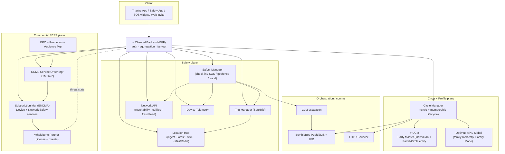
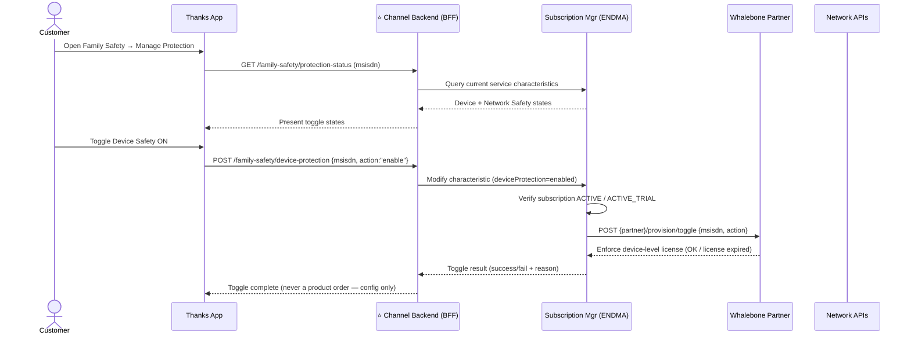
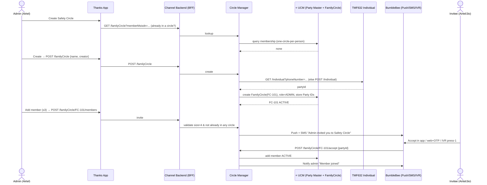

# Airtel Family Safety — System, API & Integration Plan

**Purpose:** From the BRDs, EA HLD docs and the Figma Exhaustive-Cases flows, identify **every system** that participates in Family Safety / Safety Circle, **which APIs each system exposes/consumes**, **how the systems interact**, the **flow with the Channel Backend (BFF) and the user/party-profile backend (UCM) in focus**, the **engineering effort** (by API + complexity), the **challenges**, and the **partners**.

**Status:** Draft for Architecture + Product review
**Date:** 2026-10-30
**Based on:**
- `Airtel_Family_Safety_BRD_(002)(1).pdf` — product BRD (circle, check-in, SOS, unreachability, routine, fraud, parental, SafeTrip)
- `EA-Create_Family_Safety_Circle.pdf` — HLD: circle setup, consent, membership lifecycle, UCM data model
- `EA-Family_Safety_Architecture.pdf` — HLD: commercial plane + Device/Network Safety (Whalebone, COM, Subscription), **Channel Backend (BFF)**
- `BRD-_SDK_solution_2nd_app_.pdf` — partner SDK / license management BRD
- `EA-Safety_Trip_-_Real-time_GPS_Location.pdf` — Location Hub + Trip Manager
- Figma `39:4390` Exhaustive Cases (≈487 LP screens) + `Family-Safety-Circle-Functionality-Checklist.md`

> **Legend for API maturity**
> `(EA)` = named in an EA HLD doc · `(BRD)` = stated in a BRD · `[INFERRED]` = required by Figma/BRD behaviour but not yet in a shared LLD. Finalise all paths in OpenAPI during LLD.

---

## 0. Answer up front — the two backends you asked to focus on

| You asked about | What the source docs actually name | Where |
|---|---|---|
| **Channel Backend** | **Channel Backend (BFF)** — `<<channel>>` tier that sits between the Thanks App and the Service Order Manager (COM) / Subscription Manager / Whalebone / Network APIs. It is the single aggregation + auth tier for all Family Safety journeys. | EA-Family_Safety_Architecture — "Enable/Disable Device & Network Safety" sequence diagrams |
| **User-Profile Backend** | **Not named verbatim.** The equivalent role is split across **UCM** (new *Family Circle* entity + *Party Master / Individual* records = the member/party profile store) and **Circle Manager** (owns circle + membership lifecycle on top of UCM). Commercial identity still lives in **Siebel/Customer (TMF629)**; family hierarchy comes from **Optimus API**. | EA-Create_Family_Safety_Circle — UCM Family Circle Domain + Party Master diagram |

So in this plan, **"user-profile backend" = UCM Party Master + UCM Family Circle entity, fronted by Circle Manager**, and every member-identity read/write is routed there (never into the Customer/TMF629 billing entity — see §9 "Why Customer entity fails").

---

## 1. System inventory (who is in play)

### 1.1 Family Safety Circle plane (consent, circle, safety events, location)

| ID | System | Owner (from EA stakeholder matrix) | Responsibility |
|---|---|---|---|
| S01 | **Thanks App** (+ Safety App for device protection) | App FE / Marketing (Lakshay) | Discovery, purchase, circle UI, SOS widget, dashboard, SDK host |
| S02 | **Channel Backend (BFF)** ⭐ | Channel (Surili Jain) | Single aggregation/auth tier: fans out to Circle Manager, Safety Manager, Trip Manager, COM, Subscription, Network; builds home/member-card payloads |
| S03 | **Circle Manager / Family Circle Service** | UCM (Vibhu Gupta) | Circle entity, invites, membership lifecycle, roles, consent, member validation for Trip |
| S04 | **UCM — Party Master + Family Circle entity** ⭐ | UCM (Vibhu Gupta) | Party/Individual records (MSISDN, name), new *FamilyCircle* entity holding circle metadata + member Party IDs + roles + per-member feature characteristics |
| S05 | **Safety Manager** | EA (Safety Event model) | Unified Safety Event: `CHECK_IN`, `SOS`, `GEOFENCE`, `INACTIVITY`, `FRAUD`, `FALL`; state machine, responses, history |
| S06 | **Trip Manager** | EA (Safety Trip) | SafeTrip / Emergency Trip create/start/stop, viewer selection, tracking-session link |
| S07 | **Location Hub** | EA (Safety Trip) | Location ingest API, latest-location API, SSE stream; Kafka `location.events`, Redis/Aerospike latest, History DB |
| S08 | **Network API** | Network (Gopal Dave / Bhabani) | Reachability/network state, cell-tower location assist, **Airtel Safe fraud signal feed** |
| S09 | **Device Telemetry** | Device platform | Battery, signal/mode, ringer, unlock/activity, permission state |
| S10 | **CLM** | Lifecycle | Staged escalation journeys (30→45→60 min) from clickstream miss events |
| S11 | **IVR / BumbleBee voice** | Voice | Automated check-in call (60 min); invite "press 1" join |
| S12 | **BumbleBee Communication Platform (Push + SMS)** | Comms | Invites, reminders, SOS, threat alerts, activation msgs |
| S13 | **OTP / Bouncer** | Auth | Web-invite consent OTP; OTP/biometric for role/permission changes (SC7) |
| S14 | **Admin Console** | Ops | Escalation thresholds (CI4), nudge config (EX2) |
| S15 | **Advisor / CRM view** | Service | Read-only case/consent/alert visibility (BRD §11) |
| S16 | **Clickstream / Analytics** | Analytics | Instrumentation (BRD §14); feeds CLM windows |
| S17 | **Audience Manager** | Audience (Parshant Verma) | Free-trial / "Claim Now" eligibility rules |

### 1.2 Commercial / BSS plane (pack purchase, subscription, license)

| ID | System | Owner | Responsibility |
|---|---|---|---|
| S18 | **COM / Service Order Manager** | COM (Sidhant / Vikalp) | **All LOB orders via TMF622**; orchestrates provisioning |
| S19 | **Subscription Manager (ENDMA)** | Digital (Salil / Kaushal) | Family Safety subscription carrying **two services: Device Safety + Network Safety** |
| S20 | **EPC (Product/Service catalog) + Promotion** | Product (Shubham/Shadab) | Product & Service Specs (`partner_sku_id`, planTier, screens), hidden free-sample PO |
| S21 | **Siebel Postpaid / ATOM / FX / Inform / LAPU / Event Bus / M2M Product Inventory** | BSS (Sai/Nitish/Gaurav/Ankit) | Postpaid+prepaid provisioning rails, customer entity, order ingestion |
| S22 | **Optimus API + Family Mode** | BSS/CX | Parent–child / managed-account hierarchy; add MSISDN to admin Family Mode |
| S23 | **Whalebone Partner backend** | Partner (external) | License allocate/verify/suspend/delete; threat event sync |
| S24 | **Whalebone SDK (on-device)** | Partner (external) | Malware, fraud-APK block, safe browsing, content filter, parental enforcement, Device ID |

---

## 2. Partners (as requested)

| # | Partner | Type | What they provide | APIs / interface | MVP? |
|---|---|---|---|---|---|
| 1 | **Whalebone** | External security vendor (SDK + backend) | Malware detection, fraud-APK block, safe browsing, content filtering, parental enforcement, Device ID; **annual license pool** rotated into Airtel packs | License allocate / map / verify / suspend / delete; threat-event sync to Airtel dashboard; on-device SDK as a **dynamically loaded module inside Thanks App** | ✅ Yes (Device/Network Safety) |
| 2 | **24×7 Fraud Expert Helpline** | BPO / service desk | Human experts to verify suspicious activity / report fraud | Call-centre integration (telephony + case view) | ✅ (SDK BRD Feature 5) |
| 3 | **Uber / Ola / Rapido** | Mobility | Trip origin/destination/ETA/route for destination-aware SafeTrip | Partner trip APIs | ❌ Phase 2+ (explicitly NON-MVP) |
| 4 | **Google Maps** | Maps/geocoding | Route-specific monitoring, detours | Maps/Directions API | ❌ Phase 2+ (NON-MVP) |
| 5 | **Wearable partner(s)** | Device | Fall / movement / inactivity signals | Partner wearable API | ❌ Future (if integrated) |

> **BumbleBee** and **IVR** are Airtel-internal platforms (Push/SMS/voice), not external partners. **Whalebone is the only external partner in MVP.**

---

## 3. System interaction — connection matrix

| From | To | Protocol | Why |
|---|---|---|---|
| Thanks App | **Channel Backend (BFF)** | REST / SSE | All journeys go through BFF (auth + aggregation) |
| Channel Backend (BFF) | Circle Manager | REST | Create circle, invite, accept, leave, roles, members |
| Channel Backend (BFF) | Safety Manager | REST | Check-in, SOS, responses, history, schedules |
| Channel Backend (BFF) | Trip Manager | REST | Start/stop SafeTrip, select viewers |
| Channel Backend (BFF) | Location Hub | REST + **SSE** | Latest location + live stream to viewers |
| Channel Backend (BFF) | COM (Service Order Mgr) | REST (TMF622) | Buy/claim pack |
| Channel Backend (BFF) | Subscription Mgr (ENDMA) | REST | Device/Network Safety toggle (config, not order) |
| Channel Backend (BFF) | Network API / Telemetry | REST | Reachability + device status for member cards |
| Circle Manager | **UCM Party Master / Family Circle entity** | REST | Persist circle + member Party IDs + roles + feature chars |
| Circle Manager | TMF632 Individual | REST | Resolve/create Individual (party) by phone number |
| Circle Manager | Optimus API / Siebel | REST | Fetch family hierarchy; add MSISDN to admin Family Mode |
| Circle Manager | BumbleBee (Push/SMS) / IVR | Async | Invite dispatch (app / SMS / press-1), member-left notice |
| Circle Manager | OTP / Bouncer | REST | Web-invite consent OTP; SC7 auth |
| Circle Manager | Subscription Mgr | Event | Revoke shared pack on member/admin exit |
| Safety Manager | BumbleBee Push | Async | Check-in / SOS notify |
| Safety Manager | CLM | Event | Start escalation journey on miss |
| Safety Manager | Trip Manager → Location Hub | REST | Emergency Trip on SOS |
| Safety Manager | Network + Telemetry | REST | Context on SOS / unreachability |
| CLM | Push → sticky → IVR → Safety Manager | Orchestration | 30→45→60 min escalation then alert circle |
| Trip Manager | Circle Manager | REST | Validate viewers are active members |
| Trip Manager | Location Hub | REST | Create/close tracking session |
| Location Hub | Kafka → Redis/Aerospike + History DB | Internal | Latest-location fan-out for SSE |
| COM | Subscription Mgr → Whalebone | Order events / Partner API | Activate subscription, assign license |
| Whalebone SDK | Whalebone Partner backend | Partner channel | License verify, threat telemetry |
| Whalebone Partner | Channel Backend / Dashboard API | Partner → Airtel | Threats-blocked stats sync |
| IVR / BumbleBee | Safety Manager | Callback | Record IVR response on check-in/invite |

---

## 4. Flow diagrams

### 4.1 Context — everything around the Channel Backend (BFF)

### 4.2 Channel Backend (BFF) in focus — Device Safety toggle (EA sequence)

### 4.3 User/Party-profile backend in focus — Create circle + invite (UCM)

---

## 5. APIs by system (the core table)

### 5.1 Channel Backend (BFF) ⭐

| Method | API | Purpose | Downstream | Source |
|---|---|---|---|---|
| GET | `/family-safety/home` | Aggregate landing: circle + members + card status | Circle, Telemetry, Network, Safety | `[INFERRED]` (Figma LP-35) |
| GET | `/family-safety/members/{id}` | Member detail aggregate | Circle, Telemetry, Safety | `[INFERRED]` (LP-38/39) |
| GET | `/family-safety/protection-status` | Device/Network Safety toggle states | Subscription Mgr | (EA) |
| POST | `/family-safety/device-protection` | Enable/disable Device Safety (config) | Subscription → Whalebone | (EA) |
| POST | `/family-safety/network-protection` | Enable/disable Network Safety (config) | Subscription → Network | (EA) |
| POST | `/family-safety/purchase` / `/claim` | Buy / claim pack | COM (TMF622) | (EA/BRD) |
| * | *pass-through* for circle/safety/trip | Thin proxy w/ auth + payload shaping | respective services | `[INFERRED]` |

### 5.2 Circle Manager (on top of UCM) ⭐

| Method | API | Purpose | Source |
|---|---|---|---|
| GET | `/familyCircle?memberMsisdn=` | Eligibility / already-in-circle | (EA) |
| POST | `/familyCircle` | Create circle | (EA) LP-04 |
| GET | `/familyCircle/{id}` | Circle summary | (EA) LP-35 |
| PATCH | `/familyCircle/{id}` | Name/avatar/settings | `[INFERRED]` LP-18 |
| POST | `/familyCircle/{id}/members` | Invite (≤3; validate size<4) | (EA) SC1–4 |
| GET | `/familyCircle/{id}/invites` | Pending invites | `[INFERRED]` US7 |
| POST | `/invites/{id}/remind` | Remind (does **not** restart 2-day window) | `[INFERRED]` LP-09 |
| POST | `/invites/{id}/resend` | Resend expired | `[INFERRED]` LP-17 |
| GET | `/invites/{token}` | Invite preview (app/web) | (EA) LP-11..14 |
| POST | `/familyCircle/{id}/accept` | Accept in app | (EA) LP-12 |
| POST | `/invites/{token}/accept-web` | Accept after OTP | (EA) LP-13 |
| POST | `/invites/{token}/accept-ivr` | Press-1 join | (EA) LP-14 |
| POST | `/familyCircle/{id}/switch` | Leave other circle → join | `[INFERRED]` LP-16 |
| GET | `/familyCircle/{id}/members` | Members + roles + relationship | (EA) SC2/SC5 |
| PATCH | `/members/{memberId}` | Relationship/role/permissions | (EA) SC5/SC7 |
| POST | `/familyCircle/{id}/members/{partyId}/leave` | Leave / leave-request | (EA) SC8 |
| POST | `/leaveRequests/{id}/approve` | Admin approve/reject leave | (EA) |
| POST | `/familyCircle/{id}/adminExit` | Admin exit → grace period | (EA) |
| DELETE | `/members/{memberId}` | Admin remove | (EA) REMOVED |
| POST | `/members/{memberId}/reverify` | MSISDN/SIM change / 3-month non-Airtel re-verify | (EA) SC9 |
| GET | `/contacts/airtel-family` | Airtel family first, then contacts | `[INFERRED]` LP-05·3 |

**Events:** `InviteCreated`, `InviteAccepted`, `MemberLeft`, `CirclePendingClosure`, `CircleTerminated`.
**UCM data:** `FamilyCircle{circle_id, name, creator_id, status}` + member Party IDs + roles + per-member feature characteristics (new entity — **not** Customer/TMF629, not `Individual.relatedParty`).

### 5.3 Safety Manager

| Method | API | Purpose | Source |
|---|---|---|---|
| POST | `/safety-events` | Create (`CHECK_IN`/`SOS`/`GEOFENCE`/`INACTIVITY`/`FRAUD`/`FALL`) | (EA) CI1/SO1 |
| GET | `/safety-events/{id}` | Detail + state machine | (EA) CI5 |
| GET | `/circles/{id}/safety-events` | History (30-day) | (EA) LP-40 |
| PATCH | `/safety-events/{id}` | State transitions | (EA) CI3 |
| POST | `/safety-events/{id}/responses` | Receiver / IVR response | (EA) CI2 |
| GET | `/safety-events/{id}/responses` | Response list | (EA) CI5 |
| POST | `/check-ins/schedules` + `GET`/`PATCH` | Scheduled check-in (repeat/pause/resume) | `[INFERRED]` LP-67/69 |
| POST | `/sos/{id}/cancel` | Cancel + reason | (EA) SO5 |
| PUT | `/circles/{id}/sos-priority` | SOS priority recipients | `[INFERRED]` |
| POST | `/sos/{id}/emergency-trip` | Start Emergency Trip | (EA) |

**Check-in state:** `SENT→DELIVERED→RESPONDED | NO_RESPONSE→ESCALATING→ESCALATED`
**SOS state:** `SENT→FAMILY_NOTIFIED→ACTIVE→RESOLVED | CANCELLED`
**Escalation (CI4):** t+30 push → t+45 sticky → t+60 IVR → alert circle (thresholds via Admin Console).

### 5.4 Trip Manager + Location Hub (SafeTrip)

| Method | API | System | Source |
|---|---|---|---|
| POST | `/trips` · `/trips/{id}/start` · `/stop` · `GET /trips/{id}` · `GET /trips/active` · `PATCH /trips/{id}` | Trip Manager | (EA) |
| POST | `/location/v1/tracking-sessions` | Location Hub — start session | (EA) |
| POST | `/location/v1/tracking-sessions/{TS}/locations` | Location Hub — ingest pings | (EA) |
| GET | `/location/stream?trackingSessionId={TS}` | Location Hub — **SSE** to viewers | (EA) |
| GET | `/location/v1/tracking-sessions/{TS}/latest` | Latest before SSE subscribe | `[INFERRED]` |

**Rules:** dynamic ping interval (active vs idle), GPS else cell-tower via Network API, do **not** persist cell-only tracks, close stream on trip end.

### 5.5 Network API + Device Telemetry

| Capability | Proposed API | Source |
|---|---|---|
| Reachability / network state | `GET /network/v1/msisdn/{msisdn}/reachability` | `[INFERRED]` UR1 |
| Network event stream | `GET /network/v1/stream` (SSE) | `[INFERRED]` |
| Fraud signal feed | consume "Airtel Safe signal feed" | (BRD) FR1 |
| Device heartbeat / status | `POST /telemetry/v1/devices/{id}/heartbeat`, `GET /telemetry/v1/members/{id}/status` | `[INFERRED]` LP-36 |

### 5.6 Commercial plane (COM / Subscription / Whalebone)

| System | API / interface | Purpose |
|---|---|---|
| COM | TMF622 Product Order | All LOB orders for Family Safety PO |
| EPC + Promotion | Product/Service Spec (`partner_sku_id`), hidden free-sample PO | Catalog + 3-month postpaid trial |
| Subscription Mgr (ENDMA) | Create/update subscription with **Device Safety + Network Safety** services | Pack lifecycle, toggles |
| Whalebone Partner | allocate / map / verify / suspend / delete license; threat sync | `LicenseID → CustomerID → MSISDN → DeviceID → Subscription → Validity` |
| Whalebone SDK | on-device module inside Thanks App | malware/APK/URL/content/parental |

### 5.7 Places / Geofence (Reachability + Parental) — ownership decision needed

Recommended: **Places owned by Circle Manager**, breach → Safety Manager `GEOFENCE`. `GET/POST /members/{id}/places`, `PUT /places/{id}/alerts` `[INFERRED]`.

---

## 6. Effort estimate (by API count + complexity)

Assumptions: one backend engineer ≈ 5 productive days/week; estimates are **backend build + integration + unit/integration test**, excluding app FE, partner-side work, SIT/UAT, and infra hardening. Complexity: **L** = CRUD/thin, **M** = state machine / multi-system, **H** = realtime / partner / data-model change.

| # | System | APIs (new/changed) | Cx | Eng effort (person-weeks) | Key cost driver |
|---|---|---|---|---|---|
| 1 | **Channel Backend (BFF)** ⭐ | ~10 (aggregation + toggles + proxy) | M | **6–8** | AuthZ, home/member aggregation fan-out, error/degradation handling |
| 2 | **UCM — FamilyCircle entity + Party Master** ⭐ | new entity + reads/writes | H | **8–12** | **New data model** (avoid Customer/Party collisions), migrations, 30-mesh problem |
| 3 | **Circle Manager** | ~22 | M–H | **10–14** | Invite lifecycle, consent, 3-channel accept, grace period, roles |
| 4 | **Safety Manager** | ~13 | M–H | **8–12** | Two state machines, responses, schedules, history/retention |
| 5 | **CLM escalation + IVR callback** | journey + callback | M | **3–5** | Staged timers, clickstream dependency, IVR integration |
| 6 | **Trip Manager** | ~6 | M | **4–6** | Trip lifecycle, viewer validation |
| 7 | **Location Hub** | ~5 + pipeline | H | **8–12** | Ingest + Kafka + Redis + **SSE** fan-out + battery-aware intervals |
| 8 | **Network API** | ~2 (+feed) | M | **3–5** | Reachability semantics, SSE vs poll, fraud feed |
| 9 | **Device Telemetry** | ~2 | M | **3–4** | Permission-gated capture, OS differences |
| 10 | **Push/SMS/BumbleBee + OTP** | integration | L–M | **3–5** | High-priority/sticky push, web-invite OTP |
| 11 | **COM + Subscription Mgr + EPC/Promotion** | TMF622 + service model | H | **10–14** | Order orchestration, trial PO, two-service subscription |
| 12 | **Whalebone integration + License Mgmt** | partner APIs + LMS | H | **8–12** | License inventory/rotation/mapping, suspend/delete, device re-pair |
| 13 | **Places / Geofence** | ~3 | M | **3–5** | Geofence eval + event routing |
| 14 | **Advisor view + Analytics/instrumentation** | read APIs + events | L–M | **3–5** | Privacy-scoped read, ~30 instrumentation events |
| — | **Cross-cutting** (consent model, privacy guardrails, security review, env, NFR) | — | H | **6–10** | Consent/permission split, "degrade gracefully", audit |

**Indicative backend total: ~95–130 person-weeks** (≈ **2–3 pods over ~5–6 months** for MVP → full suite). **MVP (P0–P1: circle + check-in + SOS + push):** ~30–40 person-weeks. Add App FE (parallel, similar order), partner lead time, SIT/UAT separately.

### Phased delivery (aligned to BRD roadmap)

| Phase | Scope | Systems online |
|---|---|---|
| **P0** | Circle create/invite/accept (app+SMS+IVR), members, roles | BFF, Circle Mgr, UCM, BumbleBee, OTP |
| **P1** | Check-in + SOS + history + push escalation | + Safety Mgr, CLM, IVR |
| **P2** | Telemetry + reachability on member cards | + Network, Telemetry |
| **P3** | SafeTrip + Location Hub SSE | + Trip Mgr, Location Hub, Redis/Kafka |
| **P4** | Commercial pack + Whalebone Device/Network Safety | + COM, Subscription, EPC, Whalebone |
| **P5** | Parental Controls + Places/geofence + scheduled check-ins | + Places, Whalebone parental |
| **P6** | Fraud / routine / unreachability intelligence polish | Network fraud, CLM tuning |

---

## 7. Challenges / risks

| # | Challenge | Impact | Mitigation |
|---|---|---|---|
| 1 | **New UCM FamilyCircle entity** — Customer (TMF629) and `Individual.relatedParty` both break (non-Airtel members, circle-level attrs, N×(N-1) mesh writes on join/leave) | Data-model rework if wrong | Build the dedicated FamilyCircle entity now (per EA); never model members as Customers |
| 2 | **Non-Airtel members (Jio/Vi)** | Reachability/network/fraud signals unavailable → degraded features | App-based check-in/SOS only; disclose limits before invite; 3-month re-verify |
| 3 | **Invite cap conflict** — Figma says 3, EA says max 4 (1 admin + 3) / older text 6 | Data model + UX | **Resolve with Product** (plan uses 1 admin + 3 = 4) |
| 4 | **Realtime battery drain** (Location SSE) | UX/battery complaints | Dynamic active/idle ping; cell-tower fallback; don't persist cell-only tracks |
| 5 | **"Unreachable" ≠ "unsafe"** copy risk | Trust / false alarm | Strict copy review (UR2); explainable alerts; graceful degradation ("Unable to check status") |
| 6 | **Consent vs OS permission split** | Legal / privacy | Consent once at accept; permissions per-feature, independently revocable; immediate revocation |
| 7 | **Whalebone license lifecycle** — annual pool rotated into monthly/6-month packs, X-day retention, device re-pair, suspend/delete real-time? | Partner dependency, billing disputes | Confirm verify/disable SLA with partner; license inventory + mapping + reconciliation; define X days |
| 8 | **Toggle vs order** — Device/Network Safety enable/disable is **config on existing service, not a product order** | Billing correctness | Route toggles through Subscription Mgr characteristic change, not COM |
| 9 | **Admin exit / circle grace period** | Continuity | 7-day grace, any eligible member can take over; revoke shared pack on exit |
| 10 | **Escalation timing not frozen** (5/10/15 min? CI4 says 30/45/60) | Behaviour inconsistency | Freeze thresholds with CFT; keep configurable via Admin Console |
| 11 | **iOS capability gaps** (Safari extension; limited background) | Feature parity | Disclose iOS limits in product (NFR-09) |
| 12 | **Parental Controls offline enforcement + uninstall/accessibility block** | Enforcement reliability | Local rules + sync on reconnect; block uninstall / alert parent (Android); declare device/OS-dependent |
| 13 | **Advisor privacy** | Compliance | Read-only, consent-scoped, no raw location/routine; OTP for assisted changes |
| 14 | **Many systems (~24) + external partner** | Integration/SIT complexity | Phase delivery P0–P6; contract-first OpenAPI; BFF isolates app from churn |

---

## 8. Open architecture decisions (owners to confirm)

| # | Decision | Owner |
|---|---|---|
| 1 | Single Family Safety **BFF** vs app→each service | Architect (confirmed: BFF) |
| 2 | **Places** ownership (Circle vs Safety vs Location) | Architect |
| 3 | Invite max (3 vs 4 vs 6) | Product |
| 4 | Whalebone inside Thanks App module vs separate Safety App (EA: module; SDK BRD: separate app) | Product + Architect |
| 5 | Network SSE vs poll | Network + App |
| 6 | License X-day retention after expiry | Product + Partner |
| 7 | Safety Event delete policy / 30-day retention | Product |
| 8 | Escalation thresholds (30/45/60 vs 5/10/15) | CFT |
| 9 | Home Wi-Fi / IPTV / STB signal owners (routine break) | Homes + Network |

---

## 9. Why the Customer / Party entity fails (data-model note)

- **Customer (TMF629)** = commercial billing relationship → modelling non-Airtel members as customers creates fake/shadow BSS accounts, pollutes metrics and CRM. ❌
- **`Individual.relatedParty`** = person-to-person pointer → can't hold circle-level attributes (name, avatar, rules) and forces N×(N-1) mutual-link writes (6 members = 30 links) on every join/leave. ❌
- ✅ **Solution:** a dedicated **UCM FamilyCircle entity** holding circle metadata, member Party IDs, roles and per-member feature characteristics — this is the "user/party-profile backend" for Family Safety. Commercial identity stays in Siebel/Customer; family hierarchy comes from Optimus; only the **admin line** carries the paid subscription.

---

*This is an integration HLD/LLD planning doc derived from the 5 uploaded PDFs + Figma `39:4390`. It is not a substitute for the EA LLD packages marked "LLD — Implementation team to share." Finalise §5 as OpenAPI per service and resolve §8 before build.*
