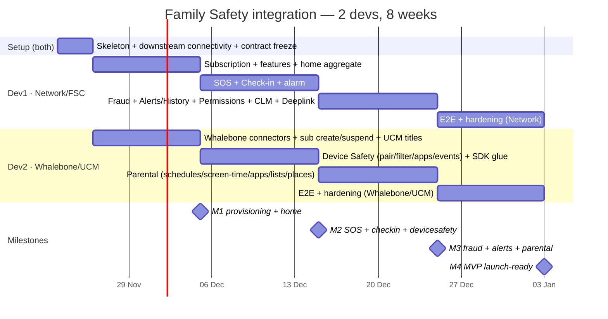

# Family Safety — Integration & Dev Plan (Whalebone · Network · UCM)

**Team:** 2 developers · **Start:** 23 Nov 2026 (dev starts today) · **Target MVP:** ~8 weeks (4 × 2-week sprints)
**Layer built:** Family Safety **orchestrator** (BEFE/Guardian) — stateless, consume-only (no DP persist), fanning out to 3 downstreams.

## 1. Systems & ownership split

| Downstream | What we integrate | Owner |
|---|---|---|
| **Network / FSC** (`/fsc` v1.8) | Subscription (provision/cancel/suspend/resume + features), SOS, Check-in, Device status, Fraud/spam, Alerts+History, CLM payload, Deeplink, Permissions, Alarm | **Dev 1** |
| **Whalebone** (`/management` + `/events` + SDK) | Device Safety + Parental: subscriptions, devices (filter/applications/scheduled-filter), allow/deny lists, events, pair-app/SDK, segment_id state | **Dev 2** |
| **UCM** | Relationship titles (mom/dad), member name/profile resolution, Family-Mode / app-installed / Airtel flags | **Dev 2** |
| **Orchestrator core** (shared) | Scaffold, auth context, downstream clients, retry/idempotency, aggregation, observability | **Dev 1 lead + Dev 2** |

**Rule of thumb:** Dev 1 owns the **Network/FSC** vertical + orchestrator spine; Dev 2 owns the **Whalebone + UCM** verticals. Both pair on the shared skeleton in Sprint 0.

## 2. Timeline (Gantt)

## 3. Sprint plan

### Sprint 0 — Day 1–3 (both, this week)
- Repo, CI, orchestrator service skeleton (stateless, config-driven); health/trace/log.
- **Connectivity + auth** to all 3: FSC base URL + keys; Whalebone `Wb-Access-Key`/`Wb-Secret-Key`; UCM creds. One successful call each (`family/get`, `GET /management/devices/{id}`, UCM profile).
- **Contract freeze:** FSC swagger **v1.8**, Whalebone `/management`+`/events`, UCM title API. Generate downstream clients + mock servers.
- Decide the **identity map**: `msisdn = deviceId = subscriptionId`, `circleId = familyId`, membershipId.
- **Definition of Done** + branch/PR flow agreed.

### Sprint 1 — Wk 1–2 → **M1: provisioning + home**
| Owner | Tasks |
|---|---|
| **Dev 1** | `POST /subscription` (CREATE/CANCEL/SUSPEND/RESUME on msisdn); `GET /subscription/features/fetch`; `POST /features/toggle`; **Home aggregate** = `family/get` + `device/status/fetch` + features |
| **Dev 2** | Whalebone client; `POST /management/subscriptions` (segment_id=devicesafety) + suspend/activate; `GET /management/devices/{id}`; **UCM** title (mom/dad) + name resolution; app-installed/Airtel flags |

### Sprint 2 — Wk 3–4 → **M2: SOS + check-in + device safety**
| Owner | Tasks |
|---|---|
| **Dev 1** | `POST /trigger/sos` (CREATE/ACK/RESOLVE) + `DELETE /sos/cancel` + `sos/status/check` → **live SOS DTO** (location/battery/responders); `POST /trigger/checkin` (CREATE/RESPONSE/DISMISS/PAUSE/RESUME) + status; `alarm/incoming` |
| **Dev 2** | Device Safety: `pair-app` token → SDK bootstrap glue; `PUT /devices/{id}/filter` (7 threats true); `PUT /applications`; `GET /events/search|stats`; **segment_id** state machine (devicesafety/parental/both/none) |

### Sprint 3 — Wk 5–6 → **M3: fraud + alerts + parental**
| Owner | Tasks |
|---|---|
| **Dev 1** | `GET /fraud/alert/fetch` + `POST /fraud/alert/action` (warn/end-call); **Alerts+History** = `alert/fetch` + `history/fetch` with role-scoping + UCM titles; **Permissions** `update`/`fetch` + feature-status engine; `clm/payload/fetch`; `deeplink/resolve` |
| **Dev 2** | Parental: `scheduled-filter` (bedtime/study presets), `content-filter`, allow/deny `lists`, screen-time, apps, places/usage/location mapping; GET-merge-PUT policy builder; reports via `/events/stats` |

### Sprint 4 — Wk 7–8 → **M4: launch-ready**
- E2E integration tests across all 3 downstreams; idempotency + retry/back-off (429/409 per Whalebone ops rules); reachability/lifecycle wiring; observability/alerting; UAT; bug-fix; launch checklist.

## 4. Integration points & cross-cutting

- **Notification deeplink** → `deeplink/resolve` (deeplinkId + msisdn/groupId) → app calls the right checkin/sos/fraud API. (Dev 1, Sprint 3.)
- **CLM payload** for checkin/sos message/escalation config → `clm/payload/fetch`. (Dev 1.)
- **Permission → feature-status** engine: permissions on/off per member drive `checkinWorking`/`sosWorking` etc., pushed to Channel. (Dev 1.)
- **Membership ↔ Whalebone subscriptionId (= MSISDN)** linkage. (Dev 2.)
- **UCM titles** injected into alerts/history and member cards. (Dev 2.)

## 5. External dependencies / asks (track as blockers)

| # | Needed from | Item | Blocks |
|---|---|---|---|
| 1 | Network | GAP APIs: reachability/HLR, back-online, low-battery, MNP/lifecycle events, invite lifecycle, `getCircleByMsisdn` | Home signals, lifecycle |
| 2 | Network | CLM payload contract + deeplink id scheme confirmation | Sprint 3 |
| 3 | Network | LBS lookup + no-internet SOS short-code | SOS edges |
| 4 | Whalebone | Airtel-hosted backend URL, resolver discovery domain, Access/Secret keys, app-catalogue IDs | Dev 2 Sprint 1 |
| 5 | Whalebone | segment_id auto-apply (steps 3/7 "new dev") | Parental activation |
| 6 | UCM | Title mapping + profile API contract + auth | Dev 2 Sprint 1 |
| 7 | Legal | Remote end-call; non-app invite acceptance | Fraud action, invites |

## 6. Risks

- **Downstream readiness** — several Network APIs are GAP (not yet built/shared); use mocks, keep contracts frozen, escalate early.
- **Whalebone "new development"** (auto segment_id) not in MVP window — may need manual filter PUTs as fallback.
- **SDK pairing** (Android/iOS) owned by app team — coordinate the token hand-off.
- **2-dev bandwidth** — Parental is the largest surface; if it slips, it is P1 and can trail SOS/check-in (P0).

## 7. Start today (Day 1 actions)

1. Create the orchestrator repo + CI; both devs clone.
2. Request/confirm credentials: FSC keys, Whalebone Access/Secret + backend URL, UCM creds (dependency #4, #6).
3. Stand up mock servers from FSC v1.8 + Whalebone + UCM contracts.
4. Dev 1 → `POST /subscription` skeleton + `family/get` client. Dev 2 → Whalebone `GET /management/devices/{id}` + UCM title client.
5. Daily 15-min standup; shared board with the Sprint-1 tasks above.

---

*Grounded in FSC swagger v1.8, the Airtel Secure (Whalebone) HLD, and the BEFE requirements. P0 = circle provisioning + SOS + check-in + device status + fraud + alerts; P1 = device safety, parental, lifecycle/banners.*
