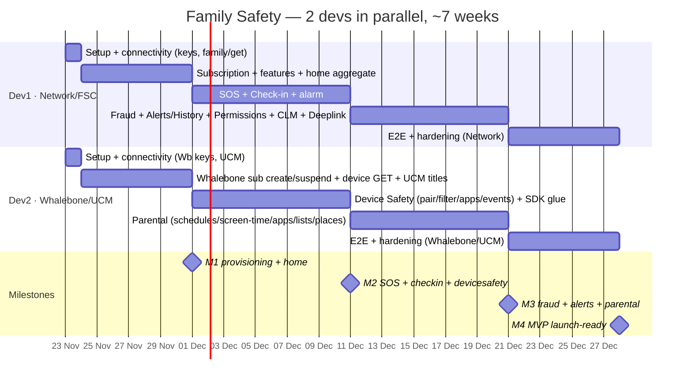

# Family Safety — Integration & Dev Plan (Whalebone · Network · UCM)

**Team:** 2 developers, **parallel** from day 1 · **Start:** 23 Nov 2026 (today) · **Target MVP:** ~7 weeks
**Layer built:** Family Safety **orchestrator** (BEFE/Guardian) — stateless, consume-only (no DP persist), fanning out to 3 downstreams.

> **Contracts are ready.** Whalebone APIs are already shared (device-management + public events + SDK). Network/FSC APIs are shared as **swagger v1.8** — **member create / update / delete / role-update are removed**; provisioning is via the **Subscription** APIs (`POST /subscription` CREATE/CANCEL/SUSPEND/RESUME on msisdn + features fetch/toggle). So both devs code against live contracts immediately — **no mock-first phase**.

## 1. Systems & ownership split (parallel tracks)

| Track | Downstream | Scope | Owner |
|---|---|---|---|
| **A** | **Network / FSC** (`/fsc` v1.8) | Subscription (provision/cancel/suspend/resume + features), SOS, Check-in, Device status, Fraud/spam, Alerts+History, CLM payload, Deeplink, Permissions, Alarm | **Dev 1** |
| **B** | **Whalebone** (`/management` + `/events` + SDK) + **UCM** | Device Safety + Parental (filter/apps/scheduled-filter/lists/events, pair-app/SDK, segment_id), UCM titles/profile/Family-Mode flags | **Dev 2** |

Network contract excludes member CRUD — nothing to build there; Dev 1 uses **Subscription** for provisioning and **`family/get`** for the member list.

## 2. Timeline (Gantt — both tracks run in parallel)

## 3. Sprint plan (parallel; ~2-week cadence)

### Day 1 (today, both — a few hours, not a gate)
- Orchestrator repo + CI already up; both clone and run.
- **Connectivity + auth** against the **live shared APIs**: Dev 1 → FSC keys + `family/get`; Dev 2 → Whalebone `Wb-Access-Key`/`Wb-Secret-Key` + backend URL (`GET /management/devices/{id}`) and UCM creds.
- Lock the identity map: `msisdn = deviceId = subscriptionId`, `circleId = familyId`. Then straight into Sprint 1 — no blocking handoff between the tracks.

### Sprint 1 — Wk 1–2 → **M1: provisioning + home**
| Dev 1 (Network) | Dev 2 (Whalebone + UCM) |
|---|---|
| `POST /subscription` (CREATE/CANCEL/SUSPEND/RESUME on msisdn) | `POST /management/subscriptions` (segment_id=devicesafety) + suspend/activate |
| `GET /subscription/features/fetch` + `POST /features/toggle` | `GET /management/devices/{id}` (status, segment_id) |
| **Home aggregate** = `family/get` + `device/status/fetch` + features | **UCM** titles (mom/dad) + name resolution; app-installed/Airtel flags |

### Sprint 2 — Wk 3–4 → **M2: SOS + check-in + device safety**
| Dev 1 | Dev 2 |
|---|---|
| `POST /trigger/sos` (CREATE/ACK/RESOLVE) + `DELETE /sos/cancel` + `sos/status/check` → live SOS DTO (location/battery/responders) | `pair-app` token → SDK bootstrap glue; `PUT /devices/{id}/filter` (7 threats true) |
| `POST /trigger/checkin` (CREATE/RESPONSE/DISMISS/PAUSE/RESUME) + status | `PUT /applications`; `GET /events/search|stats`; **segment_id** state machine |
| `alarm/incoming` | membership ↔ subscriptionId linkage |

### Sprint 3 — Wk 5–6 → **M3: fraud + alerts + parental**
| Dev 1 | Dev 2 |
|---|---|
| `GET /fraud/alert/fetch` + `POST /fraud/alert/action` (warn/end-call) | Parental: `scheduled-filter` (bedtime/study presets), `content-filter` |
| **Alerts+History** = `alert/fetch` + `history/fetch`, role-scoped + UCM titles | allow/deny `lists`, screen-time, apps, places/usage/location mapping |
| **Permissions** `update`/`fetch` + feature-status engine; `clm/payload/fetch`; `deeplink/resolve` | GET-merge-PUT policy builder; reports via `/events/stats` |

### Sprint 4 — Wk 7 → **M4: launch-ready**
- E2E across all 3 downstreams; idempotency + retry/back-off (429/409 per Whalebone ops rules); reachability/lifecycle wiring; observability; UAT; bug-fix; launch checklist.

## 4. Cross-cutting (shared, slot into the sprint that owns it)

- **Notification deeplink** → `deeplink/resolve` (deeplinkId + msisdn/groupId) → app calls the right checkin/sos/fraud API. (Dev 1, S3.)
- **CLM payload** for checkin/sos message + escalation → `clm/payload/fetch`. (Dev 1, S3.)
- **Permission → feature-status** engine drives `checkinWorking`/`sosWorking`, pushed to Channel. (Dev 1, S3.)
- **Membership ↔ Whalebone subscriptionId (= MSISDN)** linkage. (Dev 2, S2.)
- **UCM titles** injected into alerts/history + member cards. (Dev 2, S1.)

## 5. Dependencies (most cleared — contracts shared)

| # | From | Item | Status |
|---|---|---|---|
| 1 | Network | FSC v1.8 APIs (subscription, trigger, device, fraud, alert, history, clm, deeplink, permission) | ✅ **shared** |
| 2 | Whalebone | management + events + SDK APIs, backend URL, Access/Secret keys, app-catalogue IDs | ✅ **shared** (confirm keys/URL on Day 1) |
| 3 | UCM | Title mapping + profile API contract + auth | ⚠️ confirm Day 1 |
| 4 | Network | GAPs still open: reachability/HLR, back-online, low-battery, MNP/lifecycle events; CLM payload + deeplink-id scheme | ⚠️ needed by S3; else stub & wire later |
| 5 | Whalebone | segment_id auto-apply ("new dev") | ⚠️ fallback = manual filter PUTs |
| 6 | Legal | Remote end-call; non-app invite acceptance | ⚠️ parallel, non-blocking for P0 |

## 6. Risks

- **UCM + Network GAPs** (reachability, lifecycle, CLM/deeplink specifics) are the only real unknowns — isolate behind an interface so the P0 flows (SOS/check-in/device/fraud/alerts) don't wait on them.
- **SDK pairing** (Android/iOS) owned by the app team — coordinate the token hand-off in S2.
- **Parental is the largest surface** (P1) — if it slips it trails the P0 features without blocking launch.
- **2-dev bandwidth** — tracks are independent, so a slip on one doesn't stall the other.

## 7. Start today (Day 1)

1. Both clone the orchestrator repo; CI green.
2. Confirm credentials: FSC keys (✅ shared), Whalebone Access/Secret + backend URL, UCM creds (dep #3).
3. Dev 1 → `POST /subscription` skeleton + `family/get` client (one real call). Dev 2 → Whalebone `GET /management/devices/{id}` + UCM title client (one real call).
4. Daily 15-min standup; board with the Sprint-1 tasks above.

---

*Grounded in FSC swagger v1.8 (member CRUD removed; Subscription-based provisioning), the Airtel Secure (Whalebone) HLD, and the BEFE requirements. P0 = provisioning + SOS + check-in + device status + fraud + alerts; P1 = device safety, parental, lifecycle/banners.*
