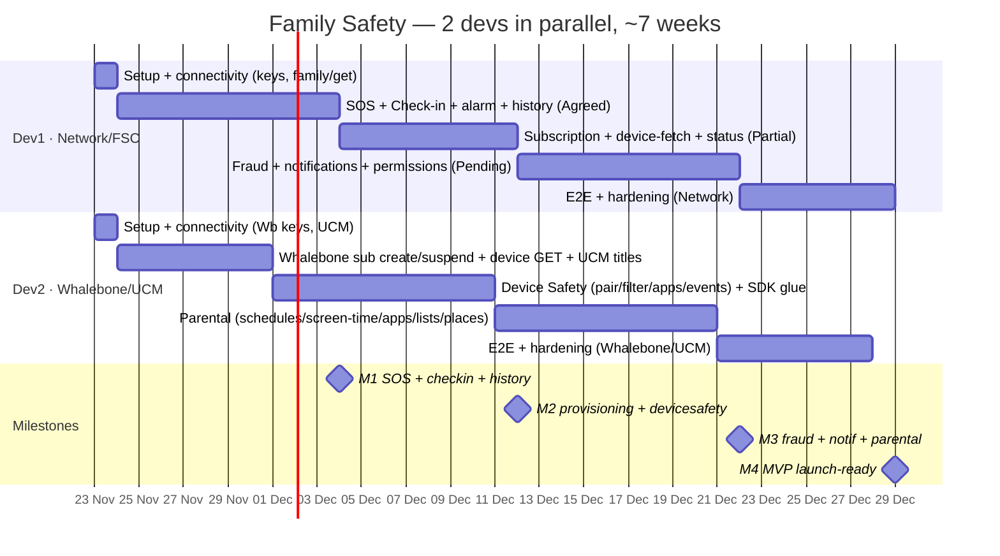

# Family Safety — Integration & Dev Plan (Whalebone · Network · UCM)

**Team:** 2 developers, **parallel** from day 1 · **Start:** 23 Nov 2026 (today) · **Target MVP:** ~7 weeks
**Layer built:** Family Safety **orchestrator** (BEFE/Guardian) — stateless, consume-only (no DP persist), fanning out to 3 downstreams.

> **Contracts shared; Network agreement is partial.** Whalebone APIs are shared (device-management + public events + SDK). Network/FSC is shared as **swagger v1.8** (member create/update/delete/role-update removed). Per the **23 Nov Network agreement**: SOS, Check-in, Alarm and History are **Agreed** (build now); Device-status fetch and Family/Member status fetch are **Partially Agreed** (enum + service-status logic pending); **Fraud Alert fetch/action are Agreement-Pending**. So devs **build agreed-first**, and gate the partial/pending items on the action items in §2.

## 1. Systems & ownership split (parallel tracks)

| Track | Downstream | Scope | Owner |
|---|---|---|---|
| **A** | **Network / FSC** (`/fsc` v1.8) | Subscription (provision/cancel/suspend/resume + features), SOS, Check-in, Device status, Fraud/spam, Alerts+History, CLM payload, Deeplink, Permissions, Alarm | **Dev 1** |
| **B** | **Whalebone** (`/management` + `/events` + SDK) + **UCM** | Device Safety + Parental (filter/apps/scheduled-filter/lists/events, pair-app/SDK, segment_id), UCM titles/profile/Family-Mode flags | **Dev 2** |

Network contract excludes member CRUD — nothing to build there; Dev 1 uses **Subscription** for provisioning and **`family/get`** for the member list.

## 2. Network API readiness — 23 Nov agreement (drives build order)

| Network API | Our v1.8 endpoint | Status | Pending / action |
|---|---|---|---|
| Check-in Create/Response/Dismiss/Pause/Resume | `POST /trigger/checkin` | ✅ Agreed | build now |
| Check-in Status Fetch | `GET /trigger/checkin/status/check` | ✅ Agreed | build now |
| SOS Create / Update | `POST /trigger/sos` | ✅ Agreed | build now |
| SOS Status Fetch | `GET /trigger/sos/status/check` | ✅ Agreed | build now |
| SOS Cancel | `DELETE /trigger/sos/cancel` | ✅ Agreed | build now |
| Incoming Alarm | `POST /alarm/incoming` | ✅ Agreed | build now |
| SOS Kill | `POST /alarm/sos/kill` | ✅ Agreed | Network-side use |
| History Fetch | `GET /history/fetch` | ✅ Agreed | minor IT queries |
| Device Status **Fetch** | `GET /device/status/fetch` | 🟡 Partial | **ParameterName ENUM** pending — Device Telemetry team |
| **Family Status Fetch** | `GET /family/get` (+ service status) | 🟡 Partial | per-member service **Available/Working** — needs Surili's service list + logic |
| **Member Status Fetch** | `GET /subscription/features/fetch` | 🟡 Partial | same action items as Family Status |
| Outgoing Alarm / **Notifications** (Bumblebee) | `clm/payload/fetch` + `deeplink/resolve` | 🟡 Partial | Content ID→Event ID templates; IT+Growth to share **Event IDs + dynamic params + deeplink/Alarm ID** |
| **Fraud Alert Fetch** | `GET /fraud/alert/fetch` | 🔴 Pending | discussion **not started** |
| **Fraud Alert Response/Action** | `POST /fraud/alert/action` | 🔴 Pending | follow-up to close points |
| Device Status **Store** | (removed — consume-only) | ⏸ Pending | SDK team: interface / params / permissions (feeds fetch; not our call) |
| Subscription Create/Cancel/Suspend/Resume | `POST /subscription` | ⚠️ Not in agreement | **raise with Network** — not yet on the agreed list |

**Action items to unblock (owners):**
1. **Surili** → share the full service list + the Working / Not-Working business logic (e.g. SPAM available only to Airtel; SOS = Not Working if Location permission denied). Unblocks Family/Member Status Fetch **and** our permission→feature-status engine.
2. **Device Telemetry team** → finalize the `ParameterName` ENUM for Device Status Fetch.
3. **IT + Growth** → finalize notification templates; share Event IDs + dynamic params + deeplink/Alarm ID to Network. Unblocks Outgoing Notifications → our CLM/deeplink.
4. **Network + IT** → follow-up to finalize Fraud Alert Fetch + Response/Action contracts.
5. **SDK team** → Device Status Store interface/params/permissions discussion.
6. **IT / Amit** → raise the Subscription provisioning API (create/cancel/suspend/resume) — not yet in the Network agreement.

## 3. Timeline (Gantt — both tracks run in parallel)

## 4. Sprint plan (parallel; ~2-week cadence; **agreed-first**)

### Day 1 (today, both — a few hours, not a gate)
- Orchestrator repo + CI already up; both clone and run.
- **Connectivity + auth** against the **live shared APIs**: Dev 1 → FSC keys + `family/get`; Dev 2 → Whalebone `Wb-Access-Key`/`Wb-Secret-Key` + backend URL (`GET /management/devices/{id}`) and UCM creds.
- Lock the identity map: `msisdn = deviceId = subscriptionId`, `circleId = familyId`. Then straight into Sprint 1 — no blocking handoff between the tracks.

### Sprint 1 — Wk 1–2 → **M1: SOS + check-in + history (all Agreed)**
| Dev 1 (Network) — **Agreed APIs first** | Dev 2 (Whalebone + UCM) |
|---|---|
| `POST /trigger/sos` (CREATE/ACK/RESOLVE) + `DELETE /sos/cancel` + `sos/status/check` → live SOS DTO | `POST /management/subscriptions` (segment_id=devicesafety) + suspend/activate |
| `POST /trigger/checkin` (CREATE/RESPONSE/DISMISS/PAUSE/RESUME) + status | `GET /management/devices/{id}` (status, segment_id) |
| `alarm/incoming`; `history/fetch` | **UCM** titles (mom/dad) + name resolution; app-installed/Airtel flags |

### Sprint 2 — Wk 3–4 → **M2: provisioning + home + device safety** *(Partial — track action items)*
| Dev 1 | Dev 2 |
|---|---|
| `POST /subscription` (CREATE/CANCEL/SUSPEND/RESUME) — **raise agreement (AI#6)** | `pair-app` token → SDK bootstrap glue; `PUT /devices/{id}/filter` (7 threats true) |
| `GET /device/status/fetch` — enum **TBD (AI#2)**; `GET /subscription/features/fetch` | `PUT /applications`; `GET /events/search|stats`; **segment_id** state machine |
| **Home + Family/Member status** (service Available/Working) — **gated on Surili's logic (AI#1)** | membership ↔ subscriptionId linkage |

### Sprint 3 — Wk 5–6 → **M3: fraud + notifications + parental** *(Pending — may slip)*
| Dev 1 | Dev 2 |
|---|---|
| `GET /fraud/alert/fetch` + `POST /fraud/alert/action` — **Agreement Pending (AI#4)**; keep behind interface | Parental: `scheduled-filter` (bedtime/study presets), `content-filter` |
| **Notifications/CLM/Deeplink** `clm/payload/fetch` + `deeplink/resolve` — **needs Event IDs/templates (AI#3)** | allow/deny `lists`, screen-time, apps, places/usage/location mapping |
| **Permissions** `update`/`fetch` + feature-status engine (pairs with AI#1); **Alerts+History** role-scoped + UCM titles | GET-merge-PUT policy builder; reports via `/events/stats` |

### Sprint 4 — Wk 7 → **M4: launch-ready**
- E2E across all 3 downstreams; idempotency + retry/back-off (429/409 per Whalebone ops rules); reachability/lifecycle wiring; observability; UAT; bug-fix; launch checklist.

## 5. Cross-cutting (shared, slot into the sprint that owns it)

- **Notification deeplink** → `deeplink/resolve` (deeplinkId + msisdn/groupId) → app calls the right checkin/sos/fraud API. (Dev 1, S3.)
- **CLM payload** for checkin/sos message + escalation → `clm/payload/fetch`. (Dev 1, S3.)
- **Permission → feature-status** engine drives `checkinWorking`/`sosWorking`, pushed to Channel. (Dev 1, S3.)
- **Membership ↔ Whalebone subscriptionId (= MSISDN)** linkage. (Dev 2, S2.)
- **UCM titles** injected into alerts/history + member cards. (Dev 2, S1.)

## 6. Dependencies & blockers

The six **action items in §2** are the Network-side blockers (Surili's service logic, device ENUM, notification templates/Event IDs, fraud agreement, SDK store, subscription agreement). Plus:

| From | Item | Status |
|---|---|---|
| Whalebone | management + events + SDK APIs, backend URL, Access/Secret keys, app-catalogue IDs | ✅ shared (confirm keys/URL Day 1) |
| UCM | Title mapping + profile API contract + auth | ⚠️ confirm Day 1 |
| Whalebone | segment_id auto-apply ("new dev") | ⚠️ fallback = manual filter PUTs |
| Legal | Remote end-call; non-app invite acceptance | ⚠️ parallel, non-blocking for P0 |

## 7. Risks

- **Fraud Alert (fetch + action) is Agreement-Pending** — the fetch discussion hasn't even started. Highest contract risk; kept in S3 behind an interface so it can slip to a follow-up without blocking SOS/check-in/history (all Agreed).
- **Service Working/Not-Working logic (AI#1, Surili)** gates Family/Member status + the permission→feature-status engine — the single dependency that touches the most screens. Chase it in week 1.
- **Device ParameterName ENUM (AI#2)** — build `device/status/fetch` now; wire the final enum when the Telemetry team confirms.
- **Notifications/CLM/Deeplink (AI#3)** depend on Growth templates + Event IDs — Bumblebee flow can't finalize until those land.
- **Subscription provisioning not yet agreed (AI#6)** — raise immediately; build against the proposed contract meanwhile.
- **2-dev bandwidth** — tracks are independent, so a slip on one doesn't stall the other.

## 8. Start today (Day 1)

1. Both clone the orchestrator repo; CI green.
2. Confirm credentials: FSC keys (✅ shared), Whalebone Access/Secret + backend URL, UCM creds (dep #3).
3. Dev 1 → `POST /subscription` skeleton + `family/get` client (one real call). Dev 2 → Whalebone `GET /management/devices/{id}` + UCM title client (one real call).
4. Daily 15-min standup; board with the Sprint-1 tasks above.

---

*Grounded in FSC swagger v1.8 (member CRUD removed; Subscription-based provisioning), the Airtel Secure (Whalebone) HLD, and the BEFE requirements. P0 = provisioning + SOS + check-in + device status + fraud + alerts; P1 = device safety, parental, lifecycle/banners.*
