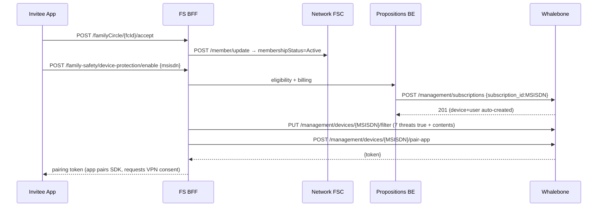
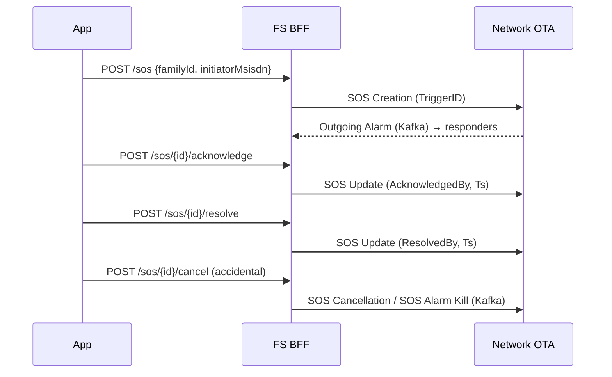

# Family Safety — Orchestration Layer Mapping (DETAILED · NO optimization)

**What this is:** the **full 1:1 expansion** of the Channel BE / Family Safety BFF orchestration — **every upstream intent as its own endpoint**, each bound to its **exact downstream call(s)** on **Network** and **Whalebone**, with field-level request/response mapping and per-flow sequences. No enum/param collapsing.

**Companion doc:** `Orchestration-Upstream-Downstream-Optimized.md` = the collapsed/enum version (recommended freeze).

**Date:** 2026-11-16 · **Status:** Draft for Network + Whalebone binding review

---

## 1. Layer & ownership

```
App / UDA / services  ──►  CHANNEL BE / FS BFF  ──►  Network (FSC + OTA)  +  Whalebone (Mgmt + Public v2)
                                                 └►  Propositions BE (billing→Whalebone subscription)
                                                 └►  BumbleBee / IVR (dispatch)
```

| Capability | Owning downstream |
|---|---|
| Family/circle + member CRUD, roles | **Network FSC** `/fsc` |
| Check-in, SOS, alarms/notifications, device-status, safety report, IVR | **Network OTA event engine** |
| Subscription, threat/content filter, app block, scheduled filter, allow/deny, reports, pairing, suspend/activate | **Whalebone Management `/3`** |
| Block stats / timeline / recent events | **Whalebone Public API v2** |
| Billing/eligibility → subscription trigger | **Propositions BE** |

> `deviceID == subscriptionID == MSISDN` (Whalebone). Whalebone auto-creates device+user on subscription; Airtel never `POST /management/devices`, `POST /management/users`, or `DELETE`.

---

## 2. Full downstream inventory (every endpoint)

### 2A. Network FSC (`/fsc`, Swagger 2.0)
| # | Method | Path | Query / body |
|---|---|---|---|
| N1 | POST | `/api/v1/family/create` | `RequestFamilyPojo` |
| N2 | GET | `/api/v1/family/get` | `?familyId=` |
| N3 | POST | `/api/v1/family/update` | `?familyId=` + `RequestFamilyPojo` |
| N4 | POST | `/api/v1/member/add` | `RequestFamilyMemberPojo` |
| N5 | POST | `/api/v1/member/delete` | `?familyId=&memberId=` |
| N6 | GET | `/api/v1/member/get` | `?familyId=&memberId=` |
| N7 | GET | `/api/v1/member/getAll` | `?familyId=` |
| N8 | POST | `/api/v1/member/role/update` | `?familyId=&familyMemberRole=&memberId=` |
| N9 | POST | `/api/v1/member/update` | `?memberId=` + `RequestFamilyMemberPojo` |

### 2B. Network OTA event engine (JSON sync / Kafka)
| # | API | Key fields |
|---|---|---|
| O1 | Sync: Circle Create/End | family attrs |
| O2 | Sync: Member Add/Del/Update/Active/Inactive | member attrs |
| O3 | Sync: Member Role Mod | role |
| O4 | Incoming Alarm/Notification | AlarmID, InitiatedBy, TargetType(Individual/Responder/Broadcast), TargetMSISDN, TargetFamilyID, AlarmType, AdditionalData |
| O5 | Outgoing Alarm/Notification (Kafka) | AlarmID, TargetMSISDN, FamilyID, AlarmType, AdditionalData |
| O6 | SOS Alarm Kill (Kafka) | SOSAlarmID, Action=Kill |
| O7 | Check-in Create | TriggerID, FamilyID, InitiatorMSISDN, TargetMSISDN, ScheduleType(OneTime/Periodic), ScheduleTime |
| O8 | Check-in Status Update | TriggerID, Action(Dismiss/Pause/Resume) |
| O9 | Check-in Response | TriggerID, CheckInTimestamp, CheckInResponse |
| O10 | Check-in Status Check | TriggerID/FamilyID/InitiatorMSISDN → Check-in Data + Response arrays |
| O11 | SOS Creation | TriggerID, FamilyID, InitiatorMSISDN |
| O12 | SOS Cancellation | TriggerID |
| O13 | SOS Update | TriggerID, AcknowledgedBy/Ts, ResolvedBy/Ts |
| O14 | SOS Status Check | TriggerID/FamilyID/InitiatorMSISDN → SOS Data array |
| O15 | Device Status Store | DataID, MSISDN, FamilyID, StatusArray(Battery/Ringer/NetworkType/NetworkStrength/Location/Lock-Unlock, Value) |
| O16 | Device Status Retrieve | MSISDN/FamilyID → Status array |
| O17 | Safety Report Retrieve | MSISDN/FamilyID → Safety array |

### 2C. Whalebone Management (`/3` → `/management`)
| # | Method | Path |
|---|---|---|
| W1 | POST | `/management/subscriptions` |
| W2 | POST | `/management/subscriptions/{id}/suspend` |
| W3 | POST | `/management/subscriptions/{id}/activate` |
| W4 | GET | `/management/devices/{id}` |
| W5 | GET/PUT | `/management/devices/{id}/filter` |
| W6 | GET/PUT | `/management/devices/{id}/applications` |
| W7 | GET/PUT | `/management/devices/{id}/scheduled-filter` |
| W8 | GET/POST | `/management/subscriptions/{id}/{listType}` (whitelist\|blacklist) |
| W9 | POST | `/management/subscriptions/{id}/{listType}/delete` |
| W10 | GET/PUT | `/management/users/{id}/reports` |
| W11 | POST | `/management/devices/{id}/pair-app` |

### 2D. Whalebone Public API v2 (`/whalebone/2` → `/events`)
| # | Method | Path |
|---|---|---|
| P1 | GET | `/events/stats?...&aggregate=threat_type` |
| P2 | GET | `/events/stats?...&aggregate=device_id` |
| P3 | GET | `/events/stats?...&aggregate=domain` |
| P4 | GET | `/events/timeline?...&interval=day` |
| P5 | GET | `/events/search?...&sort=desc` |

---

## 3. Detailed 1:1 upstream → downstream mapping (un-optimized)

Every intent is its **own** upstream endpoint.

### 3.1 Circle & membership
| # | Upstream endpoint (own) | Downstream | Notes |
|---|---|---|---|
| 1 | `GET /familyCircle/{fcId}` | N2 `family/get?familyId` (+ N7 `member/getAll`) | map `fcId↔familyId` |
| 2 | `POST /familyCircle` | N1 `family/create` (+ O1 Circle Create sync) | idempotent create |
| 3 | `PATCH /familyCircle/{fcId}` | N3 `family/update?familyId` | settings |
| 4 | `GET /familyCircle/{fcId}/members` | N7 `member/getAll?familyId` | list |
| 5 | `GET /familyCircle/{fcId}/members/{memberId}` | N6 `member/get?familyId&memberId` | detail |
| 6 | `POST /familyCircle/{fcId}/invite` | N4 `member/add` + BFF invite-state + O4/BumbleBee notify | **own** |
| 7 | `POST /familyCircle/{fcId}/resend` | N9 `member/update` (new token) + notify | **own** |
| 8 | `POST /familyCircle/{fcId}/remind` | **no FSC write** + notify only | no window reset |
| 9 | `POST /familyCircle/{fcId}/accept` | N9 `member/update → Active` (+ O2 Member Active) | consent |
| 10 | `POST /familyCircle/{fcId}/decline` | N9 `member/update → Inactive` or N5 `member/delete` | — |
| 11 | `POST /familyCircle/{fcId}/leave` | N5 `member/delete` (+ admin-approval in BFF) | — |
| 12 | `DELETE /familyCircle/{fcId}/members/{memberId}` | N5 `member/delete?familyId&memberId` (+ 2nd-hop de-provision) | force remove |
| 13 | `POST /familyCircle/{fcId}/members/{memberId}/role` | N8 `member/role/update` (+ O3 Role Mod) | role change |
| 14 | `GET /contacts/availability?msisdn` | **GAP G1** (needs `family/getByMsisdn`) | dedupe |

### 3.2 Protection toggles (commercial)
| # | Upstream endpoint (own) | Downstream |
|---|---|---|
| 15 | `GET /family-safety/protection-status?msisdn` | W4 `GET devices/{id}` + subscription state (+ P1–P5 live) |
| 16 | `POST /family-safety/device-protection/enable` | PBE → W1 `POST subscriptions` → W5 `PUT devices/{id}/filter` (7 threats true) |
| 17 | `POST /family-safety/device-protection/disable` | W2 `POST subscriptions/{id}/suspend` |
| 18 | `POST /family-safety/network-protection/enable` | Network safety config |
| 19 | `POST /family-safety/network-protection/disable` | Network safety config |
| 20 | `POST /family-safety/device-protection/reactivate` | W3 `POST subscriptions/{id}/activate` (renewal) |

### 3.3 Safety events — each type & action its own endpoint
| # | Upstream endpoint (own) | Downstream |
|---|---|---|
| 21 | `POST /check-ins` | O7 Check-in Create |
| 22 | `POST /check-ins/{id}/status` (dismiss/pause/resume) | O8 Check-in Status Update |
| 23 | `POST /check-ins/{id}/response` | O9 Check-in Response |
| 24 | `GET /check-ins?id\|familyId\|msisdn` | O10 Check-in Status Check |
| 25 | `POST /sos` | O11 SOS Creation |
| 26 | `POST /sos/{id}/cancel` | O12 SOS Cancellation |
| 27 | `POST /sos/{id}/acknowledge` | O13 SOS Update (ack) |
| 28 | `POST /sos/{id}/resolve` (end) | O13 SOS Update (resolve) |
| 29 | `POST /sos/{id}/kill` | O6 SOS Alarm Kill (Kafka) |
| 30 | `GET /sos?id\|familyId\|msisdn` | O14 SOS Status Check |
| 31 | `POST /fraud-alerts` | O4 Incoming Alarm (fraud/Presidential) |
| 32 | `POST /alerts/{id}/notify` | O5 Outgoing Alarm (Kafka) / BumbleBee |
| 33 | `POST /alerts/{id}/escalate` | O5 Outgoing Alarm / IVR |
| 34 | `POST /device-status` (ingest) | O15 Device Status Store |
| 35 | `GET /device-status?msisdn\|familyId` | O16 Device Status Retrieve |
| 36 | `GET /safety-report?msisdn\|familyId` | O17 Safety Report Retrieve |
| — | `GEOFENCE`, `INACTIVITY` | **GAP G7** — no Network owner (excluded in PPT) |

### 3.4 Device Safety & Parental (all Whalebone) — each its own endpoint
| # | Upstream endpoint (own) | Downstream |
|---|---|---|
| 37 | `GET /parental/{msisdn}/content` | W5 `GET devices/{id}/filter` |
| 38 | `PUT /parental/{msisdn}/content` | W5 `PUT devices/{id}/filter` (GET-merge-PUT; threats stay true) |
| 39 | `GET /parental/{msisdn}/apps` | W6 `GET devices/{id}/applications` |
| 40 | `PUT /parental/{msisdn}/apps` | W6 `PUT devices/{id}/applications` |
| 41 | `GET /parental/{msisdn}/schedule` | W7 `GET devices/{id}/scheduled-filter` |
| 42 | `PUT /parental/{msisdn}/schedule` | W7 `PUT devices/{id}/scheduled-filter` |
| 43 | `GET /parental/{msisdn}/whitelist` | W8 `GET subscriptions/{id}/whitelist?page=0&page_size=200` |
| 44 | `POST /parental/{msisdn}/whitelist` | W8 `POST subscriptions/{id}/whitelist {domains}` |
| 45 | `POST /parental/{msisdn}/whitelist/remove` | W9 `POST subscriptions/{id}/whitelist/delete` |
| 46 | `GET /parental/{msisdn}/blacklist` | W8 `GET subscriptions/{id}/blacklist` |
| 47 | `POST /parental/{msisdn}/blacklist` | W8 `POST subscriptions/{id}/blacklist {domains}` |
| 48 | `POST /parental/{msisdn}/blacklist/remove` | W9 `POST subscriptions/{id}/blacklist/delete` |
| 49 | `GET /parental/{msisdn}/reports` | W10 `GET users/{id}/reports` |
| 50 | `PUT /parental/{msisdn}/reports` | W10 `PUT users/{id}/reports` |
| 51 | `POST /device/{msisdn}/pair` | W11 `POST devices/{id}/pair-app` → `{token}` |

### 3.5 Stats (Whalebone Public API v2) — each widget its own endpoint
| # | Upstream endpoint (own) | Downstream |
|---|---|---|
| 52 | `GET /stats/{msisdn}/threats` | P1 `/events/stats?aggregate=threat_type` |
| 53 | `GET /stats/family/{fcId}/per-member` | P2 `/events/stats?aggregate=device_id` (Airtel maps member MSISDNs) |
| 54 | `GET /stats/{msisdn}/top-sites` | P3 `/events/stats?aggregate=domain` |
| 55 | `GET /stats/{msisdn}/trend` | P4 `/events/timeline?interval=day` |
| 56 | `GET /stats/{msisdn}/recent` | P5 `/events/search?sort=desc` |

**Un-optimized surface ≈ 56 upstream endpoints** (vs ~17 optimized).

---

## 4. Field-level mapping (key transforms)

### 4.1 Circle create (upstream → N1)
| Upstream | Network FSC `RequestFamilyPojo` |
|---|---|
| `name` | `familyName` (req) |
| `description` | `familyDescription` (req) |
| — (default) | `familyStatus = "Active"` |
| `members[]` | `familyMemberPojos[]` (`RequestFamilyMemberPojo`) |
| per member `msisdn` | `msisdn` (req) |
| per member `airtelCustomer` | `airtelCustomer` (0=Airtel, 1=other) (req) |
| per member `role` | `circleMemberRole` (ADMIN/SUB_ADMIN/SPONSER/MEMBER) |
| — (new) | `membershipId = 0`, `membershipStatus = "Active"` |

### 4.2 Device-safety enable (upstream → W1 → W5)
| Step | Call | Body |
|---|---|---|
| 1 billing | PBE eligibility/billing | — |
| 2 subscribe | W1 `POST /management/subscriptions` | `{"subscription_id":"{MSISDN}"}` → 201 (device+user auto-created) |
| 3 base policy | W5 `PUT /management/devices/{MSISDN}/filter` | `threats[]` all 7 `blocked:true` (+ selected `contents[]`) |
| 4 pair | W11 `POST /management/devices/{MSISDN}/pair-app` | → `{pairing_response:{token}}` (hand token to app) |

### 4.3 Content filter change (upstream 38 → W5, GET-merge-PUT)
1. `GET /management/devices/{id}/filter` (current). 2. Merge changed `contents[]`. 3. **Keep all 7 `threats` `true`.** 4. `PUT` full object. Omitted threat/content types become **unblocked** — always send the complete intended policy.

---

## 5. Sequences

### 5.1 Create circle + invite (Airtel vs non-Airtel)
```mermaid
sequenceDiagram
  participant APP as Airtel App
  participant BFF as Channel BE / FS BFF
  participant FSC as Network FSC
  participant OTA as Network OTA
  participant BB as BumbleBee
  APP->>BFF: POST /familyCircle {name, members[]}
  BFF->>FSC: POST /api/v1/family/create (RequestFamilyPojo)
  FSC-->>BFF: familyId, txnId
  BFF->>OTA: Sync Circle Create
  APP->>BFF: POST /familyCircle/{fcId}/invite {msisdn, role, airtelCustomer}
  BFF->>BFF: invite-state = INVITED (BFF store; FSC lacks state)
  BFF->>FSC: POST /api/v1/member/add (membershipStatus pending-equiv)
  BFF->>BB: Push + SMS invite
  Note over BFF: Non-Airtel (airtelCustomer=1) → app/SMS only; no network signals
```

### 5.2 Accept + enable device safety (child line)


### 5.3 SOS lifecycle


---

## 6. Gaps / asks (same as Optimized §5)

| # | Gap | Owner |
|---|---|---|
| G1 | No MSISDN → familyId lookup (FSC) | Network — add `family/getByMsisdn` |
| G2 | FSC `membershipStatus` only Active/Inactive | Network enum **or** BFF invite store |
| G3 | No first-class INVITE/REMIND/RESEND | BFF + BumbleBee |
| G4 | Whalebone live swagger unreachable — confirm schemas/errors | Whalebone/PBE |
| G5 | Safety-event host (OTA vs separate Safety svc) | Network/Arch |
| G6 | Role enum typo `SPONSER` → `SPONSOR`? | Network |
| G7 | `GEOFENCE`/`INACTIVITY` no Network owner | Product/Arch |
| G8 | Public API v2 key custody + 429 limits | Whalebone/Airtel BE |

---

## 7. BFF orchestration responsibilities (what the layer must own)

1. **Invite-state store** — FSC has no invite lifecycle; BFF holds `INVITED/DECLINED/LEFT/EXPIRED` and writes FSC `Active` only on ACCEPT.
2. **ID mapping** — `fcId↔familyId`, `memberId`, `MSISDN=deviceID=subscriptionID`.
3. **GET-merge-PUT** for every Whalebone filter/app/schedule write (preserve threats + other rules).
4. **Idempotency** — create-circle and subscription-create must be idempotent (pre-check existence).
5. **Retry per failed step** (not whole journey): subscription-create success → wait for device; 409 → GET existing; policy PUT fail → re-PUT full policy; pairing fail → retry; 429 → back off.
6. **Fan-out/notify** via Network OTA Outgoing Alarm (Kafka) / BumbleBee / IVR.
7. **Non-Airtel degradation** (`airtelCustomer=1`): app/SMS check-in + SOS only; no network signals.

---

*Reconstructed from Family_Member_API_Documentation (Network FSC), API_Doc.pptx (Network OTA engine) and Airtel_SDK_HLD (Whalebone Aura). Whalebone paths are HLD-derived — validate against the live device-management swagger (`apidocs.whalebone.io/devicemanagement`) before coding.*
