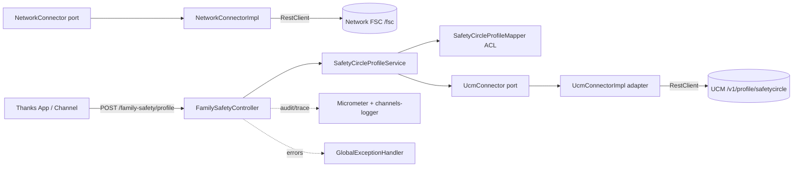

# Safety-Hub — Code & Architecture Analysis

**Scope:** `origin/integration` base + `MYAIR-123395-Network-Integration` + `MYAIR-123390-UCM-Integration`
**Date:** 23 Nov 2026 · **Basis:** the shared branch code extract (not a live checkout)
**Service:** `safety-hub` — the Family Safety orchestrator (BEFE/Guardian), channel context `/safety/hub`.

## 1. Folder / package structure

```
com.airtel.online.safetyhub
├── audit/                SafetyHubAuditLoggingEvent         (channels-logger @Audit enricher)
├── config/               NetworkRestClientConfig, UcmRestClientConfig
│   └── properties/       NetworkDownstreamProperties, UcmProperties   (@ConfigurationProperties)
├── connector/            ── downstream "ports"
│   ├── network/          NetworkConnector + impl/NetworkConnectorImpl
│   └── ucm/              UcmConnector     + impl/UcmConnectorImpl
├── constants/            ApiNameConstants, ApiPathConstants, CommonConstants, NetworkConstants, UcmConstants
├── controller/           FamilySafetyController                        (channel REST API)
├── enums/                GroupStatus, MemberServiceStatus, ProfileIdType, SafetyHubErrorCode
├── exception/            SafetyHubError, SafetyHubException
│   └── handler/          GlobalExceptionHandler                        (@ControllerAdvice)
├── mapper/               SafetyCircleProfileMapper + impl              (UCM → channel ACL)
├── pojo/vos/
│   ├── network/          Network* records (device status, family, member DTOs)
│   ├── profile/          CircleMember(+MetaData), SafetyCircleProfileData/Response  (channel VOs)
│   └── ucm/              Ucm* records (TMF-style party/group model)
├── service/              SafetyCircleProfileService + impl             (facade/orchestration)
└── util/                 TraceSupport, ValidationUtil
resources: bootstrap.yaml · log4j2-{prod,sit,tnd}.xml
test:      controller / mapper / service (UCM side only)
```

**Verdict:** clean **layered + ports-and-adapters** layout — `controller → service → connector(port)/mapper`, DTOs isolated in `pojo/vos`, cross-cutting in `audit`/`exception`/`util`. Package-by-layer (not by feature); fine at this size, but as SOS/check-in/fraud/subscription land it will grow wide — consider package-by-feature later.

## 2. Architecture



Stateless, consume-only (no DP persist) — matches the ADR. The UCM slice is wired end-to-end (controller→service→mapper→connector); the Network slice has the connector + DTOs but **no controller/service consuming it yet**.

## 3. Java 21 features used

| Feature | Used? | Where |
|---|---|---|
| **Records** (immutable data carriers) | ✅ heavily | every `pojo/vos/*`, request/response records |
| **Pattern matching for `instanceof`** | ✅ | `ex instanceof SafetyHubException she`, `output.get() instanceof ResponseEntity<?> re` |
| **`SequencedCollection.getFirst()`** (JEP 431, **21-specific**) | ✅ | `partyGroup().getFirst()`, `relatedParty().getFirst()`, `circleMembers().getFirst()` |
| Enhanced enums + `@JsonCreator/@JsonValue` | ✅ | `GroupStatus`, `MemberServiceStatus` |
| **Virtual threads** (JEP 444) | ❌ | blocking RestClient on platform threads; `spring.threads.virtual` not enabled |
| **Switch pattern matching / record patterns** (JEP 440/441) | ❌ | error/type resolution uses `instanceof` + streams, not `switch` |
| **Sealed types** | ❌ | `SafetyHubError` could be sealed; it isn't |
| Text blocks / `var` / string templates | ❌ | not used |

**Takeaway:** the code is on Java 21 and modern (records + instanceof patterns + `getFirst()`), but uses little that is *exclusively* 21 — switch-pattern-matching over the enums/error types and **virtual threads** for the blocking downstream calls are the obvious unused wins.

## 4. Spring Boot 4 / Spring 7 features used

| Feature | Signal |
|---|---|
| **`RestClient`** (modern sync client, replaces `RestTemplate`) | both `*RestClientConfig` |
| **`@ConfigurationProperties`** typed binding | `NetworkDownstreamProperties`, `UcmProperties` |
| **Boot 4 relocated test packages** | `org.springframework.boot.webmvc.test.autoconfigure.WebMvcTest` (Boot 3 was `...test.autoconfigure.web.servlet`) |
| **`@MockitoBean`** bean-override (Spring 6.2+/Boot 4, replaces `@MockBean`) | `...test.context.bean.override.mockito.MockitoBean` |
| **Micrometer Tracing** (W3C/B3/Jaeger propagation, baggage) | `TraceSupport`, `bootstrap.yaml management.tracing` |
| `@ControllerAdvice` + `ResponseEntityExceptionHandler` | `GlobalExceptionHandler` |
| Actuator, OTLP exporter config | `bootstrap.yaml management.*` |

## 5. Design patterns

| Pattern | Where |
|---|---|
| **Ports & Adapters (Hexagonal)** | `*Connector` interface (port) + `*ConnectorImpl` (adapter) |
| **Anti-Corruption Layer / Translator** | `SafetyCircleProfileMapperImpl` (UCM TMF party model → channel VO) |
| **Adapter** | connectors adapt downstream REST to domain calls |
| **Facade** | `SafetyCircleProfileServiceImpl` over connector + mapper + trace |
| **DTO / Value Object** | records in `pojo/vos` |
| **Builder** | `RestClient.builder`, `UriComponentsBuilder`, `AuditData.Builder` |
| **Factory method** | `fromValue`, `fromChannelValue`, `notImplemented()` |
| **Strategy (enum-mapped)** | `ProfileIdType` (channel↔UCM id mapping) |
| **Template method** | `ResponseEntityExceptionHandler` overrides; `executeGet` helper |
| **Decorator / AOP** | `@Audit` annotation enriching controller + connector |
| **Singleton** | Spring beans; `private` ctors on `constants/*` and `util/*` |

## 6. Principles observed

- **SOLID** — SRP (one job per class), **DIP** (depends on `*Connector`/`*Mapper`/`*Service` abstractions), ISP (tiny interfaces), OCP (enum + error-code tables).
- **Immutability** (records), **fail-fast validation** (`ValidationUtil.requireNonBlank`), **centralised error handling**, **externalised config** + profiles (sit/prod/tnd), **constructor injection**, **structured logging + distributed tracing**.
- Clean, consistent, testable (UCM side).

---

## 7. Where it lacks (prioritised)

### 🔴 Critical — the two branches do not cleanly merge
The shared files **diverged** on each branch; a naive merge breaks compilation:

| Shared file | Network branch | UCM branch | Merge risk |
|---|---|---|---|
| `ApiNameConstants` | only `NETWORK_*` | only `FETCH_*`/`UCM_*` | one overwrites the other → missing constants → **won't compile** |
| `SafetyHubErrorCode` | `NETWORK_*` + `UNKNOWN` | `ID_/TYPE_/PROFILE_/UCM_*` + `UNKNOWN` | **neither has the other's codes** → both sides fail to compile after merge |
| `GlobalExceptionHandler` | handles `ValidationException` + `ResourceNotFoundException` | **deletes** those two exceptions; handles `MissingServletRequestParameter` | Network handler imports classes UCM deleted → **broken** |
| `bootstrap.yaml` | `network.context-path: /fsc` + member paths | `network.context-path: /cx/network`, adds `channels.logger`, `ucm` | **conflicting base path** + divergent config |

**Action:** an explicit integration merge that **unions** the error-code enum and the `ApiNameConstants`, reconciles the single `GlobalExceptionHandler` (keep validation + missing-param + downstream handlers together, decide the fate of `ValidationException`/`ResourceNotFoundException`), and settles **one** `network.context-path`.

### 🟠 High
1. **Stale `member/get`** — `NetworkDownstreamProperties.memberGetPath=/api/v1/member/get` + `getMember()` target an endpoint **removed** from the Network contract (subscription replaces member CRUD). Rework to `family/get` / `subscription/features/fetch`. `NetworkMember`/`NetworkMembersResponse` also duplicate `NetworkFamilyMember`.
2. **Context-path mismatch** — `/fsc` (Network branch + swagger) vs `/cx/network` (UCM branch). Pick one; FSC v1.8 base is `/fsc`.
3. **No resilience** — no retry/back-off, no circuit breaker (Resilience4j), and downstream business envelope (`responseCode`/`responseMessage`) is deserialized but **never checked** → an HTTP-200 `responseCode=FAILURE` is treated as success. Also `.body()` may return **null** (NPE risk) — not guarded.
4. **`SimpleClientHttpRequestFactory`** — opens a new connection per call (no pooling). Use a pooled factory (`JdkClientHttpRequestFactory`/Apache HttpClient) and, on Java 21, enable **virtual threads** for the blocking calls.
5. **PII in logs/audit** — `log.info("...uri={}")` logs the MSISDN query param; the audit enricher serialises full request/response (profile, msisdn) with **no masking**. Add MSISDN masking + payload redaction.

### 🟡 Medium
6. **Security** — `security.basic: admin/admin` committed as placeholder; move to vault/secrets. Downstream auth is thin: UCM sends `x-user-id = the msisdn itself` and Network calls carry **no credentials** — confirm the real auth (mTLS/OAuth/API key).
7. **Downstream status mapping** — `executeGet` collapses every failure to `NETWORK_CALL_FAILED / 502`; a 404/400 downstream should map distinctly (not all BAD_GATEWAY).
8. **Mapper assumptions** — only the **first** `partyGroup` and **first** `partyRoleGroup` are read; multiple groups/role-groups are silently dropped. Document or handle.
9. **Test coverage gap** — Network side has **zero tests** (connector, its error handler variant, DTO mapping). No downstream contract test (WireMock) on either side. Add Network connector tests + WireMock stubs.
10. **Channel API shape** — `POST /family-safety/profile` is a **read** done as POST with query params; prefer `GET`, and add `@Valid`/bean-validation + MSISDN format checks. No API versioning (`/v1`).

### ⚪ Low / scope
11. **Whalebone track absent** — `downstream.whalebone` stub exists but no connector/config/pojos yet (expected; not started in this extract).
12. **Constant duplication** across branches (`QUERY_*`, id-type constants) — consolidate on merge.
13. **Package-by-layer** will sprawl as features land — consider package-by-feature (`sos/`, `checkin/`, `fraud/`, `profile/`).

## 8. Quick wins (first)

1. **Integration-merge reconciliation** of `SafetyHubErrorCode`, `ApiNameConstants`, `GlobalExceptionHandler`, `bootstrap.yaml` — unblocks a compiling `integration` branch.
2. Drop/replace **`member/get`**; fix the **context-path** to `/fsc`.
3. Add **downstream envelope check** + null-body guard; map 4xx/5xx distinctly.
4. **Mask MSISDN** in logs + audit.
5. Switch to a **pooled request factory** + `spring.threads.virtual.enabled=true`.
6. Add **Network connector tests + WireMock**.

---

*Analysis from the branch code extract. Strengths: clean hexagonal layering, records + modern Spring (RestClient, @MockitoBean), good UCM test coverage, tracing/audit baked in. Main risk: the Network and UCM branches have diverged on shared files and need a deliberate integration merge before they compile together.*
