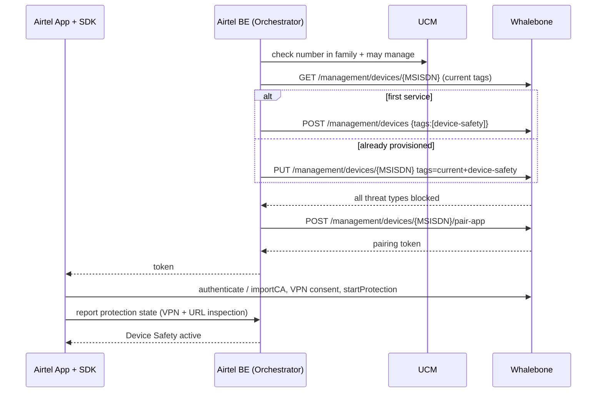

# Family Safety × Whalebone — API-Flow HLD (Airtel Secure integration)

**Date:** 26 Nov 2026 · **Owner:** Family Safety orchestrator (Airtel BE) — Whalebone adapter
**References:** Airtel Secure HLD (MVP, Whalebone Aura) · Whalebone **Device Management API** (`/management`, Retail API `/3`) · Whalebone **Public API v2** (`/events`, `/dns`, `/audit`; `GetStatistics` = `GET /events/stats`)
**Model:** `familyId = subscription_id` · `member MSISDN = device_id` · each service = a **tag** on the device (`device-safety`, `parental-control`). Toggle = **full-list PUT** (not PATCH). Phone protection runs via the **SDK** (VPN + URL inspection).

---

## 1. Whalebone API inventory we use

### A. Device Management API — base `/management` (Retail API `/3`), API key in Airtel BE only
| # | Method · Path | Purpose | Status | Use case |
|---|---|---|---|---|
| 1 | `POST /management/subscriptions` | Create subscription (`subscription_id = familyId`) | Existing | UC1 |
| 2 | `POST /management/subscriptions/{subId}/suspend` | Pack expired / cancelled | Existing | UC8 |
| 3 | `POST /management/subscriptions/{subId}/activate` | Pack renewed | Existing | UC8 |
| 4 | `GET /management/subscriptions/{subId}/devices` | List family devices: status + tags (**≤500/page**) | Existing | UC7 |
| 5 | `GET /management/subscriptions/{subId}/{listType}` | Read allow/deny list (`whitelist`/`blacklist`) | Existing | UC6, UC7 |
| 6 | `POST /management/subscriptions/{subId}/{listType}` | Add domains to allow/deny (family-wide) | Existing | UC6 |
| 7 | `POST /management/subscriptions/{subId}/{listType}/delete` | Remove domains | Existing | UC6 |
| 8 | `POST /management/devices` | Create device (`device_id = MSISDN`, `subscription_id = familyId`, `tags[]`) | Existing | UC1, UC2, UC3, UC4 |
| 9 | `GET /management/devices/{MSISDN}` | Device status + `segment_id`/tags | Existing | UC7, status |
| 10 | `PUT /management/devices/{MSISDN}` (tags = full list) | **Tag switching** — add/remove a service | **NEW (2 wk)** | UC3, UC4, UC5 |
| 11 | `GET/PUT /management/devices/{MSISDN}/filter` | Threats + content types (device-safety / parental) | Existing | UC3, UC4 |
| 12 | `GET/PUT /management/devices/{MSISDN}/applications` | App blocking (parental) | Existing | UC4 |
| 13 | `GET/PUT /management/devices/{MSISDN}/scheduled-filter` | Schedules (bedtime/study) | Existing | UC4 |
| 14 | `POST /management/devices/{MSISDN}/pair-app` | One-time SDK pairing token | Existing | UC3, UC4 |
| 15 | `POST /management/devices/{MSISDN}/suspend` | Member removed from family | Existing | UC8 |
| 16 | `POST /management/devices/{MSISDN}/migrate` | Member moves to another family | Existing* | UC8 |
| 17 | `POST /management/devices/{MSISDN}/unpair-app` | New number on a paired phone | Existing | UC8 |
| 18 | **VPN protection status** per device | On/off of SDK VPN | **NEW (1 wk)** | UC7 |
| 19 | **URL-inspection status** per device | On/off of URL inspection | **NEW (1 wk)** | UC7 |

### B. Public API v2 — base `https://[airtel-hosted-whalebone]/whalebone/2`, headers `Wb-Access-Key` + `Wb-Secret-Key`, `{MSISDN} = device_id`
| Method · Path | Purpose | Key params | Use case |
|---|---|---|---|
| `GET /events/search` | Individual block events (alerts poll) | `device_id`\|`subscription_id`, `action=block`, `timestamp_from`, `scroll`, `sort` | UC9 (alerts) |
| `GET /events/stats` **(GetStatistics)** | Aggregated totals per number (reports) | `device_id`, `action=block`, `aggregate=threat_type\|device_id\|domain\|country`, `days` | UC9 (reports/dashboard) |
| `GET /events/timeline` | Event counts per time bucket (trend) | `device_id`, `action=block`, `interval=day`, `days` | UC9 (trend chart) |
| `GET /dns/timeline` | All DNS queries ("sites checked") | `device_id`, `days` | UC9 (optional) |
| `GET /audit/logs` | Ops audit (who did what) — **not** the parent portal | user/event/category/result | Ops only |

\* `migrate` — confirm it exists vs. suspend-old + create-new; path to be confirmed with Whalebone API docs.

---

## 2. Use cases — written API flow

### UC1 — Customer buys Airtel Secure (family pack)
1. Airtel BE completes billing, assigns **familyId**.
2. `POST /management/subscriptions` `{ subscription_id: familyId, segment_id: devicesafety }`.
3. `POST /management/devices` `{ device_id: buyerMSISDN, subscription_id: familyId }` → **no tags, nothing blocked**.
4. Result: buyer **provisioned, not yet protected**.

### UC2 — Buyer adds a family member
1. Airtel BE checks buyer rights + family link (**UCM**).
2. `POST /management/devices` `{ device_id: memberMSISDN, subscription_id: familyId }` → provisioned, not protected.

### UC3 — Device Safety turned ON (own or a member's number)
1. Airtel BE checks number ∈ family and user may manage (**UCM**).
2. **Is the MSISDN already provisioned at Whalebone?**
   - **No (first service):** `POST /management/devices` `{ device_id: MSISDN, subscription_id: familyId, tags:[device-safety] }`.
   - **Yes:** `GET /management/devices/{MSISDN}` (current tags) → `PUT /management/devices/{MSISDN}` `tags = current + device-safety` (**full list**).
3. Whalebone (new): **all threat types set to blocked**.
4. Phone (Airtel app + SDK): **VPN already running?**
   - No → `POST /management/devices/{MSISDN}/pair-app` → token → SDK `authenticate`/`importCA` → OS VPN consent → `startProtection`.
5. User enables **URL inspection** (Android Accessibility / iOS Safari extension).
6. Result: **Device Safety active**.

### UC4 — Parental Control turned ON
1. Checks as UC3.
2. Tag upsert: `POST /management/devices` with `tags:[parental-control]` **or** GET-merge-`PUT` `tags = current + parental-control`.
3. Whalebone: **no action** — nothing blocked until the parent sets filters.
4. Parent sets filters (GET-merge-PUT): `PUT …/filter` (content types; **keep all 7 threats true**), `PUT …/applications`, `PUT …/scheduled-filter`.
5. SDK pairing/VPN if not running (filtering works only through the VPN).
6. Result: **Parental Control active**.

### UC5 — A service turned OFF
1. Checks (UCM).
2. `GET` current tags (from `subscriptions/{id}/devices` flow, or `GET /management/devices/{MSISDN}` if not cached).
3. `PUT /management/devices/{MSISDN}` `tags = current − removed`.
4. **Which tag removed?**
   - **device-safety:** threats → not blocked; family allow/deny **kept** if another family device still has device-safety, else deleted (new). Airtel app stops URL inspection.
   - **parental-control:** schedule deleted; content types + app filters → not blocked (new).
5. **Any tag left on the device?** No → app stops SDK (`stopProtection`/`stopProxy`); **pairing kept**. 
6. Result: **MSISDN stays provisioned + active**.

### UC6 — Buyer changes family allow / deny list
1. Airtel BE checks rights.
2. Add: `POST /management/subscriptions/{familyId}/whitelist` (or `/blacklist`) `{ domains:[…] }`; Remove: `POST …/{listType}/delete`.
3. Whalebone applies the list to **every device in the family** → applied on all family phones.

### UC7 — Buyer or member opens Airtel Secure (status screen)
1. `GET /management/subscriptions/{familyId}/devices` → status + tags of each device (**≤500/page**).
2. Airtel BE maps **tags → features** (own mapping table, fixed).
3. **VPN protection status** per device (NEW endpoint) + **URL-inspection status** per device (NEW endpoint).
4. Feature screens: `GET …/filter`, `…/applications`, `…/scheduled-filter`, family lists.
5. Airtel app composes "Working / Not working" (**no single protected flag** — combine tags + VPN-status + URL-status) → **screen shown**.

### UC8 — Lifecycle events
- **Pack expires/cancelled:** `POST /management/subscriptions/{familyId}/suspend`; renewal → `…/activate`.
- **Member removed:** `POST /management/devices/{MSISDN}/suspend`.
- **Member moves family:** `POST /management/devices/{MSISDN}/migrate`.
- **New number on a paired phone:** `POST /management/devices/{MSISDN}/unpair-app` + SDK `unpair`/`logout`.

### UC9 — Alerts & reports (Public API v2)
- **Alerts (poll new blocks):** every few min `GET /events/search?action=block&timestamp_from={lastPoll}&scroll=true` → match `device_id`→member → send alert (Airtel channels).
- **Reports (totals per number):** `GET /events/stats?device_id={MSISDN}&action=block&aggregate=threat_type&days=30` **(GetStatistics)** → `[{threat_type,count}]` → "15 threats blocked".
- **Family view:** `GET /events/stats?device_id=A&device_id=B&aggregate=device_id&days=30`.
- **Top sites:** `aggregate=domain`. **Trend:** `GET /events/timeline?interval=day&days=7`. **Recent:** `GET /events/search?sort=desc&days=7`.
- Rules: always pass `days` (max 220); >10 buckets limits the window to 24h; cache per MSISDN; back off on 429.

---

## 3. Sequence — provision + turn on Device Safety



## 4. Sequence — status screen

```mermaid
sequenceDiagram
    participant App
    participant BE as Airtel BE
    participant WB as Whalebone
    App->>BE: open Airtel Secure
    BE->>WB: GET /management/subscriptions/{familyId}/devices (tags+status)
    BE->>WB: VPN-status per device (new)
    BE->>WB: URL-inspection-status per device (new)
    BE->>WB: GET /filter, /applications, /scheduled-filter, lists
    BE->>BE: map tags->features; compose Working/Not-working
    BE-->>App: screen data
```

## 5. New development at Whalebone (gates)
1. **Tag-driven feature switching** (incl. family allow/deny rule) — **2 weeks**.
2. **VPN protection status** per device — **1 week**.
3. **URL-inspection status** per device — **1 week**.
Everything else uses existing endpoints; **exact paths of the new endpoints to be shared** with the API docs.

## 6. Cross-cutting (from the HLD ops section)
- **Auth:** Device Management API key + Public API v2 `Wb-Access-Key`/`Wb-Secret-Key` — **only in Airtel BE**, never in the app. SDK holds only the one-time pairing token + device credentials.
- **Read vs write:** initial policy = PUT directly (all 7 threats true); a changed toggle = **GET → merge → PUT** the full intended policy; omitted threat/content types become unblocked, so always send the full list. Serialize updates per MSISDN.
- **Pagination:** devices ≤500/page; stats return ≤10 groups (>10 limits to 24h).
- **Resilience:** 409 on subscription create → GET existing + resume; policy PUT fail → retry full policy; pairing fail → keep pending/error; 429 → back off. Retention: Whalebone auto-deletes after the agreed period; **Airtel never calls DELETE**.

## 7. Open items
- Confirm exact paths/params for the **3 new endpoints** (tag switch, VPN status, URL-inspection status) and whether `devices/{MSISDN}/migrate` exists or is suspend+recreate.
- **Service→feature mapping** table (Airtel BE) is "Draft for review" — sign off before build freeze.
- `segment_id` auto-apply (steps 3/7) is "new dev" — fallback = manual filter PUTs.
- iPhone parity: URL inspection via Safari extension vs Android Accessibility.

---

*API-flow HLD for the Airtel × Whalebone (Airtel Secure) integration. Endpoints verified against the Airtel Secure HLD and the Whalebone Device Management + Public API v2 surfaces; `GetStatistics` = `GET /events/stats`. The only build-gating unknowns are the 3 new Whalebone endpoints and the service→feature mapping sign-off.*
